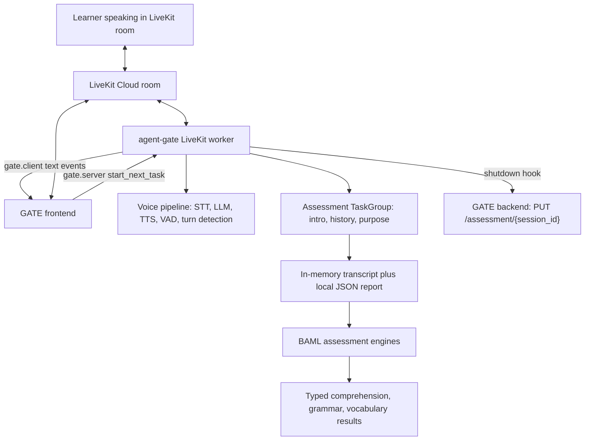

# GATE Architecture Overview

GATE is shaped like a spoken assessment system, not a generic chatbot.

The runtime asks a learner a fixed set of English-speaking prompts, records the conversation as a transcript, tells the frontend where the learner is in the assessment, and then saves the completed transcript back to the GATE backend. A separate BAML layer defines how that transcript should be evaluated.

## High-Level Architecture



The key boundary is between the live conversation and the assessment logic.

During the call, `agent-gate/conversation_flow.py` is responsible for turn-taking, task flow, progress events, and persistence. The BAML files under `assessment/baml_src/` define the offline scoring contracts: what comprehension means, when grammar should be evaluated, how vocabulary errors are counted, and what shape the output must have.

## Runtime Components

### LiveKit Worker

`agent-gate/conversation_flow.py` is the main runtime.

It creates a LiveKit `AgentSession`, starts an `EnglishAssessmentAgent`, listens for conversation items, appends transcript entries, accepts text-stream messages from the frontend, and registers a shutdown hook.

The worker is deployable through LiveKit:

```text
lk agent create
lk agent deploy
```

The checked-in `livekit.toml` contains a project subdomain and agent id, which is evidence that this was intended to run as a LiveKit Cloud agent rather than only as a local script.

### Voice Pipeline

The agent uses:

- `inference.LLM(model="openai/gpt-4.1-mini")` for the real-time tutor behavior.
- `sarvam.STT(language="en-IN", model="saaras:v3")` for Indian English speech transcription.
- `sarvam.TTS(target_language_code="en-IN", model="bulbul:v3", speaker="manan", pace=0.85)` for spoken replies.
- `silero.VAD.load()` in `prewarm()` so voice activity detection is loaded once per worker process.
- `MultilingualModel()` for turn detection.
- LiveKit background voice cancellation, with a SIP-specific telephony mode when the participant kind is SIP.

This is a practical choice for a voice assessment. The system is not waiting for typed input. It needs speech detection, transcription, response generation, TTS, and noise handling in one path.

### Assessment TaskGroup

`EnglishAssessmentAgent.on_enter()` creates a LiveKit `TaskGroup` with three implemented tasks:

```text
intro -> history -> purpose
```

Each task is an `AgentTask` with its own prompt and completion tool:

- `IntroTask.intro_complete`
- `HistoryTask.history_complete`
- `PurposeTask.purpose_complete`

The tool calls are important. The LLM does not merely say "I am done". It calls a function tool, and the function tool appends a structured `task_complete` event to the transcript.

### Frontend Progress Channel

The worker sends JSON events to the frontend over LiveKit text streams on topic `gate.client`.

Examples from the code:

```json
{"type": "assessment_metadata", "total_questions": 3}
{"type": "next_question_data", "question_number": 2, "task": "history"}
{"type": "assessment_completed"}
```

The frontend sends control messages back on topic `gate.server`. The important implemented message is:

```json
{"type": "start_next_task"}
```

When the worker receives that message, it sets an `asyncio.Event`. `HistoryTask` and `PurposeTask` wait on that event before asking their question.

This makes the frontend part of the assessment state machine. The agent can finish a task, but the frontend controls when the next task begins.

### Transcript And Persistence

The runtime transcript is a list of dictionaries. It includes both speech turns and operational events.

The worker captures spoken turns through `session.on("conversation_item_added")` and writes entries like:

```json
{
  "role": "user",
  "text": "My name is Sandipan and I'm from Kolkata and I work in software.",
  "timestamp": "2026-03-31 16:38:41.194924"
}
```

On shutdown, it:

1. appends `session_ended`;
2. saves a local `conversation_report_YYYYMMDD_HHMMSS.json`;
3. sends `PUT /assessment/{session_id}` to the backend with `status: "COMPLETED"` and the transcript;
4. deletes the LiveKit room.

The `session_id` is derived from the room name by removing the `tutor-` prefix.

## Assessment Components

The BAML layer under `assessment/baml_src/` defines typed LLM functions:

- `EvaluateTranscriptComprehension(transcript)` returns task-level comprehension classifications.
- `EvaluateTranscriptGrammar(transcript, comprehension_results)` returns grammar errors and scores.
- `EvaluateTranscriptVocabulary(transcript, comprehension_results)` returns vocabulary errors, domain terms, filler counts, and scores.

This is not a loose "ask the model to grade it" design. The files define enums, classes, output schemas, suppression rules, tests, retry policies, and generated TypeScript clients.

## Why This Project Is Interesting

The main engineering idea is that spoken assessment was broken into two different kinds of uncertainty.

The live layer handles conversational uncertainty:

- Did the learner speak?
- Did the agent finish the task?
- Is the frontend ready to advance?
- Did the room shut down cleanly?

The BAML layer handles evaluation uncertainty:

- Did the learner understand the question?
- Should grammar or vocabulary be scored at all?
- Which category does an error belong to?
- How should a score be computed from structured observations?

That split keeps the real-time conversation from carrying all the grading logic inside one giant prompt.

