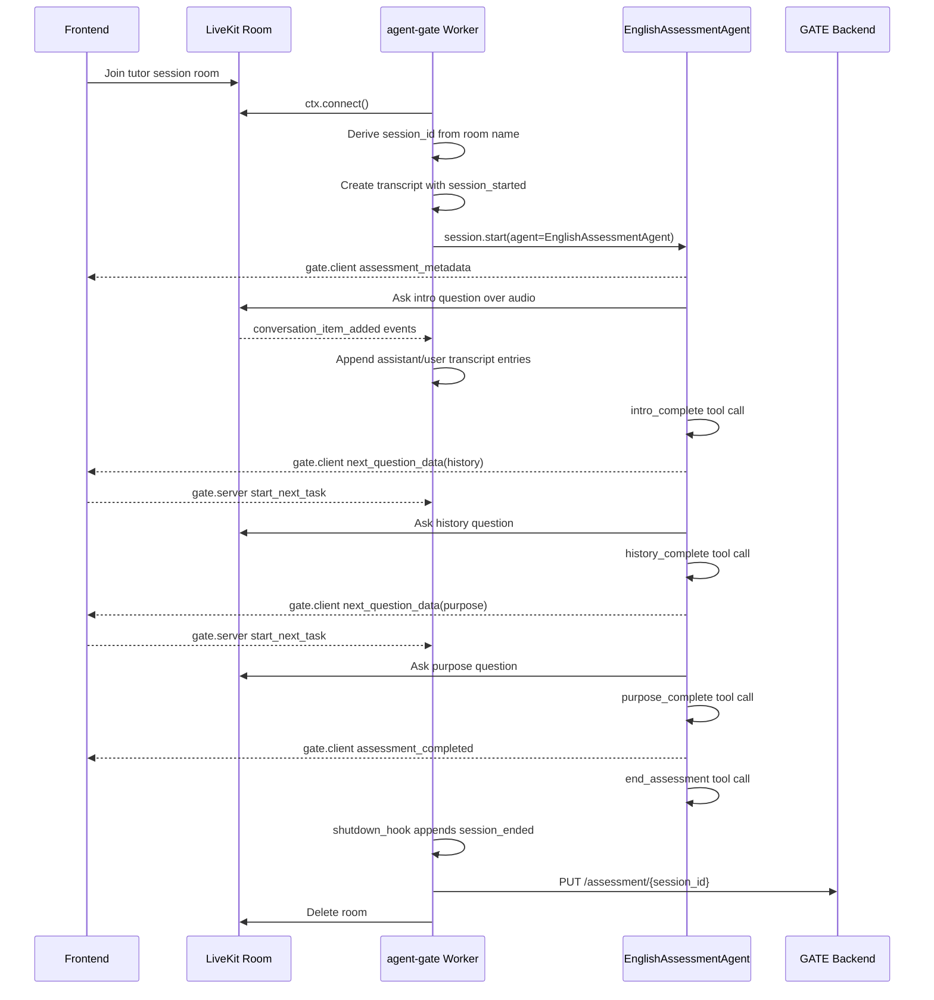
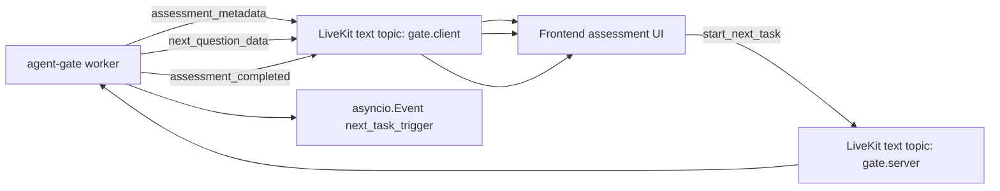

# LiveKit Conversation Flow

The implemented GATE agent is a LiveKit worker that runs one assessment session per room.

The flow begins with a room name like:

```text
tutor-a5edc07e-4dba-4787-8a38-84927897d0fa
```

`conversation_flow.py` derives the assessment session id by stripping the `tutor-` prefix. That id becomes the backend persistence key:

```text
PUT {GATE_URL}/assessment/{session_id}
```

## Request Path



## Startup

The worker prewarms Silero VAD:

```python
def prewarm(proc: JobProcess):
    proc.userdata["vad"] = silero.VAD.load()
```

That keeps VAD loading out of the hot path for every session. The `entrypoint()` then reads the VAD from `ctx.proc.userdata`.

The transcript starts immediately:

```json
{
  "event": "session_started",
  "room": "tutor-...",
  "session_id": "...",
  "timestamp": "..."
}
```

Older local reports show some sessions before `session_id` was added. Newer reports include it.

## Task Execution

The implemented tasks are intentionally small.

### IntroTask

Asks for name, place, and current service. When the LLM decides the introduction is complete, it calls `intro_complete`.

The tool:

- appends `{"event": "task_complete", "task": "intro"}`;
- sends `{"type": "next_question_data", "question_number": 2, "task": "history"}`;
- marks the task complete.

### HistoryTask

Asks how the learner first came in contact with the Hare Krishna movement or the temple.

Unlike intro, it waits for the frontend:

```python
await self._next_task_trigger.wait()
self._next_task_trigger.clear()
await self.session.generate_reply()
```

That means the UI can show the next question state before the agent asks it aloud.

### PurposeTask

Asks why the learner wants to improve spoken English and how it helps preaching service.

It also waits for the same frontend trigger before speaking. After `purpose_complete`, the task group finishes.

## Frontend Event Contract

The worker sends frontend-visible state on topic `gate.client`.



The important decision is that `next_question_data` and `start_next_task` are separate.

The agent can say "the next task is history", but the frontend controls when `HistoryTask` starts. That avoids the agent racing ahead before the UI has updated.

## Transcript Capture

The worker listens to LiveKit conversation items:

```python
@session.on("conversation_item_added")
def on_conversation_item_added(ev):
    ...
```

It extracts text from either `message.text_content` or transcript-bearing content items. It stores entries with:

- `role`
- `text`
- `timestamp`

The transcript is deliberately simple JSON. That makes it usable by both the backend and the later BAML evaluation layer.

## Shutdown Path

The shutdown hook is responsible for cleanup and persistence:

```text
append session_ended
save local conversation_report_*.json
PUT transcript to GATE backend
delete LiveKit room
```

This is a good operational boundary. Live conversation state is local while the room is alive. The durable handoff happens once, at shutdown, through the backend assessment endpoint.

## Evidence From Saved Reports

The repository includes local `conversation_report_*.json` files. They show the progression from early test sessions to completed sessions.

One completed report contains:

```text
session_started
task_complete: intro
task_complete: history
task_complete: purpose
assessment_completed
agent_hung_up
```

Other reports show partial sessions, such as only `intro` completed or no task completed before shutdown. That matters: the transcript/event model can represent both successful and interrupted sessions.

## Runtime Hardening Gaps

These are not failures, but they are visible next steps from the code:

- Backend persistence failure is logged, but the local JSON report is the only fallback.
- The backend response is not linked to a retry queue or durable outbox.
- The frontend text protocol is implicit in Python dictionaries rather than a shared schema.
- `TaskGroup._registered_factories` is accessed directly to compute `total_questions`, which depends on a private field.
- Local report filenames are timestamp-based and written in the current working directory.

The prototype is still coherent: it chose simple mechanisms that are easy to inspect before adding more production machinery.

