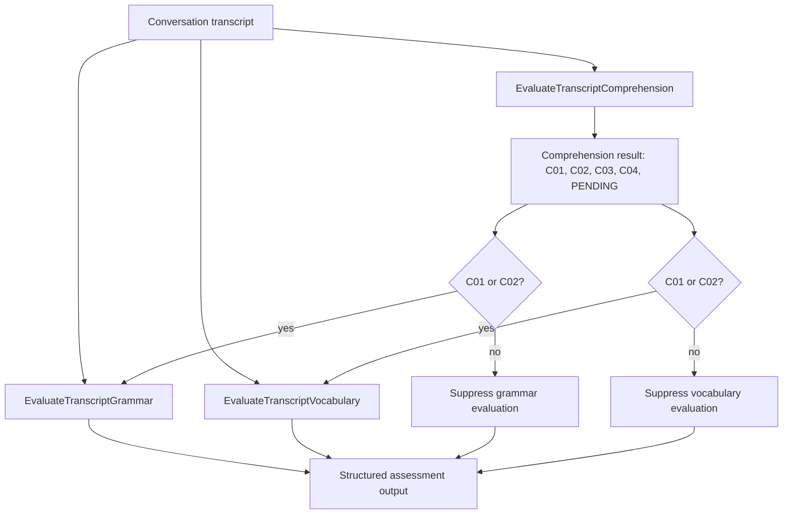

# BAML Assessment Engines

The assessment layer is where the project becomes more interesting than a normal voice-agent demo.

Instead of asking an LLM to "grade this learner" in one broad prompt, the repository defines separate BAML functions for comprehension, grammar, and vocabulary. Each function has typed inputs, typed outputs, explicit suppression rules, scoring instructions, and tests.

## Engine Pipeline



Comprehension runs first because it decides whether the learner actually answered the question. Grammar and vocabulary depend on that result.

If comprehension is C03 or C04, grammar and vocabulary are suppressed. That prevents the system from penalizing grammar or vocabulary when the learner did not understand the prompt or produced no usable response.

## Shared Transcript Shape

`assessment.baml` defines the core transcript item:

```baml
class TranscriptEntry {
  role ("assistant" | "user" | "event")?
  text string?
  event string?
  task string?
  timestamp string
}
```

This matches the runtime JSON produced by `conversation_flow.py`. Speech turns and task events live in one chronological list.

That is the small but important data-model decision: assessment engines do not need a separate conversation structure. They can infer task windows from assistant messages plus `task_complete` events.

## Comprehension Engine

`comprehension.baml` defines:

```baml
function EvaluateTranscriptComprehension(
  transcript: TranscriptEntry[]
) -> TranscriptComprehensionEvaluation
```

It classifies each completed task into:

- `C01`: fully comprehended;
- `C02`: partially comprehended;
- `C03`: miscomprehended;
- `C04`: no evidence of comprehension;
- `PENDING`: clarification requested or task incomplete.

The prompt explicitly isolates comprehension from grammar, vocabulary, pronunciation, accent, and short fluency pauses.

That is the right boundary. A learner can understand the question and still make grammar mistakes. If the comprehension engine downgraded that turn, the rest of the scoring pipeline would be contaminated.

## Grammar Engine

`grammar.baml` defines:

```baml
function EvaluateTranscriptGrammar(
  transcript: TranscriptEntry[],
  comprehension_results: ComprehensionEvaluationResult
) -> TranscriptGrammarEvaluation
```

The grammar categories are:

```text
G01: Verb Usage & Form
G02: Number Agreement
G03: Prepositions
G04: Articles & Determiners
G05: Comparatives & Degrees
```

The engine has preconditions:

- suppress if comprehension is C03 or C04;
- suppress if silence was detected;
- suppress if the learner only asked for clarification and gave no substantive response;
- proceed for C01 or C02.

The scoring is explicit. For example, G01 can deduct more when an error blocks meaning, while self-repaired errors deduct half.

The useful part is that grammar scoring is not a vibes-based aggregate. It is a set of structured error objects and a deterministic score calculation described in the prompt.

## Vocabulary Engine

`vocabulary.baml` defines:

```baml
function EvaluateTranscriptVocabulary(
  transcript: TranscriptEntry[],
  comprehension_results: ComprehensionEvaluationResult
) -> TranscriptVocabularyEvaluation
```

The vocabulary categories are:

```text
V01: Word Correctness
V02: Collocation & Natural Word Pairing
V03: Lexical Range & Repetition
V04: Filler Dominance
```

It also tracks positive temple-domain vocabulary:

```text
japa, mandir, prasadam, kirtan, seva, Prabhupada, ISKCON, tilaka, dhoti, sari, mridanga, pujari, aarti, sadhu, bhajan, darshan, guru, devotee, temple, Krishna, Hare Krishna
```

That domain list is an important product decision. The learner is not being assessed in generic business English. The assessment recognizes vocabulary that matters in their real service context.

## BAML Clients And Generation

`clients.baml` defines OpenAI and Anthropic clients, with OpenAI Responses API clients used by the current evaluator functions.

The active functions use:

- `CustomGPT5Mini` for comprehension and grammar;
- `CustomGPT4Mini` for vocabulary.

`generators.baml` generates a TypeScript client into `assessment/baml_client/`:

```baml
generator target {
    output_type "typescript"
    output_dir "../"
    version "0.220.0"
    default_client_mode async
}
```

That implies the assessment results were intended to be consumed by a TypeScript application, likely the GATE backend or frontend-adjacent service.

## Tests As Assessment Examples

The BAML files include test cases for:

- clarification handling;
- shallow but on-topic answers;
- miscomprehension;
- silence;
- grammar category priority;
- self-repaired grammar errors;
- vocabulary overlap rules;
- filler dominance;
- risk-taking with advanced vocabulary;
- correct temple-domain term usage.

These tests are not normal unit tests over Python code. They are executable examples for the evaluator prompts and schemas.

## Key Assessment Decision

The main decision is this:

```text
Use LLMs for interpretation, but make the interpretation typed, staged, and rule-shaped.
```

BAML gives the project a way to say:

- this is the exact output shape;
- this is the model client;
- these are the categories;
- this is when the engine must not evaluate;
- this is how scores are calculated;
- these examples define the intended behavior.

That is a much stronger design than one large prompt that returns prose feedback.

