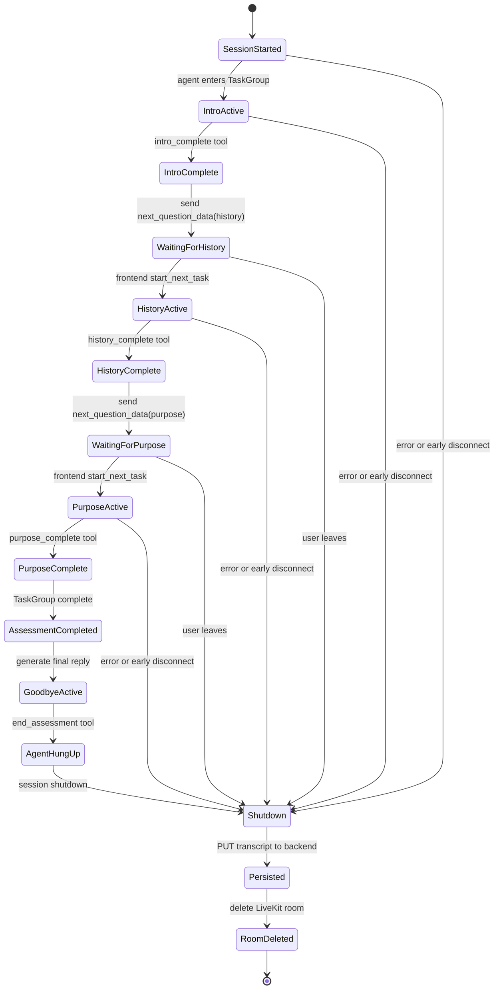
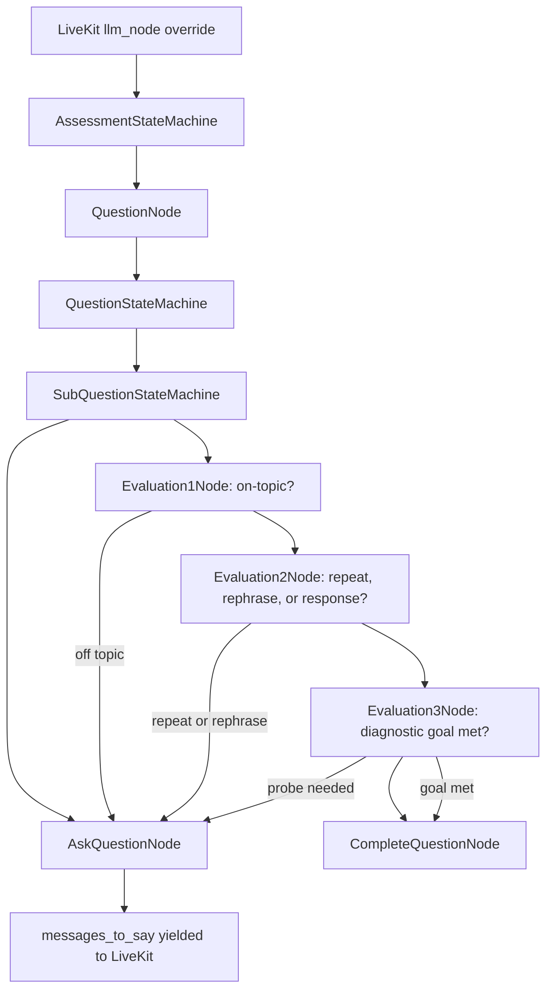

# State Machine And Key Decisions

There is no single `AssessmentState` enum in the Python code.

But the project still has a state machine. It is encoded through LiveKit tasks, function-tool callbacks, frontend text events, transcript events, and the shutdown hook.

## Assessment State Machine



The state is observable in the transcript:

```text
session_started
task_complete: intro
task_complete: history
task_complete: purpose
assessment_completed
agent_hung_up
session_ended
```

Partial sessions are also representable. Some saved reports end after only `intro`; some end before any task completion.

## Decision 1: Use LiveKit Tasks Instead Of One Long Prompt

The project could have put the entire assessment in one large agent instruction.

Instead, it defines separate `AgentTask` classes:

- `IntroTask`
- `HistoryTask`
- `PurposeTask`

Each task has a narrow goal and a tool that marks completion. This is a good fit for voice. Short task prompts reduce the chance that the model drifts into future questions or mixes multiple scoring goals into the live conversation.

## Decision 2: Let The Frontend Gate Task Progression

`HistoryTask` and `PurposeTask` wait on `next_task_trigger`.

That event is set only when the frontend sends:

```json
{"type": "start_next_task"}
```

This creates a small but useful protocol:

```text
agent completes task
agent tells frontend what is next
frontend updates UI
frontend tells agent to continue
```

This prevents the voice agent from running ahead of the assessment UI.

## Decision 3: Store Events And Speech In One Transcript

The transcript is not only a chat log. It contains speech turns and system events.

That lets later assessment code recover task boundaries:

```text
assistant asks intro question
user responds
task_complete: intro
assistant asks history question
user responds
task_complete: history
```

The BAML comprehension prompt relies on this pattern. It says each task starts with an assistant message and ends with a `task_complete` event.

The tradeoff is that the transcript format is flexible but not strongly enforced in Python. A future hardening step would define the event schema once and share it between the worker, backend, frontend, and evaluator.

## Decision 4: Use BAML For Typed Evaluation

The BAML layer turns subjective language assessment into a staged evaluator pipeline.

The best example is the suppression rule:

```text
If comprehension is C03 or C04, do not evaluate grammar or vocabulary.
```

That avoids a common grading bug. If a learner answers the wrong question, grammar analysis may still find errors, but those errors do not tell you whether the learner can answer the intended task.

BAML also makes the scoring contracts explicit enough to test and regenerate clients from.

## Historical Design: State Machine Overriding The LLM Node

Earlier commits contained a stronger version of the state-machine idea than the current `IntroTask -> HistoryTask -> PurposeTask` flow.

Two commits are especially useful evidence:

- `f32d3a3` - `State machine approach draft`
- `9dcefe7` - `Complete question node`

In that version, the agent overrode LiveKit's `llm_node()`:

```python
async def llm_node(self, chat_ctx, tools, model_settings):
    """Override llm_node to use BAML for structured output."""
    history_string = self.transcript_manager.make_history_string(chat_ctx)
    userdata["chat_history"] = history_string

    has_message_to_say = await self.assessment_state_machine.process()

    if has_message_to_say:
        messages = userdata.get("messages_to_say", [])
        yield " ".join(messages)
```

That changed the control model.

The ordinary LLM node was no longer responsible for deciding what to do next in free-form prose. The deterministic state machine owned the assessment flow. BAML was used only at evaluation nodes to classify the latest turn and choose one of a small set of actions.

The nested shape looked like this:



The important node sequence was:

```text
AskQuestionNode
-> Evaluation1Node      # topic status
-> Evaluation2Node      # user intent: repeat, rephrase, or response
-> Evaluation3Node      # diagnostic goal met?
-> CompleteQuestionNode
```

Each node had a narrow job. The LLM/BAML calls happened in the evaluation nodes, and the state machine decided the transition.

That is why this design could feel faster and more controlled:

- It avoided asking a general LLM to plan the whole assessment turn.
- It skipped model calls when the next action was already deterministic, such as asking the configured question or emitting the queued acknowledgement.
- It converted open-ended model output into state transitions like `ask again`, `probe`, `advance`, or `complete`.
- It let the runtime stop as soon as it had a message to say, then resume the state machine on the next user turn.

## Later Design: Turn-Level BAML Action Decision

A later version kept the LiveKit `QuestionTask` structure but moved the state-machine logic into `on_user_turn_completed()`.

That version tracked state fields directly on the task:

```text
_waiting_for = "question1" | "question2"
_question1_answered
_question2_answered
_question1_probe_used
_question2_probe_used
```

After each user turn, it called one BAML function:

```text
DecideNextTurn(
  question_config,
  current_question_text,
  user_response,
  recent_turns,
  assessment_state
) -> TurnEvaluation
```

The BAML return type had a bounded action enum:

```text
ADVANCE
PROBE_ONCE
REDIRECT
COMPLETE_TASK
```

Then Python enforced the action:

```text
REDIRECT    -> add system message: "Output exactly: ... focus on the current question."
PROBE_ONCE  -> mark probe used, add system message with probe_text.
ADVANCE     -> mark question answered, ask question2 or complete task.
COMPLETE    -> complete the task without relying on an LLM tool call.
```

The important phrase in the code is:

```python
"""Internal method to complete the question flow without relying on the LLM."""
```

That is the design lesson. The LLM could classify the turn, but Python owned the state transition and task completion.

## Why The State Machine Helped Latency

The speedup was not magic model latency reduction. It came from reducing unnecessary model responsibility.

In a voice assessment, many turns do not require creative generation:

- ask the exact configured question;
- repeat the current question;
- say a short redirect;
- ask one probe;
- mark the task complete;
- move from question1 to question2;
- send `next_question_data` to the frontend.

When those actions are deterministic, routing them through a general assistant prompt adds latency and failure modes. The state machine made the hot path smaller:

```text
speech transcript
-> BAML classification into a small action enum
-> Python transition
-> exact message or task completion
```

That also improved behavior. The model was less likely to ask an extra question, skip a sub-question, forget whether a probe was already used, or keep talking after the question should be complete.

## Design Tradeoff

The state-machine override was more explicit and probably faster for structured assessment, but it added implementation complexity:

- more custom node classes;
- more state to keep in sync with the LiveKit session;
- more coupling between BAML schemas and runtime transitions;
- more code paths for tool calls, generated replies, and task completion.

The current checked-out version is simpler and easier to demo. The historical version is more interesting architecturally because it shows the stronger idea: use the LLM as a classifier inside a deterministic assessment runtime, not as the owner of the whole conversation flow.

## Decision 5: Keep Domain Vocabulary In The Evaluator

The vocabulary engine recognizes temple-domain terms like `japa`, `prasadam`, `kirtan`, `seva`, and `aarti`.

This is a product-specific assessment decision. The learner is practicing English for service and preaching contexts, so domain vocabulary should count as a positive signal when used correctly.

Generic English scoring would miss that.

## Decision 6: Persist On Shutdown

The worker saves the transcript in the shutdown hook.

That is simple and works well for a prototype because the whole session can be sent as one payload:

```json
{
  "status": "COMPLETED",
  "transcript": [...]
}
```

The tradeoff is recovery. If the backend call fails, the system logs the error and still has a local JSON file, but there is no durable retry queue in this repo.

## Decision 7: Prewarm VAD

Silero VAD is loaded once per worker process through `prewarm()`.

For a voice agent, this matters. Model loading belongs in startup/prewarm, not inside the first user turn.

## What I Would Say In An Interview

The project is a good example of turning a fuzzy AI problem into a controlled workflow.

The real-time agent is intentionally narrow: ask a small number of assessment questions, track completion with tool calls, coordinate with the UI through LiveKit text streams, and save the transcript.

The assessment logic is pushed into BAML because grading needs structure. Comprehension runs first, grammar and vocabulary depend on it, and suppression rules prevent one dimension from polluting another.

The most interesting historical version went further: it overrode the LLM node and used BAML to produce bounded decisions for a Python state machine. That is the stronger interview point. The useful pattern is to let the model classify ambiguous speech, while code owns question order, probe limits, completion, and frontend progress events.

## Remaining Gaps

The repo does not show:

- the frontend code that consumes `gate.client` events;
- the backend implementation of `PUT /assessment/{session_id}`;
- the job that invokes generated BAML clients against completed transcripts;
- a stored assessment-results schema;
- retry or outbox handling for failed backend persistence;
- a shared typed protocol for frontend text-stream messages.

Those are natural next steps if this moves from working prototype to production service.
