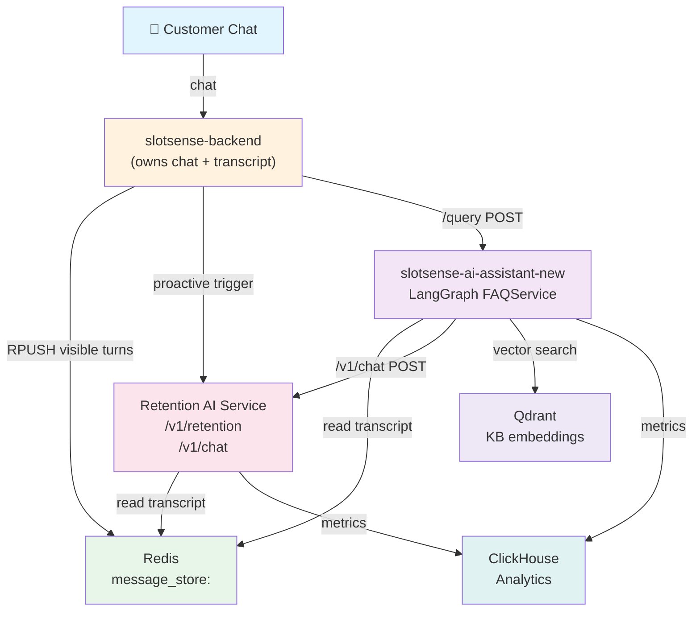
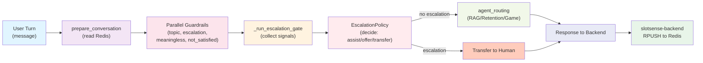

# Slotsense AI Assistant Architecture

**Version:** 2.0  
**Updated:** 2026-08-16  
**Status:** Current Production Model

---

## Executive Summary

The new slotsense-ai-assistant architecture moves beyond the 5-minute FAQ model to a sophisticated **signal-driven escalation framework**. Instead of static answers, the system:

1. **Collects signals** from user input, conversation history, and guardrails
2. **Builds situation context** using MemoryManager and conversation state
3. **Applies EscalationPolicy** to decide: assist, offer, or transfer
4. **Routes to agents** (RAG, Retention, Game) based on escalation decision

Key innovation: **Shared transcript** (Redis `message_store:<chat_id>`) allows both reactive (user reply) and proactive (trigger-based) retention paths to read the same canonical conversation.

---

## High-Level System Architecture



---

## Core Flow: Conversation Processing

Every user message triggers the same pipeline:



---

## Component Responsibilities

### slotsense-backend
- **Owns** chat UI, message persistence, and transcript
- **Writes** every visible turn to Redis `message_store:<chat_id>` (chronological RPUSH)
- **Calls** `/query` on assistant for reactive user replies
- **Calls** `/v1/retention` on retention service for proactive triggers
- **Metadata** stored in Redis includes: slot cards, quick replies, operator handoff markers, previous AI turns

### slotsense-ai-assistant-new
- **Gateway** to all AI agents (RAG, Retention, Game)
- **Single entry point**: FastAPI `/query` endpoint → FAQService (LangGraph)
- **Reads** shared transcript from Redis to maintain conversation context
- **Applies** escalation gates before agent routing
- **Normalizes** responses (live-support offers, outcome escalation rules)
- **Returns** final answer to backend

### Retention AI Service
- **Two paths:**
  - **Proactive** (`/v1/retention`): triggered by backend on lifecycle events
  - **Reactive** (`/v1/chat`): called by assistant on user reply continuation
- **Reads** same Redis transcript to see full conversation
- **Returns** retention action: message, slot payload, quiz, CTA, or next triggers
- **Shares** persona contract with assistant (language, tone, brand voice)

### MemoryManager
- **Ledger** maintained in Redis for each chat
- **Counters**: `abuse_counter`, `human_request_count`, `no_progress_count`
- **Flags**: `optional_handoff_offered`, `human_request`, `resolved`
- **Used by** escalation gate to decide if threshold breach warrants transfer

### EscalationPolicy
- **Core decision engine** that turns signals into actions
- **Rules** (in priority order):
  - Safety/needs_agent signal → **transfer now**
  - Harmful content → **assist then handoff**
  - First human request → **soft reply, no transfer**
  - Repeat human request → **transfer**
  - Abuse over threshold → **transfer with de-escalation**
  - No escalation → **continue to agent routing**

---

## Data Flow: Two Paths to Retention

### Path A: Proactive Retention (Trigger-Based)

```
Backend trigger monitor (onboarding, churn, re-engagement)
    ↓
/v1/retention (Retention AI Service)
    ├─ decides message + slots/game/quiz/CTA
    ├─ returns retention output
    ↓
Backend shows to user
    ↓
RPUSH visible turn to Redis
```

### Path B: Reactive Retention (User Reply)

```
User replies to retention message
    ↓
Backend /query POST to Assistant
    ↓
prepare_conversation (reads Redis transcript)
    ↓
Escalation gate checks if prior turn was retention
    ↓
agent_routing → Retention handler
    ↓
POST /v1/chat to Retention AI Service
    ├─ payload: conversation, latest_chat_id, customer_id, project_name, persona
    ├─ reads same Redis transcript
    ├─ returns chat answer or game/slot payload
    ↓
Assistant normalizes result
    ↓
Backend RPUSH visible turn to Redis
```

---

## Redis Message Store Schema

```yaml
Key: message_store:<chat_id>
Type: List (RPUSH order preserved)

Record format (each item):
  {
    "type": "human|rag|retention|game|operator",
    "content": "message text",
    "metadata": {
      "shown_slot_ids": [123, 456],
      "quick_replies": ["yes", "no", "tell me more"],
      "operator_handoff": true|false,
      "timestamp": "2026-08-16T10:30:00Z",
      "turn_id": "turn_uuid"
    }
  }

Ledger in same key or separate MemoryManager key:
  {
    "abuse_counter": 2,
    "human_request_count": 1,
    "no_progress_count": 0,
    "optional_handoff_offered": true,
    "human_request": true,
    "resolved": false,
    "last_escalation_check": "2026-08-16T10:30:00Z"
  }
```

---

## Next: Detailed Deep Dives

See related documents:
- [02-system-flow-detailed.md](02-system-flow-detailed.md) — Request flow with line-by-line decision points
- [03-escalation-gate-policy.md](03-escalation-gate-policy.md) — EscalationPolicy rules and signal collection
- [04-ingestion-pipeline.md](04-ingestion-pipeline.md) — Data ingestion, KB indexing, and signal macros
- [05-data-models-api.md](05-data-models-api.md) — API contracts and data models
