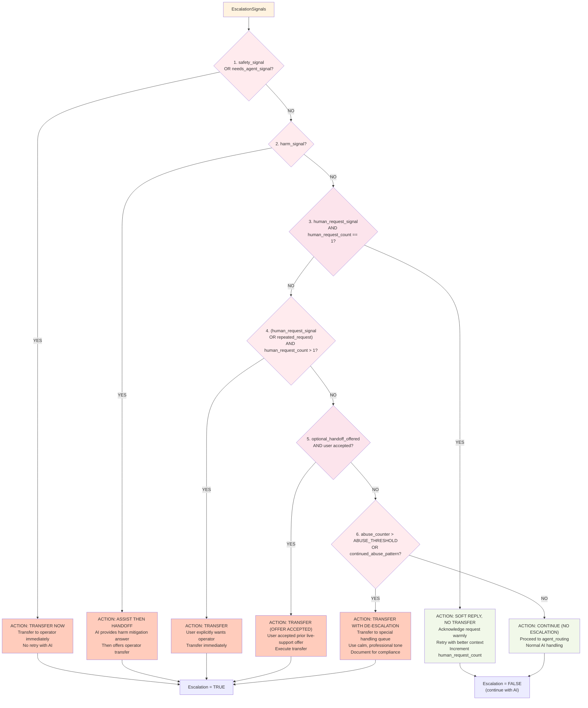

# System Flow: Detailed Request Path

This document maps every decision point in the conversation processing pipeline.

---

## Complete Request Lifecycle

```mermaid
graph TD
    Start["1️⃣ User Message Arrives<br/>(via slotsense-backend)"]
    
    Start --> PrepConv["2️⃣ prepare_conversation<br/>(FAQService)"]
    PrepConv --> ReadRedis["   • Read Redis message_store:<chat_id><br/>   • Preserve chronological RPUSH order<br/>   • Render visible metadata"]
    
    ReadRedis --> Guardrails["3️⃣ Parallel Guardrails<br/>(spawn 4 tasks simultaneously)"]
    
    Guardrails --> TopicCheck["Topic Classifier<br/>─ in_scope?<br/>─ spam_pattern?"]
    Guardrails --> EscCheck["Escalation Classifier<br/>─ escalation_signal?<br/>─ severity?"]
    Guardrails --> MeaningCheck["Meaningless Check<br/>─ empty / noise?<br/>─ already_resolved?"]
    Guardrails --> SatisfactionCheck["Satisfaction Classifier<br/>─ not_satisfied?<br/>─ repeated_request?"]
    
    TopicCheck --> Gate["4️⃣ _run_escalation_gate<br/>(collect all signals)"]
    EscCheck --> Gate
    MeaningCheck --> Gate
    SatisfactionCheck --> Gate
    
    Gate --> ReadMemory["   • Read MemoryManager counters<br/>     - abuse_counter<br/>     - human_request_count<br/>     - no_progress_count<br/>   • Check flags<br/>     - optional_handoff_offered<br/>     - human_request<br/>     - resolved"]
    
    ReadMemory --> BuildSignals["   • Aggregate into EscalationSignals:<br/>     - safety_signal<br/>     - needs_agent_signal<br/>     - harm_signal<br/>     - human_request_signal<br/>     - abuse_signal"]
    
    BuildSignals --> Policy["5️⃣ EscalationPolicy.decide<br/>(apply priority rules)"]
    
    Policy --> Rule1{"Safety signal<br/>or needs_agent?"}
    Rule1 -->|YES| TransferNow["→ TRANSFER NOW<br/>(operator takeover)"]
    Rule1 -->|NO| Rule2
    
    Rule2{"Harm signal?"}
    Rule2 -->|YES| AssistThenHandoff["→ ASSIST THEN HANDOFF<br/>(answer + offer transfer)"]
    Rule2 -->|NO| Rule3
    
    Rule3{"First human request?"}
    Rule3 -->|YES| SoftReply["→ SOFT REPLY NO TRANSFER<br/>(acknowledge, retry)"]
    Rule3 -->|NO| Rule4
    
    Rule4{"Repeat human request<br/>or abuse_counter > threshold?"}
    Rule4 -->|YES| TransferDeEsc["→ TRANSFER WITH DE-ESCALATION<br/>(calm tone, priority queue)"]
    Rule4 -->|NO| Rule5
    
    Rule5{"Accepted live-support<br/>offer?"}
    Rule5 -->|YES| TransferOffer["→ TRANSFER (offer accepted)"]
    Rule5 -->|NO| NoEsc["→ CONTINUE (no escalation)"]
    
    TransferNow --> Handoff["🤝 Operator Handoff Path"]
    AssistThenHandoff --> Handoff
    TransferDeEsc --> Handoff
    TransferOffer --> Handoff
    
    NoEsc --> Routing["6️⃣ agent_routing<br/>(LangGraph selector)"]
    
    Routing --> RouteDec{"Prior turn<br/>was retention?"}
    RouteDec -->|YES| RetentionAgent["→ Retention Agent<br/>(continuation)"]
    RouteDec -->|NO| RouteDec2
    
    RouteDec2{"Topic match<br/>game/slots?"}
    RouteDec2 -->|YES| GameAgent["→ Game Agent<br/>(slot recommendations)"]
    RouteDec2 -->|NO| RAGAgent["→ RAG Agent<br/>(KB search)"]
    
    RAGAgent --> ExecAgent["7️⃣ Execute Agent"]
    GameAgent --> ExecAgent
    RetentionAgent --> ExecAgent
    
    ExecAgent --> AgentOutput["Agent returns:<br/>- text answer, or<br/>- slot payload, or<br/>- game action, or<br/>- retention next_triggers"]
    
    Handoff --> HandoffOutput["Operator transfer with<br/>- escalation reason<br/>- chat context<br/>- suggested actions"]
    
    AgentOutput --> Normalize["8️⃣ Normalize Result<br/>(apply outcome rules)"]
    
    Normalize --> LiveSupportRule{"Live-support offer<br/>rules apply?"}
    LiveSupportRule -->|YES| AddOffer["   Inject live-support offer<br/>   in response metadata"]
    LiveSupportRule -->|NO| SkipOffer["   (skip offer)"]
    
    AddOffer --> OutcomePolicy["Apply outcome escalation<br/>policy on agent output"]
    SkipOffer --> OutcomePolicy
    
    HandoffOutput --> FinalResp["9️⃣ Final Response Object"]
    OutcomePolicy --> FinalResp
    
    FinalResp --> ReturnToBackend["Return to slotsense-backend<br/>{<br/>  'answer': '...',<br/>  'metadata': {...},<br/>  'escalation_taken': false|true<br/>}"]
    
    ReturnToBackend --> BackendStore["🔄 Backend Flow<br/>- Show answer to user<br/>- RPUSH visible turn to Redis"]
    
    style Start fill:#e1f5ff,stroke:#01579b
    style PrepConv fill:#f3e5f5,stroke:#4a148c
    style Guardrails fill:#fce4ec,stroke:#880e4f
    style Gate fill:#fff3e0,stroke:#e65100
    style Policy fill:#ffebee,stroke:#b71c1c
    style Handoff fill:#ffccbc,stroke:#bf360c
    style Routing fill:#f1f8e9,stroke:#33691e
    style ExecAgent fill:#e0f2f1,stroke:#004d40
    style Normalize fill:#f1f8e9,stroke:#33691e
    style BackendStore fill:#e8f5e9,stroke:#1b5e20
```



---

## Guardrail Details

Each guardrail runs in parallel and returns structured signals:

### Topic Classifier
```python
class TopicSignal(BaseModel):
    in_scope: bool           # Topic relevant to business?
    spam_pattern: bool       # Obvious spam/abuse?
    confidence: float        # 0.0-1.0
    reason: str
```

**Logic:**
- If `spam_pattern=True` → escalation gate increments abuse_counter
- If `in_scope=False` → soft decline, may offer operator

### Escalation Classifier
```python
class EscalationSignal(BaseModel):
    signal: bool             # Does this need escalation?
    severity: str            # "low" | "medium" | "high" | "critical"
    category: str            # "safety" | "harm" | "urgent" | "complaint"
    reason: str
    auto_transfer: bool      # Override all rules?
```

**Logic:**
- If `auto_transfer=True` → immediate transfer regardless of policy
- If `severity="critical"` → escalation gate sets needs_agent flag

### Meaningless Classifier
```python
class MeaninglessSignal(BaseModel):
    is_meaningless: bool     # Empty/noise?
    already_resolved: bool   # Question answered?
    reason: str
    suggestion: str          # e.g., "retry with more context"
```

**Logic:**
- If `already_resolved=True` → escalation gate checks resolved flag
- If `is_meaningless=True` → soft decline, may offer clarification

### Satisfaction Classifier
```python
class SatisfactionSignal(BaseModel):
    not_satisfied: bool      # Explicit dissatisfaction?
    repeated_request: bool   # Same Q asked 2+ times?
    frustration_level: str   # "low" | "medium" | "high"
    reason: str
```

**Logic:**
- If `not_satisfied=True` and human_request_count > 0 → escalation
- If `repeated_request=True` → escalation gate checks repeat rule

---

## Escalation Gate: Signal Aggregation

The gate collects all parallel signals and builds a unified context:

```python
class EscalationSignals(BaseModel):
    safety_signal: bool              # Auto-transfer?
    needs_agent_signal: bool         # Needs human?
    harm_signal: bool                # Harmful content?
    human_request_signal: bool       # User asked for agent?
    abuse_signal: bool               # Spam/abuse pattern?
    
    # Context
    abuse_counter: int               # From MemoryManager
    human_request_count: int         # From MemoryManager
    no_progress_count: int           # From MemoryManager
    optional_handoff_offered: bool   # From MemoryManager
    
    # Metadata
    primary_reason: str              # Top reason for escalation
    confidence: float                # 0.0-1.0
```

**Aggregation logic:**
```
if any([safety_signal, needs_agent_signal]):
    → escalation_severity = "critical"
elif harm_signal:
    → escalation_severity = "high"
elif abuse_signal and abuse_counter > THRESHOLD:
    → escalation_severity = "high"
elif human_request_signal and human_request_count > 1:
    → escalation_severity = "medium"
elif repeated_request:
    → escalation_severity = "medium"
else:
    → escalation_severity = "none"
```

---

## EscalationPolicy Decision Tree

The policy applies rules in strict priority order (first match wins):



---

## Outcome Escalation Policy

After the agent returns an answer, additional rules apply:

```yaml
If agent output is:

  agent_failed:
    - mark no_progress_count++
    - if no_progress_count > 2 → offer escalation
    - if no_progress_count > 5 → auto-escalate

  safety_violation:
    - override with safe message
    - escalate for review
    
  no_answer_found:
    - if user_satisfaction = low → escalate
    - if user_satisfaction = high → offer search help
    
  live_support_offer_rules:
    - if user_segment = "high_value" AND repeated_help → offer
    - if user_segment = "at_risk" AND no_progress > 1 → offer
    - track optional_handoff_offered flag
```

---

## MemoryManager Counters

The gate uses these to make decisions:

```yaml
Message Store Ledger (Redis key: ledger:<chat_id>)

abuse_counter:
  - incremented by: topic classifier (spam), repeated violations
  - used by: escalation policy (>3 = escalate)
  - reset: after operator resolves or 24h passes

human_request_count:
  - incremented by: satisfaction classifier (not_satisfied=true)
  - used by: escalation policy (>1 = escalate)
  - reset: after operator closes or resolution_confirmed

no_progress_count:
  - incremented by: when agent_failed or user still unsatisfied
  - used by: outcome policy (>2 = offer, >5 = auto)
  - reset: after successful agent answer or manual operator intervention

optional_handoff_offered:
  - set by: outcome escalation policy (live_support offer)
  - used by: escalation policy (if true + user response = transfer)
  - reset: after user accepts, declines, or 24h passes

human_request:
  - boolean flag, set when user explicitly asks for operator
  - used by: escalation policy (triggers soft/hard transfer rules)
  - reset: after operator acknowledges

resolved:
  - boolean flag, set when user confirms resolution
  - used by: meaningless classifier, escalation gate
  - reset: manual only (user can re-open)

last_escalation_check:
  - timestamp of last policy decision
  - used by: cooldown logic (avoid re-escalating within 60s)
```

---

## Next Steps

See:
- [03-escalation-gate-policy.md](03-escalation-gate-policy.md) — Macro definitions and signal collection code patterns
- [04-ingestion-pipeline.md](04-ingestion-pipeline.md) — How signals are trained/calibrated from data
