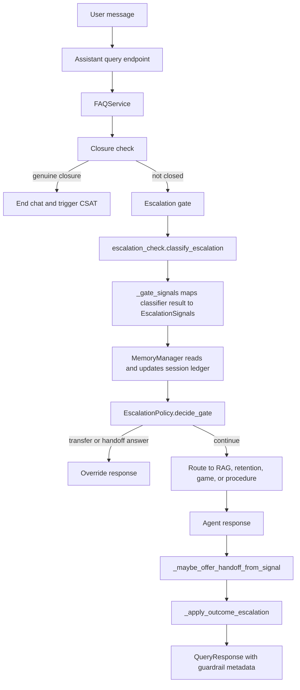
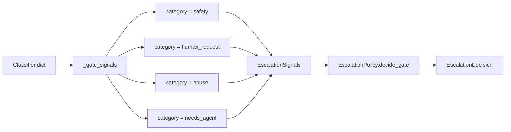
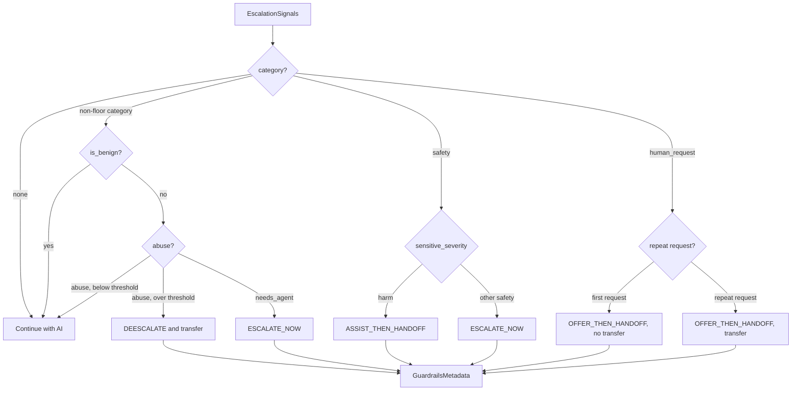
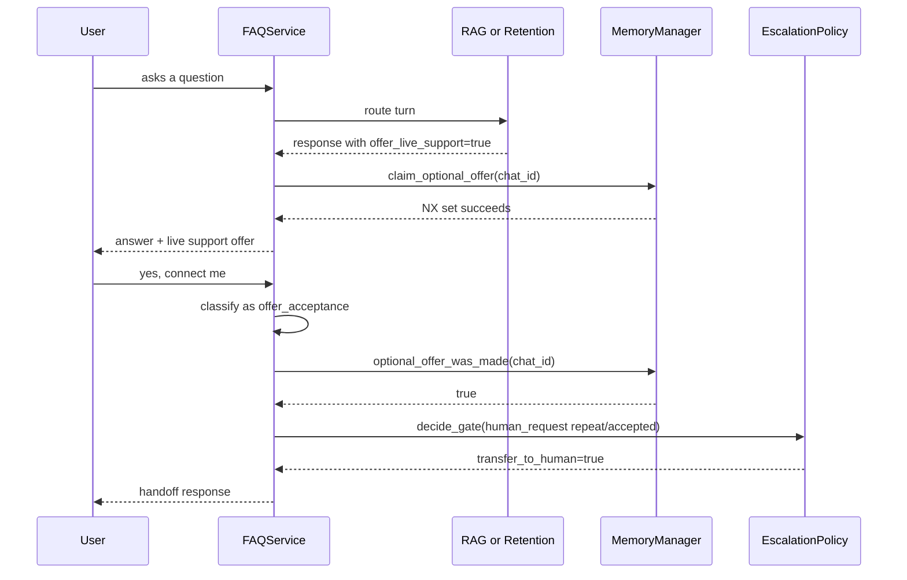
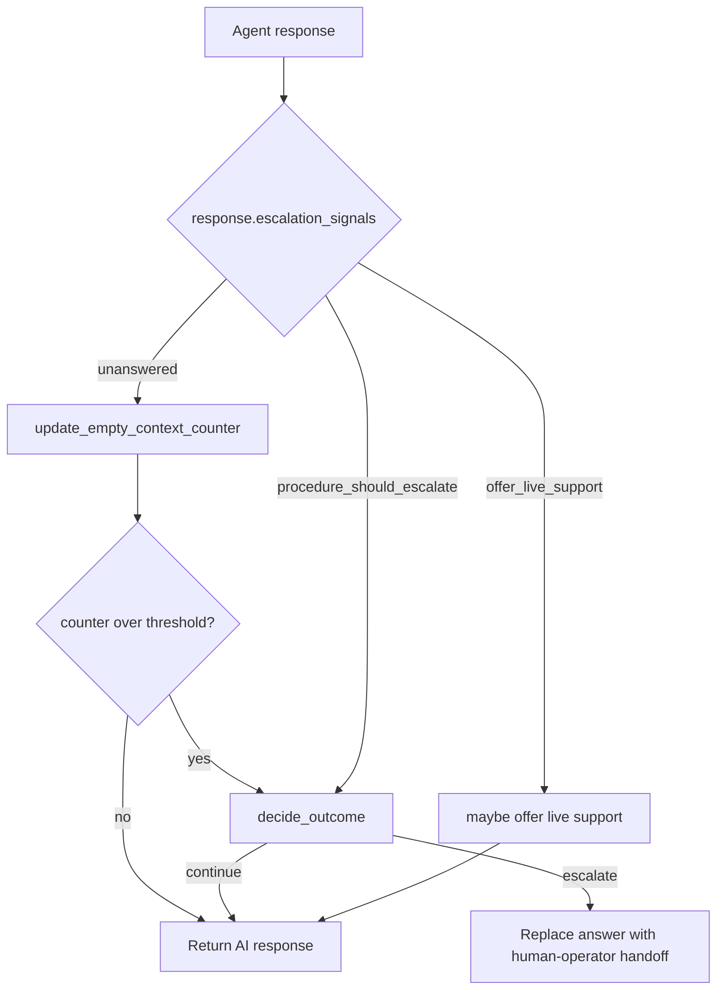
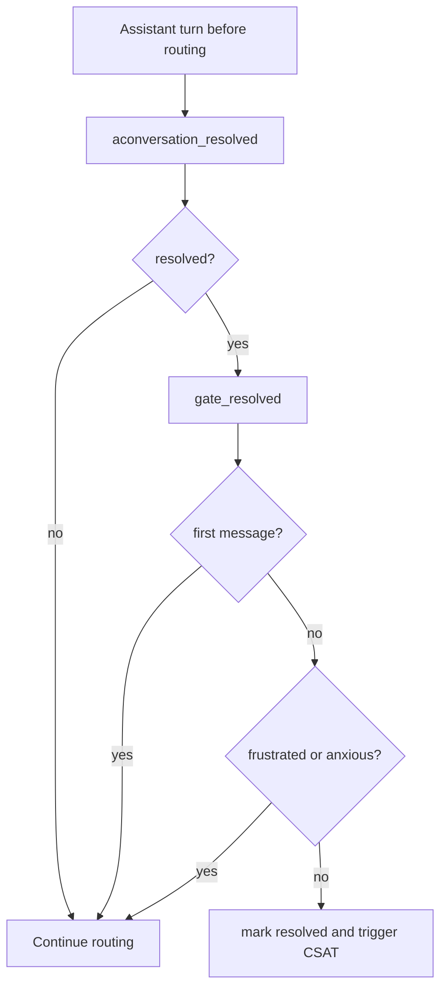

# Escalation Gate and Policy

This is the code-grounded version of the escalation design. A previous draft described invented macros such as `collect_safety_signals` and `EscalationPolicyEngine`; those are not the implementation. The real system is centered on `FAQService`, `EscalationPolicy`, `EscalationSignals`, Redis-backed session ledgers, and the response metadata returned by the assistant API.

The decision I made was to turn escalation into a small policy layer with explicit signals, rather than scattering handoff logic across RAG, retention, game, and guardrail code. The policy is intentionally boring: classify, normalize into a few signal fields, apply deterministic rules, then stamp the same metadata shape onto the response.

## Actual Runtime Shape

## Policy Surface

The policy does not receive raw classifier JSON. `FAQService._gate_signals` translates legacy classifier categories into the typed dataclass used by the policy.

Actual signal fields include:

- `category`: `safety`, `human_request`, `abuse`, or `needs_agent`.
- `sensitive_severity`: separates harm cases from other safety cases.
- `human_request` and `is_repeat_human_request`: make "first ask" different from "repeated ask".
- `abuse_over_threshold`: only repeated abuse escalates.
- `is_benign`: suppresses non-floor categories.
- `offer_live_support`: optional offer path, usually from an agent outcome.
- `unanswered`, `no_progress_over_threshold`, and `procedure_should_escalate`: outcome-stage signals.

## Gate Decision Rules

Two ideas matter here:

- Safety and explicit human requests are floor signals. They are not suppressed by `is_benign`.
- Abuse is not escalated on the first bad message. It becomes an escalation only after the Redis counter crosses the configured threshold.

## Optional Handoff Is a Two-Turn Contract

The assistant can offer live support without immediately transferring the chat. This avoids burning human capacity on every weak signal while still giving the user an escape hatch.

The Redis key is `optional_handoff_offered:{chat_id}` with a short TTL. The write uses NX semantics, so the same conversation is not repeatedly spammed with offers.

## Outcome Escalation

Not every escalation happens before the agent answers. RAG and procedure flows can also produce outcome signals after retrieval or tool execution.

For RAG, the actual source signal is `EscalationSignals(unanswered=..., offer_live_support=...)`. `unanswered` comes from empty context or an explicit `answered is False` retrieval result. The no-progress counter is stored in Redis as `frustration_counter:{chat_id}` and resets on a good answer.

## Resolution Gate

Resolution is also guarded. The system does not end a chat just because a classifier sees "thanks" or a low-context acknowledgement.

This is why the user experience is less brittle: closure needs a genuine closing signal, not just a polite phrase.

## Code Anchors

- `slotsense-ai-assistant-new/src/core/escalation/models.py`: `SituationClass`, `EscalationSignals`, `EscalationDecision`.
- `slotsense-ai-assistant-new/src/core/escalation/policy.py`: deterministic gate, optional handoff, scenario latch, and outcome decisions.
- `slotsense-ai-assistant-new/src/core/faq_service.py`: `_run_escalation_gate`, `_gate_signals`, `_maybe_offer_handoff_from_signal`, `_apply_outcome_escalation`, `_compute_resolved`.
- `slotsense-ai-assistant-new/src/core/memory/service.py`: Redis counters and flags for empty context, abuse, optional offers, and repeated human requests.
- `slotsense-ai-assistant-new/src/core/agents/rag.py`: RAG outcome signal creation.

## Interview Framing

The key architectural decision was to separate "detection" from "decision." Classifiers can be messy and change over time, but the product policy needs to be inspectable. By normalizing classifier output into `EscalationSignals`, the system can explain why a handoff happened, test edge cases without the LLM, and keep retention/game/RAG behavior consistent.

