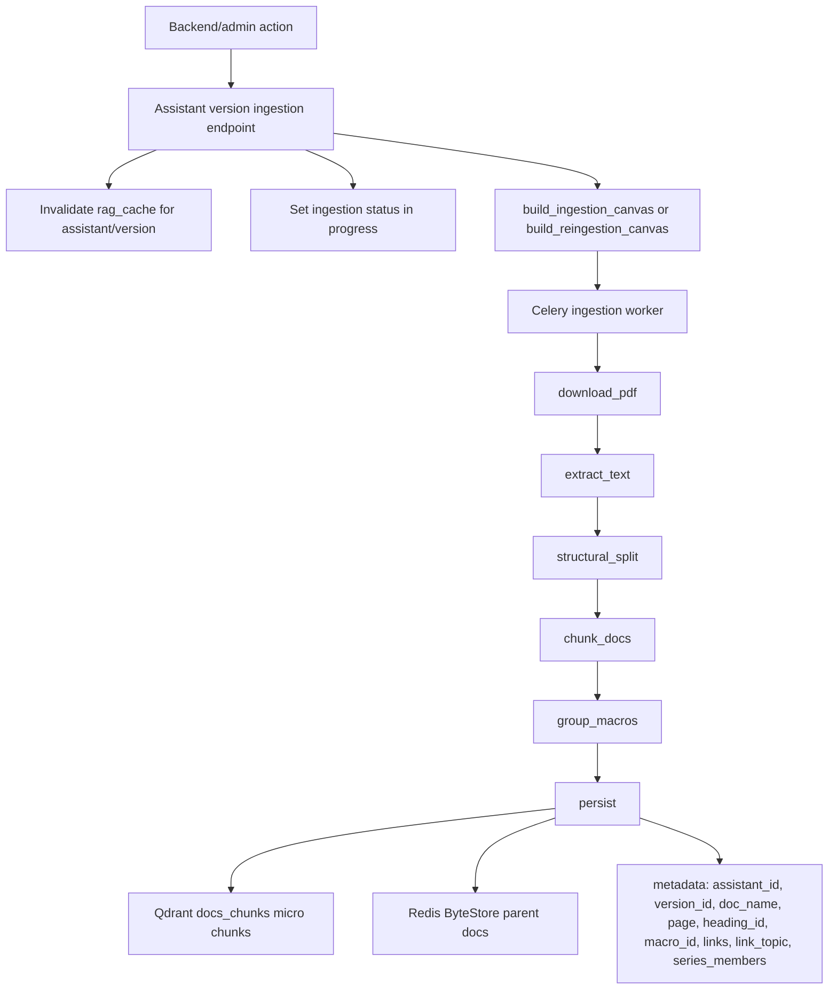
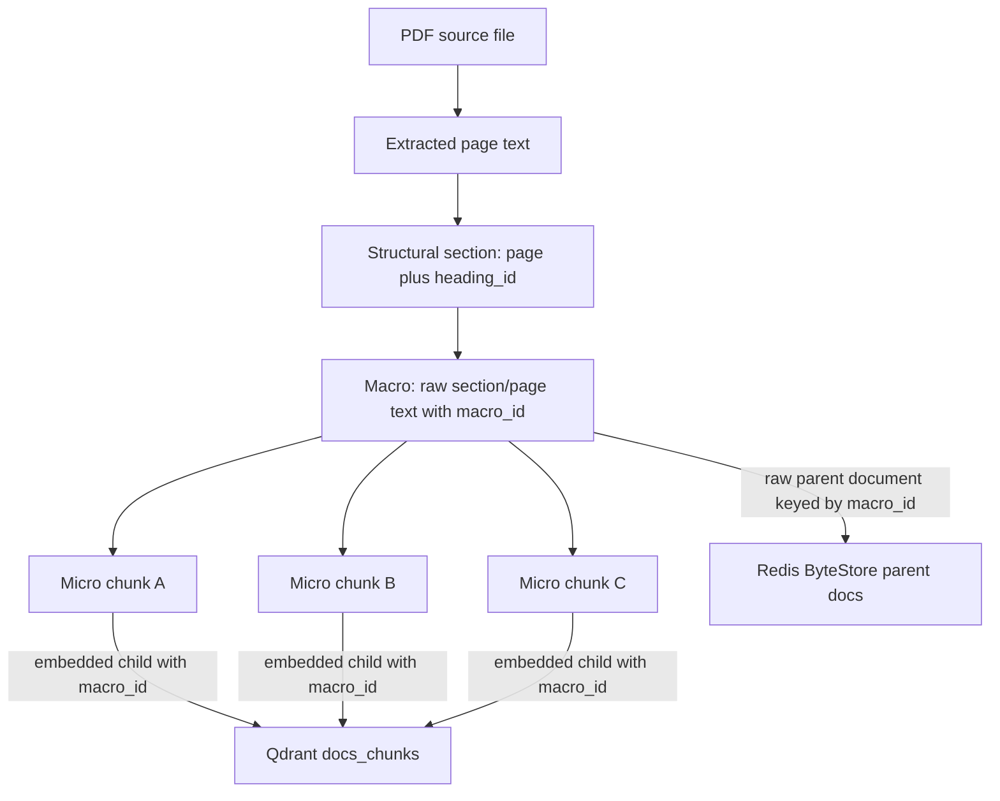
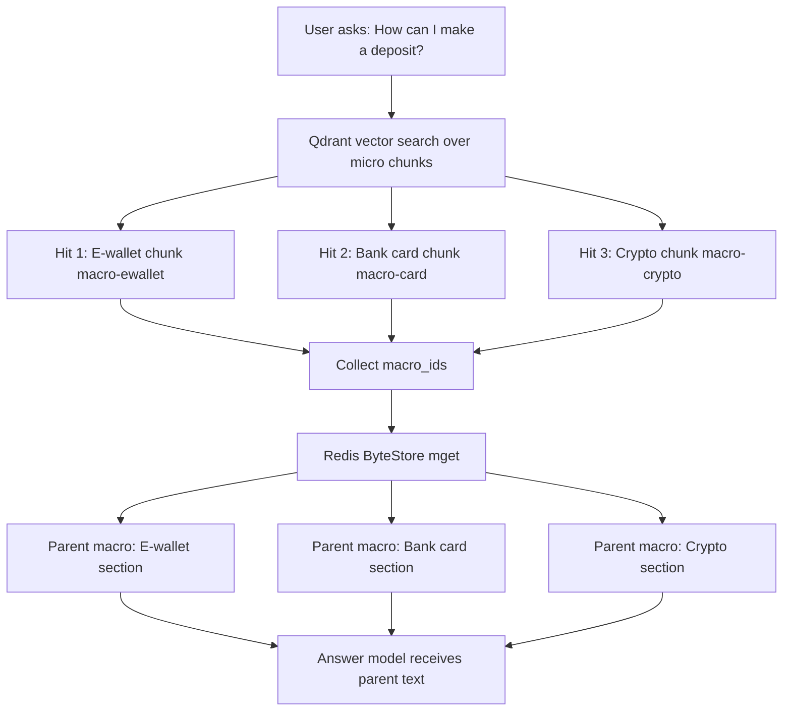
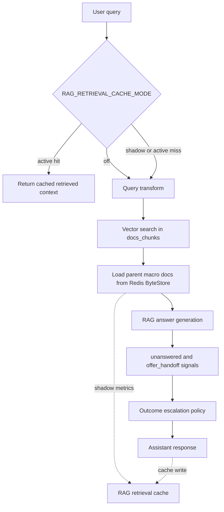
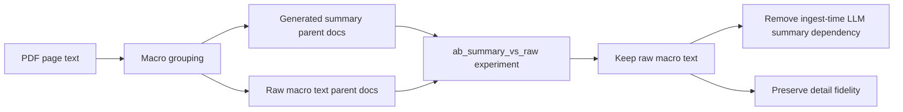
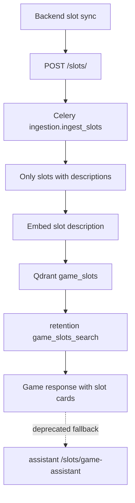
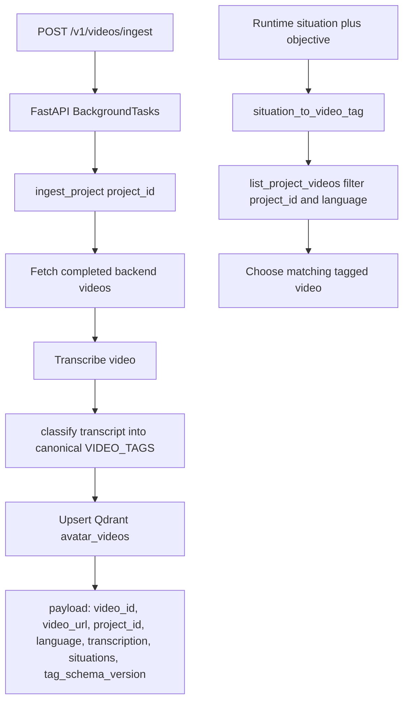

# Ingestion, Retrieval, and Cache Pipeline

This is the code-grounded version of the ingestion architecture. A previous draft described Kafka collectors, data warehouses, model registries, and training pipelines. Those are not in the current repos. The actual implementation is a set of FastAPI ingestion endpoints, Celery workers for assistant documents and slots, Qdrant collections for retrieval, Redis parent document storage, and a retention-side video ingestion job.

The underlying decision was to optimize for retrieval quality and operational simplicity: keep PDF ingestion deterministic, remove summary generation when experiments showed raw macro text was at least as useful, share slot data through Qdrant, and treat retrieval caching as a measured rollout rather than a default behavior change.

## PDF Knowledge Base Ingestion



Actual endpoints in the assistant service:

- `GET /assistants/{assistant_id}/versions/{version_id}` returns ingestion status.
- `POST /assistants/{assistant_id}/versions/{version_id}` enqueues initial ingestion.
- `PUT /assistants/{assistant_id}/versions/{version_id}` enqueues reingestion with new and removed files.
- `DELETE /assistants/{assistant_id}` deletes assistant data and invalidates cache.

The active PDF pipeline is:

```text
download_pdf -> extract_text -> structural_split -> chunk_docs -> group_macros -> persist
```

`persist` writes micro chunks to Qdrant and writes parent documents to Redis ByteStore using the raw macro text. Some old comments still mention summaries, but the active behavior is raw macro persistence, not generated summaries.

## Micro Chunks, Macros, and Parent Documents

The retrieval design is a small-to-big RAG design.

The system does not embed the same text it gives to the answer model. It embeds small child chunks for precise vector matching, then uses the matched chunk's `macro_id` to load a larger parent document from Redis.

The hierarchy is:



### Micro chunk

A micro chunk is the small text unit embedded into Qdrant. It is optimized for ranking.

Example:

```text
Text:
"For E-wallet deposits, choose Wallet in the cashier, enter the amount, and confirm the payment."

Metadata:
assistant_id = "assistant-au"
version_id = "v42"
doc_name = "How to make a deposit"
page = 3
heading_id = "2-e-wallet"
macro_id = "macro-ewallet"
language = "en"
```

The micro chunk is useful because a query like "how do I deposit with an ewallet?" can match this exact sentence.

### Macro

A macro is the larger section/page-level text created by `group_macros`. In the current implementation, chunks are mapped to the macro for the same `(page, heading_id)` section, not just the same page. That distinction matters when one PDF page contains several headings.

Example macro:

```text
macro_id = "macro-ewallet"
doc_name = "How to make a deposit"
heading_id = "2-e-wallet"
text =
"2. E-wallet deposits
You can deposit with supported wallets from the cashier page.
First choose Wallet, then enter the amount, confirm the provider redirect,
and wait for the cashier to show the deposit status..."
```

The macro is useful because the answer model usually needs more than the one sentence that ranked well. It needs the nearby procedure, limits, warning text, links, or follow-up steps.

### Parent document

The parent document is the stored LangChain `Document` whose key is the macro id. In this codebase, parent documents live in Redis ByteStore.

The parent document contains:

```text
page_content = raw macro text
metadata = assistant_id, version_id, doc_name, page, heading_id, macro_id, links, link_topic, series_members
```

So "macro" describes the logical section of source text, while "parent document" describes the retrieval object stored in Redis and returned to the LLM.

## How Retrieval Expands From Micro to Parent

At runtime, vector search happens against Qdrant `docs_chunks`, but generation uses Redis parent documents.



Concrete example:

```text
User query:
"How can I make a deposit?"

Qdrant top 3 child hits:
1. "For E-wallet deposits..."       macro_id=macro-ewallet
2. "For bank card deposits..."      macro_id=macro-card
3. "For cryptocurrency deposits..." macro_id=macro-crypto

Redis parent lookup:
mget(["macro-ewallet", "macro-card", "macro-crypto"])

Context sent to the answer model:
1. Full E-wallet macro
2. Full bank card macro
3. Full cryptocurrency macro
```

The important point is that the top three vector matches are not necessarily the exact text snippets pasted into the final prompt. They are pointers to bigger parent sections.

This gives the system two useful properties:

- Search precision from small micro chunks.
- Answer grounding from larger parent macros.

It also creates a cross-store invariant: every Qdrant child hit needs a matching Redis parent. If Qdrant has children but Redis has no parent macros, retrieval can diagnose that as `PARENT_DOC_GAP` instead of treating it as an ordinary "no answer found" case.

## Retrieval Path



The actual cache settings are conservative:

- `RAG_RETRIEVAL_CACHE_MODE` defaults to `SHADOW` in code.
- `rag_cache` is the cache collection.
- Default threshold is `0.99`.
- Question weight is `1.0`; history weight is `0.0`.

That means the cache can be measured without changing user-visible retrieval behavior unless active mode is enabled.

## Top-K Example: Why Parent Expansion Matters

Say the document "How to make a deposit" is split into three numbered sections:

```text
1. Bank card deposits
2. E-wallet deposits
3. Cryptocurrency deposits
```

Each section becomes its own parent macro, and each parent macro creates several micro chunks.

For a narrow query, that works naturally:

```text
User query:
"Can I deposit with an e-wallet?"

Top vector hit:
micro chunk from section 2, macro_id=macro-ewallet

Parent context:
the full E-wallet section
```

The model should not need the bank card or crypto sections for that answer.

For an overview query, the behavior is more subtle:

```text
User query:
"What deposit methods are available?"

Top 3 vector hits before parent expansion:
1. E-wallet chunk       macro_id=macro-ewallet
2. E-wallet limits      macro_id=macro-ewallet
3. Payment confirmation macro_id=macro-ewallet
```

Even with `k=3`, all three hits can point to the same parent macro. The model would see only the E-wallet section and might answer as if E-wallet is the only deposit method.

That is the bug the numbered-series expansion is designed to avoid.

### How a document becomes a numbered series

Series expansion starts at ingestion, not at query time.

`series_member_ids()` in `processing/ingestion/grouper.py` looks at the macros for one document and counts headings that start with a number plus a separator:

```text
1. Bank card deposits
2: E-wallet deposits
3) Cryptocurrency deposits
```

The regex is deliberately simple:

```text
^\s*\d+\s*[:.)]
```

So this is not an LLM classifier and it is not semantic clustering. It only marks documents that already look like numbered multi-section articles.

The default minimum is 3 numbered sections:

```text
SERIES_EXPANSION_ENABLED = true
SERIES_MIN_SECTIONS = 3
```

If a document has fewer than 3 numbered headings, `series_member_ids()` returns an empty list and the retrieval path behaves normally.

When the document is detected as a series, ingestion stores the same ordered `series_members` list on every parent macro in that document:

```text
Parent macro: Bank card section
macro_id = "macro-card"
series_members = ["macro-card", "macro-ewallet", "macro-crypto"]

Parent macro: E-wallet section
macro_id = "macro-ewallet"
series_members = ["macro-card", "macro-ewallet", "macro-crypto"]

Parent macro: Crypto section
macro_id = "macro-crypto"
series_members = ["macro-card", "macro-ewallet", "macro-crypto"]
```

That means any one matching section can point the retriever to the full article.

### What happens at retrieval time

The runtime sequence is:

```text
1. Qdrant searches micro chunks using assistant/version/language filters.
2. A child chunk wins and resolves to its Redis parent macro.
3. The normal retriever returns parent documents, not child chunks.
4. `LanguageAwareRetriever._expand_series()` inspects those parent documents.
5. If any parent has `series_members`, it fetches the missing sibling parent macros from Redis.
6. It appends those sibling parents to the context sent to the answer model.
```

In pseudo-code, `_expand_series()` is doing this:

```text
member_ids = []
for doc in retrieved_parent_docs:
    member_ids += doc.metadata["series_members"]

missing = member_ids - already_retrieved_macro_ids
siblings = redis_docstore.mget(missing)

return retrieved_parent_docs + siblings
```

There are a few important guardrails in that code path:

- If no retrieved parent has `series_members`, expansion is a no-op.
- If all series members are already present, expansion is a no-op.
- If Redis lookup fails, the retriever logs a warning and returns the original hits.
- Siblings are fetched only after one member has already passed the normal Qdrant filters.
- Siblings are parent macros from the same document's stored `series_members`, not a new vector search.

That last point is why assistant/version isolation is preserved. The system does not say "find more similar deposit sections anywhere." It says "this already-filtered parent belongs to a known ordered article; fetch the other parent macros from that same article."

### Walkthrough with duplicate top-k hits

For the overview query, suppose Qdrant returns three micro chunks:

```text
User query:
"What deposit methods are available?"

Qdrant child hits:
1. "For E-wallet deposits..."          macro_id=macro-ewallet
2. "E-wallet deposits may require..."  macro_id=macro-ewallet
3. "Confirm the wallet redirect..."    macro_id=macro-ewallet
```

After normal parent resolution, the retrieved parent list effectively contains one parent:

```text
retrieved_parent_docs =
[
  Parent("macro-ewallet", metadata.series_members=[
    "macro-card",
    "macro-ewallet",
    "macro-crypto"
  ])
]
```

Then `_expand_series()` computes:

```text
already_retrieved_macro_ids = ["macro-ewallet"]

member_ids from metadata =
[
  "macro-card",
  "macro-ewallet",
  "macro-crypto"
]

missing =
[
  "macro-card",
  "macro-crypto"
]
```

It fetches those missing parents from Redis:

```text
redis mget(["macro-card", "macro-crypto"])
```

The final context becomes:

```text
1. E-wallet parent macro       from the original vector hit
2. Bank card parent macro      sibling from Redis
3. Cryptocurrency parent macro sibling from Redis
```

So the query's vector signal still matters. The vector hit chooses the article. Expansion then fills in the sibling sections that belong to that article.

### What sibling expansion is not

Sibling expansion is not:

- increasing global top-k for every request;
- making every parent document the whole PDF;
- doing a second vector search for loosely related chunks;
- joining across documents with similar headings;
- using an LLM to decide which sections to add.

It is a targeted repair for one corpus shape: numbered articles where an overview answer is split across multiple page/heading macros.

### Narrow query vs overview query

For a narrow query:

```text
User query:
"Can I use an e-wallet to deposit?"

Vector hit:
macro-ewallet

Expansion result:
If macro-ewallet belongs to a detected series, siblings may still be appended.
The answer model can focus on the matching E-wallet parent because it has the
specific section plus the neighboring methods for comparison.
```

For an overview query:

```text
User query:
"What deposit methods are available?"

Vector hit:
macro-ewallet

Expansion result:
macro-card + macro-ewallet + macro-crypto
```

The key design decision is selective expansion. The system does not make every parent the entire PDF or globally raise `k`. Ordinary documents keep tight section-level parents. Only documents detected as numbered series get sibling expansion after one member has already passed assistant/version/language filtering.

## Raw Macro Text vs Summaries



The experiment in `experiments/ab_summary_vs_raw/REPORT.md` found the summary approach was not clearly better overall. Raw macro text won as the safer production choice because it preserved details and removed an ingestion-time LLM call.

## Slot Ingestion and Retrieval

Slots are ingested in the assistant repo and read directly by the retention repo.



The important architecture change is that retention does not need to round-trip through the assistant service for game slot recommendations. It can read `game_slots` in Qdrant directly, filtered by `assets_group` such as `project_id_geo`.

## Video Ingestion

Retention owns video ingestion and matching.



This is deliberately small-catalog retrieval. Instead of treating every video match as a semantic vector top-1 problem, the system stores canonical situation tags and filters by project and language.

## What This Says About The Architecture

The ingestion work moved away from "train a smarter pipeline" and toward "make the data contract sharper." The repeated pattern is:

- Put durable knowledge in Qdrant and Redis where runtime services can share it.
- Avoid ingest-time LLM dependencies unless they clearly improve retrieval quality.
- Keep cache rollouts observable through shadow mode before making them active.
- Let retention read domain assets directly when that removes service coupling.

## Code Anchors

- `slotsense-ai-assistant-new/src/api/v1/endpoints/assistant.py`: assistant version ingestion endpoints.
- `slotsense-ai-assistant-new/src/workers/tasks/ingestion/pipeline.py`: PDF ingestion chain.
- `slotsense-ai-assistant-new/src/workers/tasks/ingestion/persist.py`: Qdrant micro chunks and Redis parent documents.
- `slotsense-ai-assistant-new/src/api/v1/endpoints/slots.py`: slot ingestion endpoints.
- `slotsense-ai-assistant-new/src/infrastructure/settings.py`: retrieval cache mode and collection settings.
- `slotsense-rnd-retention-ai/src/tools/game_slots_search.py`: direct Qdrant slot search.
- `slotsense-rnd-retention-ai/src/app.py`: `/v1/videos/ingest`.
- `slotsense-rnd-retention-ai/src/video_index.py` and `src/video_tags.py`: video index payloads and tag mapping.
