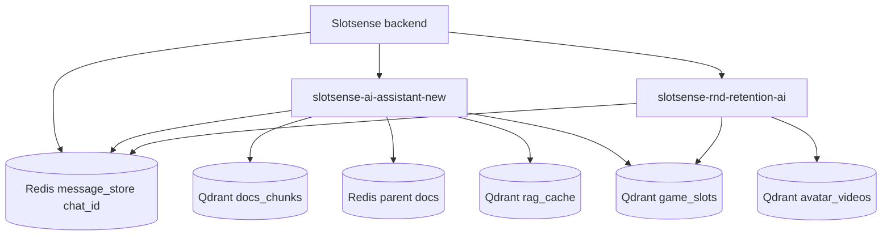
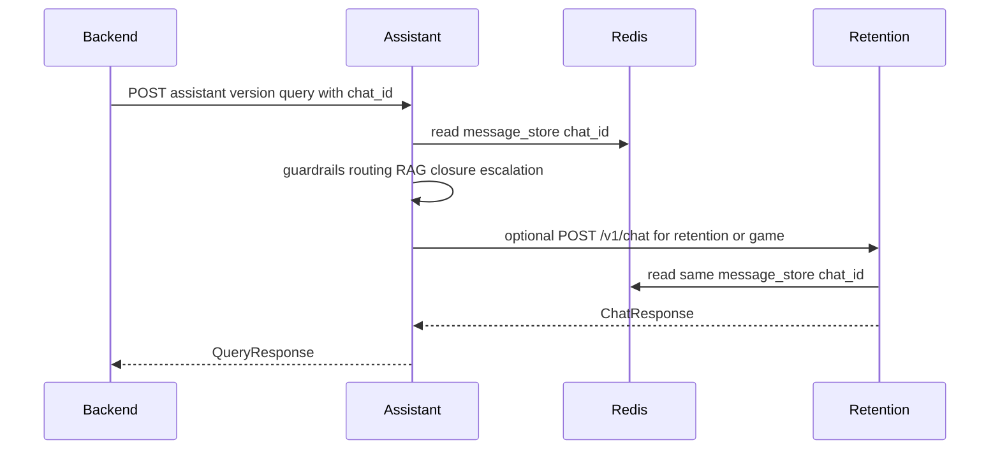
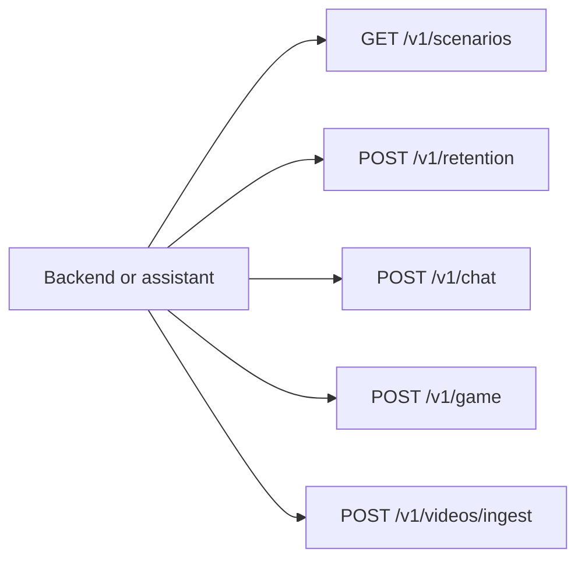
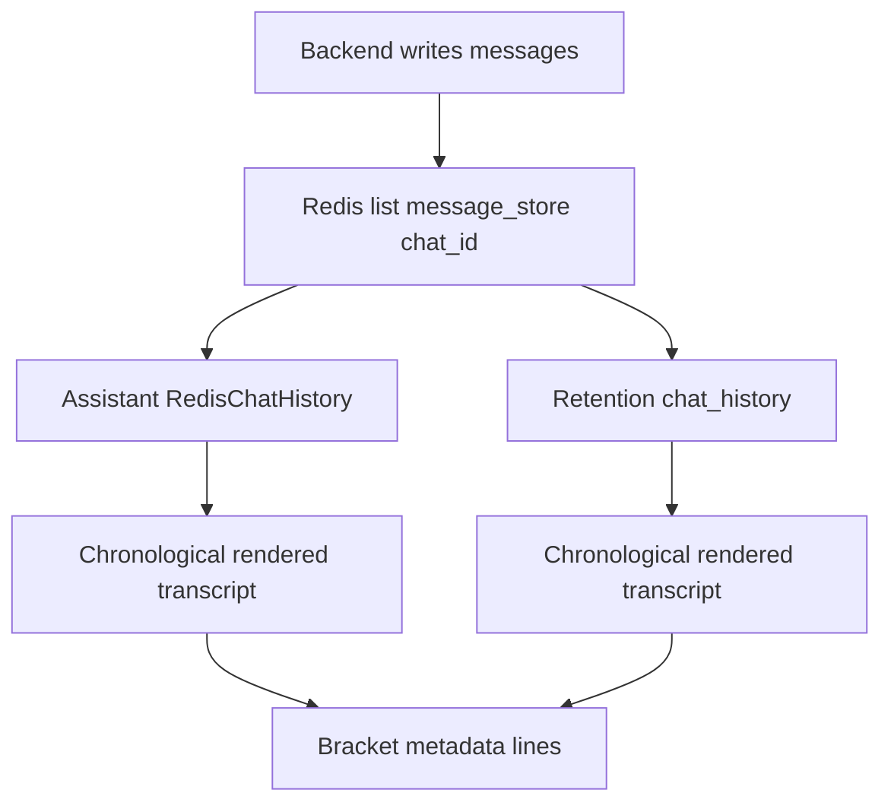
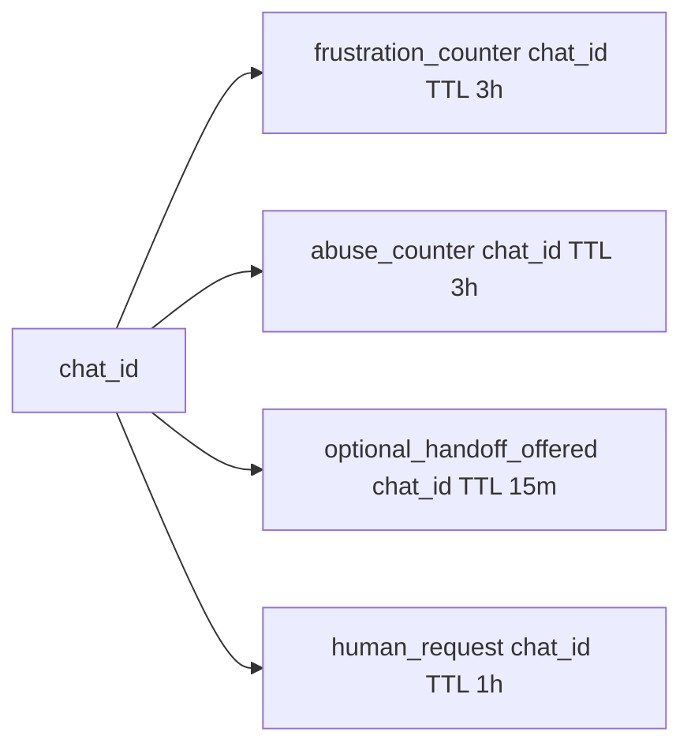
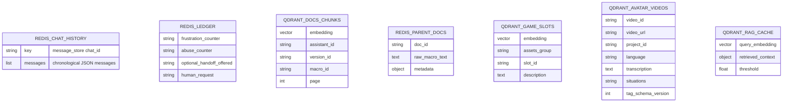

# Data Models and API Contracts

This is the code-grounded version of the API and data model map. A previous draft invented conversation and retention schemas that do not exist in the current code. The actual contracts are the assistant query schema, retention service schemas, ingestion endpoints, Qdrant collections, and Redis chat history format.

The architecture decision was to make `chat_id` the shared conversation handle between services. The backend owns the live transcript in Redis; the assistant and retention service reconstruct context from that same ledger instead of passing a bespoke conversation object through every request.

## Service Context



## Assistant Query API



Actual route:

```text
POST /assistants/{assistant_id}/versions/{version_id}/query?chat_id=...
```

Actual `QueryRequest` fields:

```text
input_type: "text" | "audio"
output_type: "text" | "audio"
audio_file: optional string
user_query: optional string
description: string
language: string = "en"
tone: optional string
client_user_id: optional string
client_user_login: optional string
project_id: optional string
project_name: optional string
stream: bool = false
attachments: optional list[string]
```

`assets_group` is derived as `project_id_language` when `project_id` exists, otherwise `leon_language`.

Actual `QueryResponse` fields include:

```text
answer
audio_transcription
audio_url
topic
human_operator
human_request
resolved
escalation_reason
situation_class
not_satisfied
agent
slots
quick_replies
reference_link
article_ids
tickets
existing_ticket_id
case_id
escalation_target
escalation_summary
```

The response shape exposes the policy outcome directly through `human_operator`, `human_request`, `resolved`, `escalation_reason`, and `situation_class`.

## Retention APIs



### `POST /v1/retention`

Actual `RetentionRequest`:

```text
customer_id
customer_login
project_name
trigger: { event, data }
objective
blocked_triggers: list = []
blocked_actions: list = []
blocked_steps: list = []
language: string = "en"
project_id: optional string
latest_chat_id: optional string
customer_profile: optional object
```

Actual `RetentionResponse`:

```text
action: ActionOutput | null
triggers: list[TriggerItem]
```

If no action is selected, the API intentionally returns `action: null` rather than inventing a default action. `ActionOutput` contains `type`, optional `settings`, and optional `steps`.

### `POST /v1/chat`

Actual `ChatRequest`:

```text
conversation
customer_id
customer_login
project_name
language = "en"
latest_chat_id
persona
game_intent = false    # deprecated and ignored
project_id
latest_message
shown_slot_ids = []
```

Actual `ChatResponse`:

```text
answer
mode = "chat"
follow_up
slots = []
steps
```

The important contract detail is that `game_intent` is no longer authoritative. Retention classifies the conversation itself and chooses chat or game mode from the shared transcript.

### `POST /v1/game`

Actual `GameRequest`:

```text
project_id
project_name
customer_id
customer_login
language = "en"
latest_message
conversation
latest_chat_id
persona
shown_slot_ids = []
```

Actual `GameResponse`:

```text
answer
follow_up
slots = []
steps
```

## Shared Transcript Contract



Both services read `message_store:<chat_id>` using `LRANGE 0 -1` and treat the list as chronological. This matters because older code paths sometimes assumed reverse order; the grounded contract is backend `RPUSH` plus chronological reads.

Important rendered metadata includes:

- `[showed slot cards: ...]`
- `[showed quiz invite]`
- `[sent video message]`
- `[offered quick replies: ...]`
- `[conversation was transferred to a human operator]`
- `[showed randomizer]`

That bracket language is part of the implicit prompt contract. It lets the LLM see UI events that are not natural-language chat messages.

## Session Ledger Keys



These keys are intentionally small and state-specific. They are not a general conversation object; they are policy memory for repeated conditions.

## Ingestion and Asset APIs

Assistant ingestion:

- `GET /assistants/{assistant_id}/versions/{version_id}` returns status.
- `POST /assistants/{assistant_id}/versions/{version_id}` starts ingestion.
- `PUT /assistants/{assistant_id}/versions/{version_id}` starts reingestion with `new_assistant_version_id`, `new_files`, and `removed_files`.
- `DELETE /assistants/{assistant_id}` removes assistant data.

Slot ingestion:

- `POST /slots/` enqueues slot ingestion for slots with descriptions.
- `GET /slots/?project_id&geo` lists slots.
- `POST /slots/game-assistant` exists as a deprecated fallback shape; retention reads Qdrant directly.

Video ingestion:

- `POST /v1/videos/ingest` accepts `project_id`, queues a background ingestion job, and returns `{ task_id, project_id, status: "queued" }`.

## Data Stores



## What Was Removed From The Story

The corrected architecture does not claim:

- A Kafka/EventBridge data collector.
- A model registry or fine-tuning training loop.
- A custom `Conversation` Pydantic model with `customer_segment`.
- A retention response containing a list of actions.
- Summary documents as the active parent document format.

The real story is stronger for an interview because it is more specific: two services share transcript memory, escalation policy is deterministic, ingestion writes concrete retrieval collections, and retention can use the same assets without depending on a second assistant API call.

## Code Anchors

- `slotsense-ai-assistant-new/src/api/schemas/query.py`: `QueryRequest`, `QueryResponse`.
- `slotsense-ai-assistant-new/src/api/v1/endpoints/query.py`: assistant query route.
- `slotsense-ai-assistant-new/src/core/models/faq.py`: internal response and guardrail metadata.
- `slotsense-ai-assistant-new/src/core/memory/redis_chat_history.py`: assistant transcript reconstruction.
- `slotsense-ai-assistant-new/src/core/memory/service.py`: Redis session ledger.
- `slotsense-rnd-retention-ai/src/schemas.py`: retention, chat, game, and video request/response models.
- `slotsense-rnd-retention-ai/src/app.py`: retention HTTP routes.
- `slotsense-rnd-retention-ai/src/chat_history.py`: retention transcript reconstruction.
- `slotsense-rnd-retention-ai/src/tools/game_slots_search.py`: direct Qdrant slot contract.

