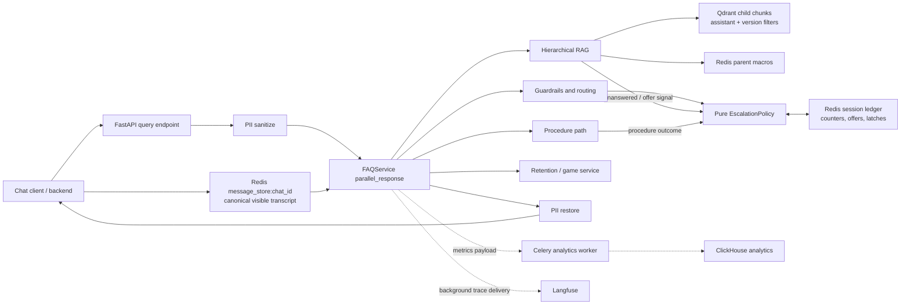

# SlotSense Architecture Thinking Through Production Incidents

**Purpose:** explain my engineering thinking to an interviewer through the production bugs, experiments, and architectural decisions that shaped the SlotSense AI assistant.

This document is intentionally different from a feature overview. It starts from failure modes, follows the diagnosis, and shows why the code ended up with its current boundaries.

For the static system view, see [01-architecture-overview.md](01-architecture-overview.md). For detailed storage ownership, see [08-database-storage-architecture.md](08-database-storage-architecture.md).

## Evidence and Attribution

I reconstructed this narrative from:

- the local `stage` history of `slotsense-ai-assistant-new`, through merge commit `a8ff832`;
- commits authored by **Sandipan Haldar** between May and August 2026;
- the current `stage` implementation and tests, not commit messages alone;
- retention ADRs and current retention code where a decision crosses repository boundaries.

The first-person incidents below are tied to commits authored by me. A small number of important stage changes were authored by teammates; those are explicitly labelled **team context** instead of being presented as my individual work. Some early fixes were later revised. I describe those as evolution, not as the current architecture.

## The Problem Behind the Features

SlotSense looked like a support-chatbot problem: route a message, retrieve knowledge, generate an answer, and sometimes escalate. Production showed that retrieval was only one part of the difficulty.

A customer experiences one conversation. Internally, that conversation can involve RAG, procedure matching, game recommendations, proactive retention, reactive retention, backend workflow messages, CSAT, and a human handoff. The damaging failures occurred when those components disagreed about state or ownership:

- a model offered live support, but no state recorded the offer, so the next `yes` did not transfer;
- a scripted scenario repeated forever because a small classifier never chose escalation;
- a setting-only version update published an empty knowledge base;
- Qdrant contained the chunks, but missing payload indexes made a small tenant look empty;
- speculative RAG could complete for an answer that was never served and still mutate counters or caches;
- pod-local dictionaries leaked memory and disagreed across replicas;
- Langfuse or ClickHouse trouble affected request latency or Kubernetes health even though answers could still be served;
- CSAT treated acknowledgements as closure or missed contextual closure after a retention sign-off.

The architecture I pushed toward was:

> **Shared visible transcript + Redis session ledger + typed policy + versioned knowledge partitions + best-effort observability.**

Models classify and draft. Code owns state transitions, irreversible actions, and failure semantics.

## Current Decision Boundaries

This diagram reflects the current code paths discussed in this document.



The important distinction is between **conversation state needed to serve correctly** and **telemetry useful for operating the system**. Redis and Qdrant are serving dependencies. Langfuse and ClickHouse are not allowed to become request-control dependencies.

## Authored Incident Map

The following map groups the main `stage` fixes I authored. The rest of the document explains the most architectural ones in depth.

| Area | Production issue or failed assumption | Durable decision | Evidence |
|---|---|---|---|
| API memory | Both 4 GiB replicas grew about 15-50 MiB/hour and were OOM-killed after roughly three days | Do not retain per-session wrappers or cross-process handoff state in process memory | `29db4ce` |
| Analytics handoff | API stored metrics in a local dictionary for a Celery worker in another process; worker read `None` and normal rows disappeared | Serialize metrics into the Celery task payload | `29db4ce` |
| Replica consistency | Human-request history lived in a pod-local dictionary | Redis is the owner of cross-turn and cross-replica state | `29db4ce` |
| Observability latency | Per-request `Langfuse.flush()` waited through backend 500s and long retries | Trace delivery is asynchronous and bounded; only shutdown flushes | `aa3eba4` |
| Trace usability | One turn appeared as disconnected traces and async child tasks lost chat context | One trace per turn, `session_id=chat_id`, with context rebound inside graph nodes | `803e288`, `9b352e7`, `f3c05f7` |
| RAG parsing | Correct plain-prose answers were discarded when the model missed the JSON envelope | Salvage clearly usable prose, but reject malformed JSON-like output | `ba19e73` |
| Retrieval diagnosis | An empty result could mean no child chunks, missing Redis parents, or threshold rejection | Diagnose `EMPTY_KB`, `PARENT_DOC_GAP`, and `BELOW_THRESHOLD` separately | `da0c417` |
| PDF extraction | The old PDF path produced inferior/stale word chunks | Use PyMuPDF and replace the version partition during full ingest | `1e15e13`, `1be11c9` |
| Idempotency | Re-ingestion stacked old and new chunks in the same version | Delete only the target assistant/version partition before rebuilding it | `1be11c9` |
| Multi-tenant retrieval | Unindexed payload filters caused 14-19 second scans and false zero-hit results for small tenants | Create keyword indexes idempotently on both new and existing collections | `aa4338c` |
| Parent context | A matching child chunk resolved to a parent that omitted surrounding section text | Preserve section-scoped parent macros end to end | `b586a56` |
| Multi-page articles | Top-k returned one section of numbered deposit/withdrawal articles and silently omitted siblings | Detect series at ingest and expand sibling macros only after a hit | `696e547` |
| Parent experiment | LLM summaries cost hundreds of calls and did not improve measured answer quality | Store raw macro text as parent context | `8e45a72` |
| Version publishing | A setting/language edit created a new version with no changed files, skipped copying, then published an empty KB | A new version always needs its own knowledge partition, even for metadata-only updates | `e45bb1c` |
| PII boundary | Raw customer identifiers would otherwise reach model calls and permanent analytics | When enabled, mask before AI, restore for the customer, and persist token-to-original mappings only in TTL Redis | `3b7ac22`, `92c8d35`, `6343868`, `4ac64e4`, `035ac1c` |
| Escalation schema | Model returned `category=repeated_question` and `escalate=false` | Remove the redundant model decision; category is the single classifier output | `7c6ac42` |
| Operator escalation | Imperative wording alone caused 255 low-stakes operator escalations in the measured window | Severity and irreversibility, not grammar, determine operator action | `4122033` |
| Safety precedence | Account deletion procedure overrode a required operator escalation | Safety/operator actions can veto procedure execution | `17fa13e` |
| Repetition | Broad repetition detection escalated valid repeated or related on-topic questions | Keep verbatim off-topic repetition narrow; use a separate no-progress mechanism for answer failure | `dca101d`, `2e7dd91` |
| Abuse | Immediate escalation on a single hostile turn was too aggressive | Track consecutive genuine abuse with TTL and escalate on persistence | `667949e`, `e6b6abb`, `2fd8578` |
| Scenario loops | Account-closure/deposit scenarios replayed forever when the classifier kept returning false | Deterministic per-session scenario latch; model may humanize wording, not decide the transition | `53916cc`, `115362d` |
| First-touch containment | Some first requests were escalated before the assistant attempted the prescribed response | Engage once, then route deterministically when unresolved | `e406e54`, `e7998e7` |
| Policy sprawl | RAG, retention, game, scenarios, and procedures stamped escalation differently | Pure `EscalationPolicy` and one service-owned gate/outcome seam | `75817eb`, `d0dce92`, `4bf83b0` |
| Offer acceptance | RAG wrote an offer sentence without setting state; the next `yeah` looked like a first human request | Agents signal offers; `FAQService` atomically records and renders them | `04177c6`, `b857ef0` |
| Stuck users | Customer repetition was visible but did not produce a support offer | Emit a no-progress offer signal, then let the service claim it | `f3f49d9` |
| Shared memory | Agents saw text but not authorship or cards/videos already shown | Canonical transcript plus deterministic shown-content lines | `7d54ded`, `655373a`, `a50d25f` |
| Game routing | Lexical `play` routing forced support questions into game mode | Keep assistant routing thin; retention owns final game-vs-chat response shape | `8498946`, `098fa9a`, `f6eb3a8` |
| CSAT | Resolution either fired during engagement or required literal `bye/goodbye` | Agent-agnostic contextual closure gate with deterministic vetoes | `ca5b22b`, `331329c`, `c92a5a5`, `f93daef` |
| Cache safety | Generated responses could contain session-specific handoff state | Cache reusable retrieval context, never transfers/offers; shadow before active use | `2075985`, `cacda1b` |
| Health semantics | Langfuse/ClickHouse incidents could fail liveness/readiness and remove healthy answer pods | Health checks cover only Qdrant and Redis, the dependencies needed to serve | `c1df215`, `135ba42` |

## Incident 1: OOM Was Really an Ownership Bug

### Symptom

On August 3, both API replicas grew continuously and were OOM-killed at 4 GiB. The measured growth was roughly 15-50 MiB per hour, with failure after about three days.

### Diagnosis

Commit `29db4ce` identified three unbounded, process-lifetime structures:

1. `MemoryManager` cached a `ConversationBufferWindowMemory` for every session. Each wrapper held its own Redis client, connection pool, and sockets. The singleton manager never evicted them even though the actual history already lived in Redis.
2. `MetricsStorage` kept `RagRtMetrics` by trace ID in the API process. The intended consumer was a Celery worker in a different process, so the worker could never read that dictionary. Metrics were silently lost while the API dictionary grew.
3. `EscalationCheckGuardrail` stored human-request state in a pod-local dictionary. It leaked and produced different answers depending on which replica handled the next turn.

### Decision

I treated all three as the same architectural error:

> A process-local object may own request-scoped computation, but it must not own unbounded session state or pretend to communicate with another process.

### Code change

- `MemoryManager` now keeps one shared raw-bytes Redis client and creates a disposable LangChain memory view per call. See `src/core/memory/service.py`.
- `RagRtMetrics.to_payload()` makes the record JSON-safe, including ISO serialization of `creation_at`; the Celery worker reconstructs it from the task payload. See `src/infrastructure/metrics.py` and `src/workers/tasks/analytics/rag.py`.
- Human-request state is read from the Redis-backed escalation ledger instead of a guardrail-owned dictionary.
- Regression tests assert that memory wrappers are not cached and metrics survive JSON/Celery serialization.

### Interview takeaway

The fix was not an LRU cache. An LRU would only cap the symptom and leave duplicated Redis clients, cross-process analytics loss, and replica disagreement. The deeper correction was to assign state to the storage/process that can actually own it.

## Incident 2: Observability Became Best-Effort Infrastructure

### Symptom

When the Langfuse backend returned 500s because its ClickHouse dependency was down, request-path `flush()` calls waited for the SDK queue, network timeout, and retries. User requests could stall for minutes.

The traces that did arrive were also difficult to use: one customer turn was split across observations, and graph-spawned async tasks sometimes lacked the chat session ID.

### Decision

I separated two requirements that had been conflated:

- **Trace completeness:** a whole turn should be understandable as one unit.
- **Serving availability:** failure to export a trace must not delay or restart the assistant.

### Code change

- `aa3eba4` removed seven request-path flushes, bounded Langfuse timeout/retry behavior, and retained only bounded shutdown flushes.
- `9b352e7` created one trace per user turn and nested PII, guardrails, routing, query transforms, retrieval, and generation beneath it.
- `803e288` rebound trace/chat context inside `_parallel_response_node`, before it spawned tasks, because Python context propagation follows task creation.
- `f3c05f7` added a readable per-turn output summary.
- `c1df215` removed Langfuse from `/health`; `135ba42` completed the distinction by checking only Qdrant and Redis.

Current evidence is in `src/infrastructure/langfuse.py`, `src/core/faq_service.py`, and `src/api/health.py`.

### Invariant

An observability outage may create missing telemetry. It must not create missing answers, failed readiness, or pod restarts.

## Incident 3: Ingestion Is a Versioned Data Deployment

Several apparently unrelated knowledge-base bugs came from treating ingestion as file processing rather than a versioned data deployment.

### Duplicate chunks on re-ingest

Full ingestion upserted new chunks without removing the old version partition. After changing PDF extraction, stale PyPDF word chunks coexisted with new PyMuPDF chunks.

`1be11c9` inserted a synchronous, version-scoped delete before rebuilding. The filter is `assistant_id + version_id`; it does not delete another assistant, another version, or source files in S3.

The invariant is:

> Re-running full ingestion for one assistant version replaces that partition; it does not append a second interpretation of the same documents.

### Empty KB after a setting-only update

Every assistant save forks a new version. `build_reingestion_canvas` treated "no added or removed files" as no work, reported success, and skipped `copy_embeddings`. The new version therefore had zero chunks, yet it could be published and the populated version archived.

`e45bb1c` made the no-file-change path copy the old partition to the new version before success notification.

The key reasoning was that file equality does not imply version-partition equality. The new `version_id` is a fresh query partition and must be populated.

### Existing Qdrant collections lacked filter indexes

The shared `docs_chunks` collection was filtered by assistant, version, language, and document. Without payload indexes, Qdrant performed slow scans over a large multi-tenant collection. I observed 14-19 second retrievals and false zero-hit results for small tenants, which then looked like an empty KB and caused timeout/handoff fallbacks.

`aa4338c` made `_ensure_collection` also ensure keyword payload indexes on its existing-collection fast path. That detail matters: only indexing newly created collections would leave production broken indefinitely. Existing environments self-heal on the next ingest.

Current fields include:

- `metadata.assistant_id`
- `metadata.version_id`
- `metadata.language`
- `metadata.doc_name`
- `doc_name`

See `src/processing/ingestion/persister.py`.

### Architectural conclusion

An assistant version is deployable knowledge state. Publish success means that its full, isolated query partition exists and is searchable with the same filters used at runtime.

## Incident 4: Small-to-Big Retrieval Needed Structural Integrity

The retrieval design stores embedded child chunks in Qdrant and parent macros in Redis. A child wins semantic search; the model receives its larger parent. This only works if the parent preserves the correct source boundary.

### Missing parent context

A chunk could match but resolve to a parent that had lost neighboring text during extraction, structural splitting, grouping, or chunking. The LLM then answered from a fragment even though the source document contained the full answer.

For `b586a56`, I measured chunk-to-macro coherence over a 330-chunk AU/NZ baseline and used Brazil/Turkey as held-out validation. The fix preserved a section-scoped macro through all ingestion stages.

### Overview questions missed sibling sections

Numbered articles such as deposit methods spread one conceptual answer across page/heading macros. At `k=3`, the real AU "How to make deposit" document returned only the E-wallet section; bank cards and cryptocurrency never reached the model. The same shape appeared in 25 of 142 documents, about 18%, concentrated in high-traffic topics.

The tempting fix was to make every parent the entire article. I rejected that because it would dilute ordinary retrieval and increase prompt context for the other 82%.

`696e547` instead:

1. detects numbered-series documents at ingest;
2. keeps tight page/heading macros for ranking;
3. stores ordered sibling macro IDs as metadata;
4. expands siblings at fetch time only when one series member has already passed tenant/version/language filtering.

See `LanguageAwareRetriever._expand_series` in `src/core/retrieval/factory.py`.

### Raw parent versus generated summary

The ingestion pipeline had an LLM summarization stage for parent macros. The 44-question raw-vs-summary experiment measured mean coverage of **90.1 for raw versus 88.7 for summary**, with raw winning key detail-fidelity questions. Summaries did not improve overall quality and added hundreds of ingest-time model calls.

`8e45a72` removed summarization and made raw section macro text the parent. This reduced cost and failure surface while slightly improving measured fidelity.

### Interview takeaway

This was not solved by raising top-k globally. I used document structure to expand context only where the corpus demonstrated that one answer was intentionally split across siblings.

## Incident 5: Escalation Evolved From Prompt Output to Policy

Escalation changed in several stages. That evolution is more important than any one prompt.

### Stage A: Remove contradictory outputs

The classifier originally returned both `category` and `escalate`. Production traces contained contradictions such as `category=repeated_question, escalate=false`. Every known category already represented an escalation trigger, so the second field added no information.

`7c6ac42` made category the single model decision. Code derives whether a recognized category is active. Unknown categories normalize to no escalation and produce a warning.

This is a general schema lesson: do not ask a model for two outputs when one is a deterministic function of the other.

### Stage B: Separate wording from severity

Imperative language was treated as `operator_action`, causing 255 measured system-triggered escalations across Portuguese, Brazilian Portuguese, and Turkish, with none initiated by an explicit human request.

`4122033` changed the criterion: imperative grammar is insufficient. The action must be financially significant, irreversible, or explicitly delegated to the operator.

The opposite edge case also mattered. Account deletion is irreversible and must reach an operator. `17fa13e` both added explicit deletion examples and prevented a matched procedure from overriding an `operator_action` safety decision.

The architecture therefore needs precedence, not just categories:

```text
safety / irreversible operator action
    > procedure convenience
    > ordinary answer flow
```

### Stage C: Learn from false-positive fixes

`dca101d` broadened repetition detection to catch a real off-topic loop. Production then showed two regressions: a repeated on-topic question after a valid answer, and several related but distinct deposit questions. `2e7dd91` narrowed `repeated_question` back to verbatim off-topic repetition.

Abuse followed a similar evolution. `667949e` initially introduced immediate abusive-message escalation because the system had no abuse category. Later stage evidence showed that one hostile message should be de-escalated, while persistent genuine abuse should transfer. `e6b6abb` added a TTL-backed consecutive counter and `2fd8578` applied suppression/de-escalation policy.

I would tell an interviewer this directly: the first fix was useful but too broad. I used production counterexamples to split distinct concepts instead of endlessly tuning one category.

### Stage D: Make scenario progress deterministic

Account-closure and deposit-not-credited scenarios had a prescribed first response. The short-circuit replayed that response every turn, while a small escalation classifier repeatedly returned false. A real stage account-closure conversation looped without handing off.

`53916cc` added a Redis counter keyed by `scenario_seen:{session}:{scenario}`. The current implementation uses a fixed three-hour episode window. The scenario can engage up to its configured maximum; the next engagement routes through `EscalationPolicy.decide_scenario_latch` and transfers with `scenario_unresolved`.

`115362d` then corrected an important type boundary: the initial fix wrote raw string `scenario_unresolved`, while downstream code expected an `EscalationReason` enum and accessed `.value`. The wire value stayed the same, but the in-process field became type-consistent.

The model can humanize the handoff sentence. It cannot decide whether the latch fired.

### Stage E: Extract a pure policy seam

By July, escalation logic existed in guardrails, RAG counters, scenario branches, retention/game routing, procedures, and misfire suppression. `75817eb`, `d0dce92`, and `4bf83b0` consolidated the decision layer.

Current `EscalationPolicy` is pure and has no Redis or LLM calls. Callers gather state, construct `EscalationSignals`, and receive `EscalationDecision` with:

- `escalate`
- `transfer_to_human`
- `situation_class`
- `escalation_reason`

Its six situation classes are:

- `ESCALATE_NOW`
- `OFFER_THEN_HANDOFF`
- `ASSIST_THEN_HANDOFF`
- `CLARIFY_AND_ROUTE`
- `DEESCALATE`
- `ANSWER_OR_ESCALATE`

`FAQService` owns I/O and stamps the final wire metadata. RAG and procedures report outcomes such as `unanswered` or `procedure_should_escalate`; they do not independently mutate transfer policy.

## Incident 6: A Support Offer Is a State Transition

### Symptom

RAG could write, "Would you like live support?" in its generated answer. That path did not call `claim_optional_offer`. When the customer replied `yeah`, the classifier recognized offer acceptance, but the Redis flag was absent. The turn fell into first-human-request containment and did not transfer.

### Root cause

There were two producers and two meanings of the same sentence:

- classifier path: rendered offer and wrote state;
- RAG prompt path: rendered offer but wrote no state.

The customer saw identical copy, but the system had different transition histories.

### Decision and implementation

`b857ef0` established **agents signal; service renders**:

- the RAG schema emits `offer_handoff=true`;
- `HierarchicalRAG` maps that to `EscalationSignals.offer_live_support`;
- `FAQService._maybe_offer_handoff_from_signal` calls the same atomic ledger operation as other offer paths;
- only after the claim succeeds does the service append the localized offer;
- the acceptance turn checks the offer flag, not the unrelated first-explicit-human-request flag.

`04177c6` made `MemoryManager` the owner of ledger transitions. `claim_optional_offer` uses `SET NX EX`, so concurrent producers cannot render duplicate offers. The TTL is a re-offer clock, not the lifetime of the conversation.

Failure semantics are intentional:

- Redis failure while claiming an offer: fail closed and skip the offer, preventing spam;
- Redis failure while checking acceptance: return false, preventing an accidental transfer;
- repeat explicit human request: tracked separately from offer acceptance.

This is the clearest example of moving a user-visible promise out of prompt text and into a transactional service transition.

## Incident 7: Shared Memory Is Transcript Plus Ledger

I deliberately did not create a general-purpose conversation entity store for v1.

The deciding question was: do agents need to mutate historical entities, or mostly refer to what the customer saw? For slot cards, quizzes, videos, and quick replies, the immediate need was conversational continuity.

`7d54ded` expanded the Redis transcript contract in `src/core/memory/redis_chat_history.py`:

- preserve backend `RPUSH` order;
- retain authorship tags;
- render rich UI events into deterministic bracket lines;
- preserve enough metadata for downstream agents to know what was shown.

`a50d25f` passed `latest_chat_id` to retention so reactive and proactive retention could read the same canonical transcript. `2ede98c` gave the game/quiz path recent history and already-shown slot IDs.

I kept volatile account state out of transcript memory. Balances, deposits, and eligibility should be fetched live because copying them into conversational memory creates stale authority.

The split is:

| State | Owner | Why |
|---|---|---|
| Visible messages and rendered UI events | `message_store:<chat_id>` transcript | All agents need conversational continuity |
| Offers, human-request history, abuse/frustration counters, scenario latches | Redis ledger keys | Deterministic cross-turn transitions and replica consistency |
| Balance, transaction, eligibility state | Backend/profile source | Must be current, not remembered |
| Retrieved source context | Qdrant child chunks + Redis parent macros | Versioned knowledge, not conversation memory |

### Routing ownership

A concrete routing bug showed why memory and ownership interact. A support question containing `play` could be forced into GAME mode by the assistant. Retention then had to undo the hint without the same RAG capability limits, and the conversation could over-promise or remain stuck.

The resulting decision, implemented across `8498946`, `098fa9a`, and `f6eb3a8`, was:

- FAQ/support indicators beat generic game words;
- assistant routing is a hint, not authoritative game intent;
- retention's `/v1/chat` owns the final `mode=game` versus `mode=chat` response shape;
- game continuations remain in the game flow because the shared transcript supplies continuity;
- the assistant still applies the agent-agnostic safety floor before retention/game execution.

## Incident 8: Resolution and CSAT Are Irreversible Actions Too

Resolution began as another classifier field. That caused two opposite classes of bug:

- `resolved=true` could leak into retention/game engagement and fire CSAT while the conversation was active;
- genuine contextual closure was missed unless the customer used literal words such as `bye`, `goodbye`, or `close chat`.

The progression was:

1. `d32022a` normalized key drift around `is_meaningless` so the guardrail contract was stable.
2. `34787b6` biased ambiguous messages away from closure.
3. `ca5b22b` stopped retention/game turns from being marked resolved mid-engagement.
4. `331329c` expanded closure beyond literal farewell tokens.
5. `c92a5a5` added an agent-agnostic closure gate before routing.
6. `f93daef` recognized a decline after a warm retention sign-off while preserving the rule that bare gratitude is not closure.

Current `FAQService._compute_resolved` asks the closure guardrail for a signal, then `gate_resolved` applies deterministic vetoes:

- never resolve the first message;
- do not treat frustrated or anxious exit language as a successful close;
- gratitude and acknowledgements alone are not closure;
- a genuine closure can short-circuit RAG, retention, or game before another agent responds.

The same principle applies as escalation: a model contributes semantic interpretation, but code controls the product action that ends the chat and triggers CSAT.

## Incident 9: PII Needed a Reversible Boundary, Not Just Redaction

The PII work was an end-to-end data-flow decision, not a regex in front of the prompt.

`3b7ac22` introduced:

1. context-aware detection;
2. typed category and severity;
3. deterministic placeholders such as per-category indexed tokens;
4. TTL Redis mappings from token to original value;
5. model execution on sanitized text;
6. restoration for both normal and streaming responses;
7. audit records and tests.

Subsequent fixes hardened rollout and privacy:

- `92c8d35`: runtime `PII_ENABLED` and `PII_FAIL_OPEN` flags for staged rollout;
- `6343868`: application-owned placeholder indexes, avoiding detector-generated collisions;
- `4ac64e4`: account numbers classified as high severity;
- `035ac1c`: stop storing raw token-to-original mappings in ClickHouse.

The current split in `src/core/sanitization/mapping_store.py` is deliberate:

- Redis stores raw mappings briefly for restoration;
- ClickHouse stores status, counts, high-severity count, categories, latency, and error;
- the retained `mappings_json` schema column is written as the string `"null"` for compatibility.

This preserves customer-visible answers while keeping permanent analytics from becoming a second store of raw identifiers.

There is an explicit operational tradeoff in the current settings: `PII_ENABLED` defaults to false in source and `PII_FAIL_OPEN` defaults to true. A detector, context-fetch, or mapping-store failure can therefore bypass sanitization rather than fail the customer request when those defaults are used. Deployment configuration determines whether PII is active. I would present this honestly as a staged-rollout/availability choice, not claim that the code provides an unconditional privacy guarantee.

## Incident 10: Cache Reusable Knowledge, Not Session Decisions

The response cache exposed a cross-cutting risk: generated answers can contain handoff copy, session-specific phrasing, or policy results.

`2075985` prevented cache writes for transfers and optional support offers. `cacda1b` then changed the experiment from response replay to retrieval-context caching with three rollout modes:

- `OFF`: no experiment;
- `SHADOW`: perform lookup and compare context agreement without serving it;
- `ACTIVE`: serve validated cached retrieval context.

The answer is still generated for the current turn, so current transcript, ledger state, tone, and policy are applied.

The decision rule is:

> Cache stable knowledge work. Recompute session-specific decisions.

### Team context: speculative execution

The stage branch's parallel guardrail/RAG orchestrator was authored by Hassan Abbas (`213a133`). A follow-up (`3c6570b`) fixed an important race: speculative RAG could finish before a losing branch was cancelled and still update no-progress counters, cache an unserved answer, or emit committed telemetry.

The current design attaches deferred side effects to the speculative response and commits them only when that response is actually selected. Discarded branches drop their counter/cache/trace effects. I treat this as a critical surrounding invariant because later escalation and cache work depends on it:

> A computation that was never shown to the customer must not advance conversation state.

## Defensive Fixes That Reinforced the Architecture

Some smaller fixes are useful in interviews because they show boundary discipline.

### Salvage usable prose without trusting malformed structure

In an NZ QA case, the model produced a correct grounded answer as plain text instead of the required JSON object. The old parser discarded it and returned a canned clarification. `ba19e73` now salvages non-empty prose unless it starts like malformed JSON or a code fence. The same commit removed invalid `trace.end()` calls on a Langfuse v2 trace object.

This is bounded recovery, not "accept anything": clearly malformed structured output still fails closed to the canned response.

### Diagnose empty retrieval at the storage boundary

`da0c417` probes only when parent retrieval is empty:

- no matching Qdrant children: `EMPTY_KB`;
- children exist but Redis parents are absent: `PARENT_DOC_GAP`;
- children and parents exist but score filtering removed them: `BELOW_THRESHOLD`.

That stopped very different incidents from collapsing into a generic "RAG returned nothing" alert.

### Health checks model serving criticality

The health endpoint originally accumulated dependencies. I first removed Langfuse (`c1df215`), then removed ClickHouse as well (`135ba42`) after recognizing that it is analytics and best-effort PII audit, not required to answer. The current health check runs Qdrant and Redis concurrently.

This is a practical Kubernetes lesson: adding a dependency to readiness changes the failure domain of the service.

## Other Targeted Production Fixes

Not every production correction became a new architecture layer. These smaller fixes still show how I used concrete conversations and storage behavior to tighten the system.

| Issue | Fix and reasoning | Evidence |
|---|---|---|
| Local ClickHouse failed with SSL/scheme errors | Infer HTTP for port 8123 and HTTPS for 8443 instead of hardcoding TLS; also correct the health request body and exception check. ClickHouse was later removed from serving health entirely. | `a26e61e`, then `135ba42` |
| "Find my favorite games" routed to recommendations | Separate discovering new games from finding/managing the platform's saved-games feature across all locale routing assets. | `ecc6f8d` |
| KYC/verification could stay in an answer loop | Treat proactive identity-verification work as an immediate agent case. | `8a20abe` |
| Delayed withdrawal mixed optional offers with explicit human asks | Keep support-offer state separate, and preserve the final escalation response when deferred side effects commit. | `09720d1` |
| FAQ copy implied access to bets or transactions | Constrain clarification to knowledge retrieval and state honestly that the assistant cannot perform account-side investigation. | `fac4209` |
| Knowledge Center URLs leaked into answer prose | Scrub KB links copied or invented by the model; only separately curated link fields may survive. | `bc14ea4` |
| Bonus troubleshooting repeated conditions already confirmed by the customer | Use conversation evidence to stop re-serving the same checklist and acknowledge when an account-side check is required. | `283a223` |
| "Yes, I met all requirements" was treated as social acknowledgement | Distinguish a diagnostic affirmation in an unresolved issue from meaningless chat, so it reaches the answer/escalation path. | `c61927c` |
| Provider URL aliases created duplicate game vectors | Deduplicate by `slot_id` and use deterministic point IDs, making slot re-ingestion idempotent. | `396f5a8` |
| Tone modifiers replaced the assistant persona | Layer the modifier on top of the base personality contract instead of replacing it. | `4513f80` |
| Retention/game bypassed critical guardrails | Apply an always-on sensitive/human-request safety floor before those agents run. | `b82471c` |
| Retention support offers mixed languages or consumed state on game turns | Translate the offer through the normal localization path and do not claim the ledger flag when the GAME wire format cannot render it. | `80120ec` |

## Decisions I Changed After Evidence

These reversals are some of the best evidence of engineering judgment:

| Initial approach | Evidence against it | Revised decision |
|---|---|---|
| Escalate any abusive turn immediately | A single hostile message did not justify transfer | De-escalate first; transfer on consecutive persistence |
| Treat broad repetition as one category | Valid on-topic retries and related questions false-positived | Keep off-topic verbatim repetition narrow; use no-progress outcome state elsewhere |
| Let models emit both category and escalation boolean | Fields contradicted each other in production | One model classification; derive the boolean in code |
| Use generated parent summaries | Experiment showed no quality gain, detail loss, and ingest cost | Raw section macro as parent |
| Cache generated responses | Responses contained session-specific policy and handoff state | Cache retrieval context and regenerate answers |
| Let any producer write support-offer copy | Identical copy could have different ledger state | One service writer records and renders the offer |
| Include observability/analytics in readiness | Their outage removed otherwise healthy answer pods | Readiness includes only serving dependencies |
| Cache per-session LangChain memory wrappers | Redis already owned history; wrappers leaked clients and sockets | Shared Redis client plus disposable per-turn view |

The pattern is not that the first design was careless. Each first design optimized one local concern. Production evidence revealed a missing boundary, so I changed the ownership model rather than stacking exceptions indefinitely.

## Collaborative Stage Context I Do Not Claim as Solo Work

Several team-authored fixes are important to the final architecture and should be represented accurately:

- `1c5e9ac` by Hassan Abbas restored assistant/version filtering by constructing a fresh retriever with filters baked into `search_kwargs`; invocation-time overrides were dropped by LangChain.
- `20725eb` by Hassan Abbas built a real Qdrant `Filter` so the non-native language pass stopped filtering on nonexistent flattened fields.
- `74f58d5` by Hassan Abbas limited retrieval queries to the current question so history keywords did not dominate a topic pivot; the answer model still receives conversation history.
- `57c7d4f` by Hassan Abbas made cache history a hard partition instead of a soft embedding influence, preventing semantically similar history from pulling a new question toward the wrong cached topic.
- `213a133` and `3c6570b` by Hassan Abbas introduced speculative RAG with a gated writer and then deferred its side effects until the branch was served.

These commits fit the same architectural direction: enforce tenant/session boundaries as exact filters and state transitions, not as semantic similarity or cancellation timing.

## What the Architecture Says About My Engineering Style

Across these incidents, I repeatedly used the same reasoning process:

1. Start from a production trace, data count, timing, or reproducible conversation rather than a generic prompt complaint.
2. Identify the owner of the state or decision.
3. Remove redundant probabilistic outputs when code can derive them.
4. Define fail-open or fail-closed behavior according to customer harm, not convenience.
5. Preserve tenant, version, and session isolation at storage/query boundaries.
6. Measure retrieval changes against real corpus shapes and held-out locales.
7. Shadow risky performance changes before allowing them to affect answers.
8. Make telemetry explain the final customer-visible decision, while keeping telemetry outside the serving critical path.

The resulting system is not simply an LLM chatbot. It is a distributed, stateful support system in which LLMs provide semantic judgment and language generation, while typed code and external state stores own continuity, safety, privacy, and irreversible actions.

## Interview Deep-Dive Stories

For a system-design or production-engineering interview, I would choose three stories based on the question.

### Reliability: OOM and process boundaries

> Both API replicas were dying every few days. I traced the growth to three process-local stores that had accidentally been given session or cross-process responsibility. I removed per-session Redis-client wrappers, serialized metrics into the Celery payload, and moved human-request state to Redis. The common fix was ownership, not garbage collection: process memory should not own unbounded distributed state.

### AI architecture: escalation policy

> Production showed that escalation was not one classifier. We had safety, human asks, abuse persistence, no-progress outcomes, scenarios, procedures, and offer acceptance, each with different semantics. I turned classifiers and agents into signal producers, extracted a pure policy layer, and kept Redis reads and response rendering in the service. That made first ask versus repeat ask, offer versus transfer, and assist-first versus immediate escalation explicit and testable.

### Data and RAG: versioned ingestion

> A setting-only edit could publish an empty KB, re-ingestion could stack duplicate chunks, and unindexed Qdrant filters made small tenants look empty. I treated an assistant version as a deployable data partition: rebuild idempotently, always materialize the new version, index every query filter, and diagnose child-vector absence separately from missing Redis parents. Retrieval quality then improved through measured structural changes rather than a global top-k increase.

## Two-Minute Interview Pitch

> I worked on a multi-agent support and retention assistant where the hardest production problems were state ownership and decision boundaries, not just prompt quality. RAG, procedures, games, retention, CSAT, and human handoff all appeared as one chat to the customer, but they ran across services, replicas, workers, and several stores.
>
> I used incidents to reshape the architecture. An unbounded per-session memory cache OOM-killed both replicas, so I moved durable session state to Redis and passed analytics explicitly to Celery instead of pretending a local dictionary crossed processes. A scripted account-closure flow looped because a small model never escalated, so I introduced a deterministic scenario latch. A generated support offer could be visible without being recorded, so agents now signal and one service atomically records and renders the offer. I applied the same pattern to CSAT: models detect closure, but code decides whether the chat actually ends.
>
> On the knowledge side, I made re-ingestion idempotent, fixed metadata-only versions publishing empty partitions, added Qdrant payload indexes for tenant/version filters, and measured small-to-big retrieval against real multi-page documents. We kept tight section parents for normal documents and expanded siblings only for detected numbered series. An experiment also showed raw parent text outperformed generated summaries while removing hundreds of ingest-time model calls.
>
> The common design principle was that models can observe and draft, but code and external stores must own promises, durable state, tenant isolation, and irreversible actions. Observability remains rich enough to explain a whole turn, but it is best-effort and cannot take the serving path down.

## Questions This Prepares Me to Answer

- **How do you debug memory growth in an AI API?** Trace object lifetime and ownership, especially per-session SDK wrappers, connection pools, task handoff state, and process boundaries.
- **How do you design memory for multi-agent chat?** Use the canonical visible transcript for conversational continuity, a typed Redis ledger for transitions, and live backend reads for volatile business state.
- **How do you control LLM-driven escalation?** Treat model output as signals; put transfer, precedence, counters, and failure semantics in a pure policy plus service-owned state transitions.
- **How do you prevent premature CSAT?** Make closure agent-agnostic but gate it against first turn, ambiguity, gratitude-only messages, and negative exits.
- **How do you make ingestion safe for multiple assistants and versions?** Treat each version as an isolated deployable partition, replace it idempotently, index all filter fields, and never publish before the partition exists.
- **How do you improve hierarchical RAG?** Validate child-to-parent coherence, diagnose child and parent stores independently, and use corpus structure for selective context expansion.
- **What should be cached?** Reusable retrieval context, not generated answers or stateful policy outcomes; use shadow comparison before active rollout.
- **How should observability fail?** Drop or delay telemetry within bounds, but never block answers or fail readiness for non-serving dependencies.
- **How do you discuss collaborative architecture honestly?** Attribute individual fixes, explain the surrounding team invariants, and show how your changes composed with them.

## Code and Commit Evidence Index

| Topic | Current code | Authored commits |
|---|---|---|
| Memory and Redis ledger | `src/core/memory/service.py`, `src/core/memory/redis_chat_history.py` | `29db4ce`, `7d54ded`, `e6b6abb`, `04177c6` |
| Escalation policy | `src/core/escalation/models.py`, `src/core/escalation/policy.py`, `src/core/faq_service.py` | `75817eb`, `d0dce92`, `4bf83b0`, `53916cc`, `b857ef0` |
| Closure and CSAT | `src/core/faq_service.py`, `src/core/guardrails/meaningless_check.py`, `src/core/guardrails/misfire_policy.py` | `ca5b22b`, `331329c`, `c92a5a5`, `f93daef` |
| Hierarchical retrieval | `src/core/retrieval/factory.py`, `src/processing/ingestion/*` | `b586a56`, `696e547`, `8e45a72`, `da0c417` |
| Versioned ingestion | `src/core/workflows/ingestion.py`, `src/core/workflows/reingestion.py`, `src/processing/ingestion/persister.py` | `1be11c9`, `aa4338c`, `e45bb1c`, `1e15e13` |
| RAG output and cache | `src/core/agents/rag.py`, `src/core/faq_service.py` | `ba19e73`, `2075985`, `cacda1b` |
| PII | `src/core/sanitization/*`, `src/api/v1/endpoints/query.py` | `3b7ac22`, `92c8d35`, `6343868`, `4ac64e4`, `035ac1c` |
| Observability and analytics | `src/infrastructure/langfuse.py`, `src/infrastructure/metrics.py`, `src/workers/tasks/analytics/rag.py` | `aa3eba4`, `803e288`, `9b352e7`, `f3c05f7`, `29db4ce` |
| Health | `src/api/health.py` | `c1df215`, `135ba42` |
| Retention/game routing | `src/core/faq_service.py`, retention `src/service.py`, retention `src/chat_history.py` | `a50d25f`, `8498946`, `098fa9a`, `f6eb3a8` |
