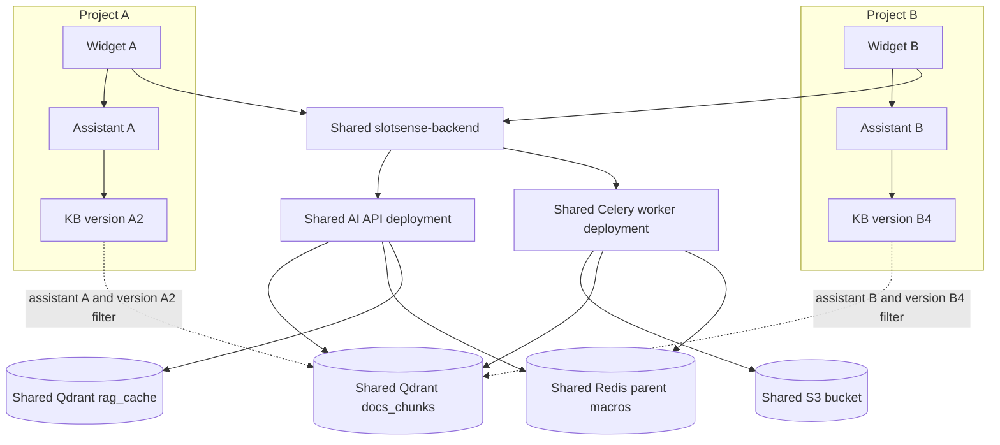
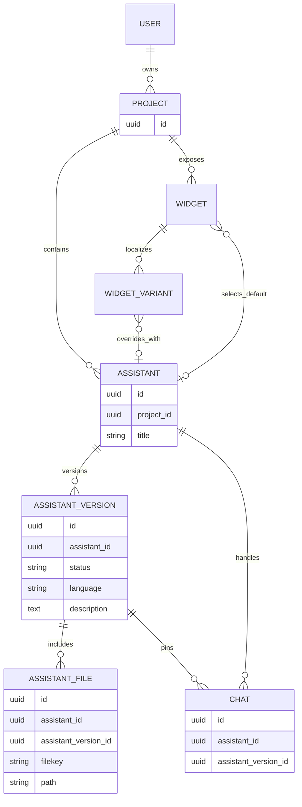
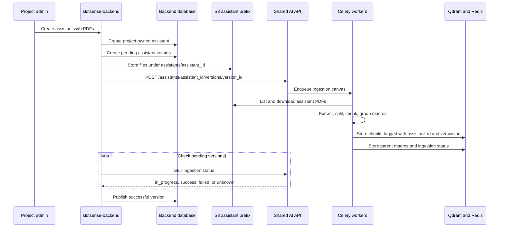
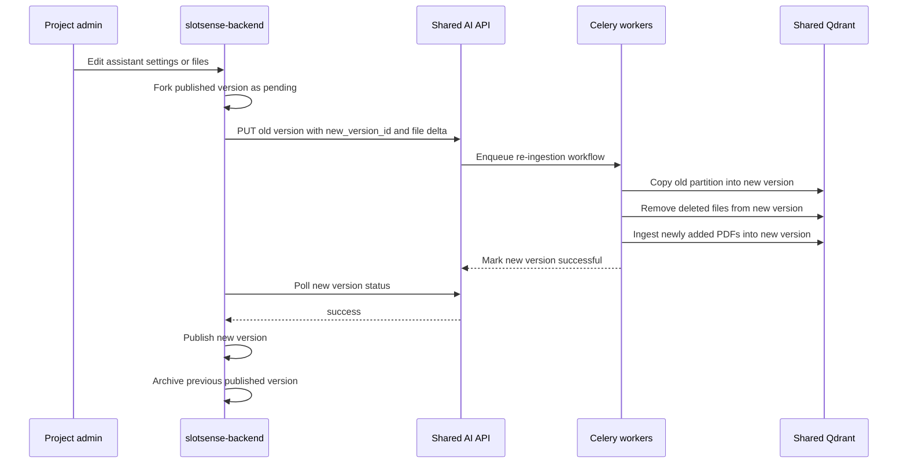
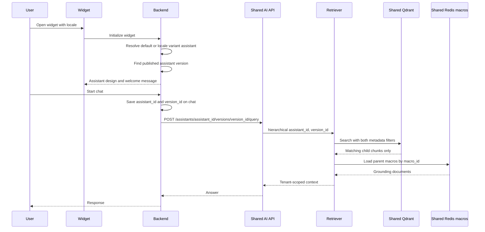
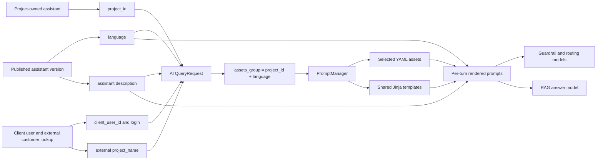
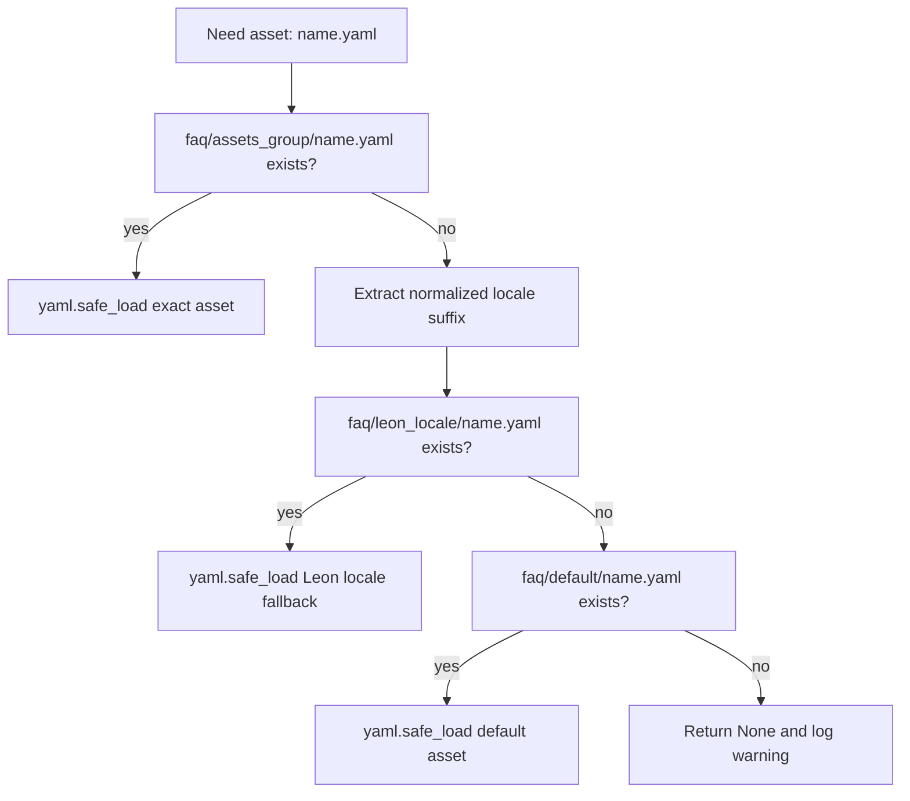
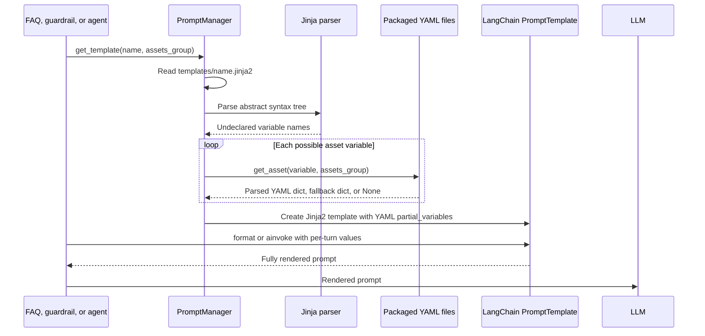
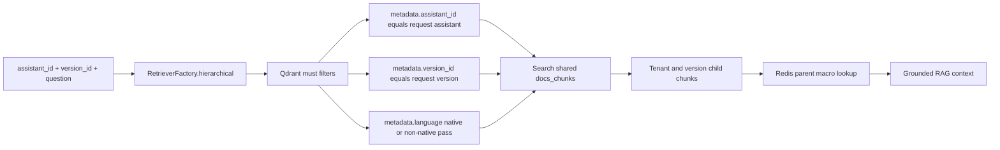
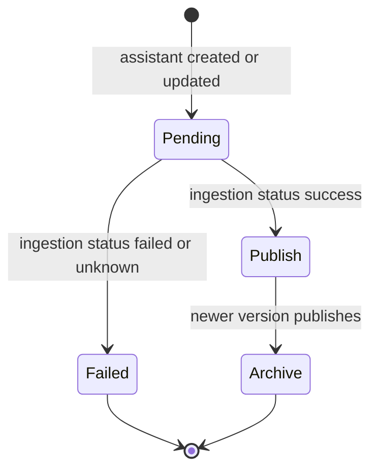

# Multi-Tenant Assistant and Knowledge-Base Architecture

**Status:** Code-grounded description of the current repositories
**Repositories inspected:** `slotsense-backend`, `slotsense-ai-assistant-new`, `slotsense-helm-charts`, and `slotsense-infrastructure`

## The Short Version

Slotsense does not deploy one AI service, pod, or vector collection for every customer assistant. It deploys one shared AI-assistant application per environment and treats each assistant as a logical, versioned knowledge partition.

The backend owns the tenancy hierarchy and release lifecycle:

```text
user -> project -> assistant -> assistant version -> assistant files
```

At runtime, the backend sends both `assistant_id` and `version_id` to the shared AI service. The retriever applies both values as Qdrant filters, so two assistants can use the same API pods, workers, embedding model, Qdrant collection, and Redis cluster without intentionally sharing knowledge.

The same request also carries the published assistant version's language and description, plus project and customer context. The AI service uses those values to assemble prompts from shared Jinja templates and packaged YAML assets at request time. This prompt-assembly axis is related to multi-tenancy, but it is separate from Qdrant knowledge isolation.

The architecture decision is therefore:

> Share compute and storage infrastructure, but partition knowledge and release state by `(assistant_id, version_id)`.

## What "Tenant" Means Here

There are several identifiers, and they do different jobs.

| Identifier | Owner | Meaning |
|---|---|---|
| `project_id` | Backend | Customer/project ownership boundary and prompt-assets namespace |
| `assistant_id` | Backend | A project-owned assistant with its own source files and knowledge identity |
| `version_id` | Backend | A publishable snapshot of an assistant's configuration and indexed KB |
| `chat_id` | Backend | A conversation instance, pinned to an assistant and version when created |
| `assets_group` | AI service | Prompt-asset lookup key computed as `<project_id>_<normalized language>`, with locale and default fallbacks |

`project_id` is the administrative tenant boundary. `assistant_id + version_id` is the retrieval boundary. They are related, but they are not interchangeable.

## Shared Deployment, Logical Isolation



The deployment evidence is straightforward:

- The Helm chart defines one `slotsense-ai-assistant-api` deployment and one `slotsense-ai-assistant-worker` deployment per environment.
- Argo CD defines one application for stage and one for production, not one application per assistant.
- Production horizontally scales the shared API and workers from two to five replicas.
- Tenant identity arrives in each request; it is not encoded in a tenant-specific process or hostname.

This keeps deployment count independent of the number of assistants. Adding an assistant creates database rows, source objects, and indexed vectors, not Kubernetes resources.

## Backend Ownership Model



The backend protects assistant administration through authenticated project routes such as:

```text
POST /v1/projects/{project_id}/assistants
POST /v1/projects/{project_id}/assistants/{assistant_id}
GET  /v1/projects/{project_id}/assistants
```

`AuthorizeProject` checks that the authenticated user owns the project. `AuthorizeAssistant` checks the assistant through its project's user relationship. Assistants are listed by `project_id`, and assistant names are unique only within a project.

The widget is the runtime selection layer. A widget has a default `chat_assistant_id`; a locale-specific widget variant can override it. This lets one project map, for example, its default experience to one assistant and a French variant to another without deploying either assistant separately.

## Creating and Publishing an Assistant



The first version is created as `pending`. Files are stored under the S3 prefix `assistants/{assistant_id}/`, and the backend calls the AI ingestion endpoint with the assistant and version IDs.

The worker stamps each child chunk with metadata including:

```text
assistant_id
version_id
language
doc_name
macro_id
```

The backend's `CheckAssistantVersionJob` polls Redis-backed ingestion status through the AI API. A successful pending version becomes `publish`; a failed one becomes `failed`. Publication happens only after indexing reports success.

## Updating Without Breaking the Live Assistant

An update creates a new partition instead of mutating the published partition in place.



This is a copy-on-version strategy:

- Existing vectors are copied from the old version to the new version.
- Removed files are excluded or deleted only from the new partition.
- New files are embedded into the new partition.
- The old published partition remains available until the new partition succeeds.
- On success, the backend publishes the new version and archives the old one.

Even an edit that changes only language, description, or design creates a new version. The re-ingestion workflow must still copy the old vectors. A previous short circuit reported success without copying them, which published an empty KB. Commit `e45bb1c` fixed that by treating every new version as a fresh Qdrant partition, even when the file delta is empty.

## Runtime Routing and Version Pinning



The chat row stores both `assistant_id` and `assistant_version_id` when the conversation starts. Later messages use the IDs stored on the chat, rather than looking up whichever version is currently published.

That creates an important rollout property:

> New chats receive the newly published KB; an existing chat remains pinned to the KB version with which it started.

This avoids changing the source of truth halfway through a conversation. It also makes a response reproducible: analytics can identify the exact assistant version used for the turn.

## Runtime Language, Client Context, and Prompt Assembly

Knowledge is selected by assistant and version. Prompt behavior is assembled from a different set of runtime values:



### 1. Where the runtime values come from

The backend does not ask the AI service to look up assistant configuration. It resolves the published version and sends the relevant values with every query.

| Runtime value | Backend source | AI use |
|---|---|---|
| `assistant_id` | Assistant selected by widget/chat | Qdrant knowledge filter, tracing, and agent state |
| `version_id` | Published version when chat starts; pinned on chat | Qdrant knowledge filter and cache partition |
| `language` | `AssistantVersion.language` | Response language, language-aware retrieval, translation, and prompt-asset lookup |
| `description` | `AssistantVersion.description` | Topic scope and the `assistant_description` block in the RAG prompt |
| `project_id` | `Assistant.project_id` | Computes `assets_group`; scopes Knowledge Center and other project data |
| `client_user_id` | Chat's client-user session | Ticket lookup, retention identity, and state |
| `client_user_login` | Backend customer lookup in ClickHouse | Preferred customer identity for procedure and retention integrations |
| `project_name` | Backend customer lookup in ClickHouse | External project slug/name for procedure and retention calls |

`StartChatAction` finds the published `AssistantVersion`, pins its ID to the chat, and places the version's `language` and `description` in the encrypted chat token. It separately derives `project_id` from the assistant. On later messages, `SendMessageAction` decrypts the token, reloads the chat, and reinserts `project_id` and `client_user_id` from backend-owned records before calling the AI service.

Both `AiAssistantApiClient::sendMessage` and `sendMessageStream` send the same prompt-related body fields:

```json
{
  "user_query": "...",
  "language": "pt_BR",
  "description": "...",
  "project_id": "<project UUID>",
  "client_user_id": "<client-user UUID>",
  "client_user_login": "<external login when found>",
  "project_name": "<external project when found>"
}
```

The route path carries `assistant_id` and `version_id`; `chat_id` is a query parameter. Streaming adds only `stream: true` to this contract.

One subtle distinction is important: the chat row's `locale` may prefer the incoming widget locale, but the AI payload shown above uses `AssistantVersion.language`. The checked path therefore treats response language as version configuration, not as a freely changing per-message chat locale.

### 2. Language normalization and the asset key

The AI `QueryRequest` normalizes the incoming language before computing the asset group:

```text
hyphen becomes underscore
pt_BR is preserved as a first-class regional locale
every other region suffix is removed
```

Examples from the current normalizer:

| Incoming language | Normalized language | Asset key with a project ID |
|---|---|---|
| `pt-BR` | `pt_BR` | `<project UUID>_pt_BR` |
| `en-AU` | `en` | `<project UUID>_en` |
| `ru-KZ` | `ru` | `<project UUID>_ru` |
| `tr` | `tr` | `<project UUID>_tr` |

`QueryRequest.assets_group` then returns:

```text
<project_id>_<normalized language>   when project_id is present
leon_<normalized language>          when project_id is absent
```

For user-facing Jinja variables, `PromptManager` separately maps language codes to names such as `English`, `Turkish`, `European Portuguese`, and `Brazilian Portuguese`. Unknown codes fall back to `English` in `get_language_name`.

### 3. The actual YAML lookup order

`PromptManager.get_asset(name, assets_group)` performs a per-file lookup, not an all-or-nothing directory load:



The precise order is:

1. `src/core/prompting/assets/faq/<assets_group>/<name>.yaml`
2. `src/core/prompting/assets/faq/leon_<locale>/<name>.yaml`
3. `src/core/prompting/assets/faq/default/<name>.yaml`

The `pt_BR` suffix is checked before a final underscore split so `<project UUID>_pt_BR` falls back to `leon_pt_BR`, not `leon_BR`. Commit `82fac96` added this multi-part-locale handling.

Because fallback happens for each asset file, a tenant pack can override only `company.yaml` and `topic_categories.yaml` while inheriting other files from its locale or `default`.

### 4. Which asset packs and YAML files exist

The current package contains 16 asset directories:

```text
default
leon_de        leon_el        leon_en-au     leon_en-in
leon_en-nz     leon_fr        leon_pt        leon_pt_BR
leon_ru        leon_ru-kz     leon_tr
twin_gr        twin_pt        twin_ru        twin_tr
```

Most groups contain the following files:

| YAML asset | What it controls | Example Jinja or code consumer |
|---|---|---|
| `company.yaml` | Customer-facing brand/company name | `{{ company.name }}` in RAG, routing, topic, vision, quiz, and ticket-prefill prompts |
| `slang.yaml` | Payment, betting, bonus, and account terminology | `{{ slang.slang }}` in `main_rag_system_prompt.jinja2` |
| `agent_descriptions.yaml` | Available agent keys and routing descriptions | Loop in `agent_routing.jinja2`; filtered at runtime when retention is unavailable |
| `escalation_criteria.yaml` | Classifier categories, descriptions, examples, and subcategories | Loop in `escalation_check.jinja2`; category list is re-read by `EscalationCheckGuardrail` |
| `topic_categories.yaml` | On-topic, off-topic, and first-touch scenario definitions | Loops in `topic_classification.jinja2`; direct lookup for scenario handling |
| `meaningless_messages.yaml` | Greeting, thanks, acknowledgement, closure, and similar categories | Loop in `meaningless_check.jinja2` |
| `predefined_responses.yaml` | Canned escalation, human-request, operator, off-topic, and insufficient-context text | `canned_*.jinja2` wrappers |
| `summary.yaml` | Topic, urgency, and issue-cost labels for history summaries | Loops in `history_summarization.jinja2` |
| `documentation.yaml` | Historical documentation link | Link use is currently disabled by `TopicGuardrail._get_documentation_link`, which returns an empty string |
| `link_categories.yaml` | Link-topic classification labels used during document persistence | `link_topic_classification.jinja2` with the `default` asset group |

`ticketing_topics.yaml` is different. It exists only in `default` and `leon_pt` in the inspected tree. `FAQService` loads it directly only when `TICKETING_ENABLED` is true, validates it with `TicketingTopicsConfig`, and treats invalid or missing data as no configured ticketing topic.

These YAML files are packaged with the AI application image. The backend does not upload or generate them when an assistant is created. Creating a new assistant creates database/version/file/vector state; adding a new prompt asset pack still requires files in the AI repository and an application deployment.

### 5. How YAML enters Jinja at runtime

`PromptManager.get_template()` implements the automatic binding:



The key convention is name matching. A template variable named `company` causes a lookup for `company.yaml`; `agent_descriptions` maps to `agent_descriptions.yaml`; `escalation_criteria` maps to `escalation_criteria.yaml`.

The parser actually treats every undeclared Jinja variable as a possible asset. Variables without a corresponding YAML file return `None` during preload and are supplied later by the call site. Templates containing runtime-only variables can opt out with `preload_assets=False`; the Knowledge Center article summarizer does this for `title` and `article_text`.

For the main RAG answer, prompt assembly has two stages:

1. `chat_prompt()` loads `main_rag_system_prompt.jinja2` and `main_rag_user_prompt.jinja2`, then binds YAML assets plus the human-readable language, resolved tone, and optional-live-support flag.
2. `HierarchicalRAG.prepare_rag_context()` invokes that prompt with the assistant description, retrieved PDF context, conversation history, current question, matched procedure case, Help Center articles, and source-availability flags.

The final model therefore receives a tenant-shaped composition rather than a tenant-specific source file:

```text
shared Jinja instructions
+ selected/fallback YAML brand and policy assets
+ assistant-version language and description
+ assistant/version-filtered knowledge context
+ chat history and current question
+ optional procedure and Help Center context
```

Guardrail and routing templates use the same mechanism. For example:

- `topic_classification.jinja2` receives localized `topic_categories` plus runtime description, language, and conversation;
- `escalation_check.jinja2` receives localized `escalation_criteria` plus the conversation;
- `agent_routing.jinja2` receives `agent_descriptions`, but FAQ code can remove the retention agent from that in-memory dict for a turn when retention is disabled or absent from history;
- canned templates dereference localized values from `predefined_responses.yaml`.

Both `get_asset` and `get_template` use bounded LRU caches. Their cache keys include `assets_group`, so a loaded `leon_tr/company.yaml` value is not intentionally reused as `leon_pt/company.yaml`. Rendering still happens with per-turn question, history, context, and assistant values.

### 6. What "client" does and does not select

There are three client-like concepts in the request, and only one participates in YAML lookup:

| Concept | Used for prompt asset selection? | Actual role |
|---|---|---|
| Backend `project_id` | Yes | Forms the first part of `assets_group` |
| External `project_name` | No | Procedure customer lookup and retention payload |
| `client_user_id` / `client_user_login` | No | Customer-specific tickets, procedures, and retention context |

LLM providers are also shared, not selected per tenant. The current dependency graph constructs one main OpenAI provider with a Gemini fallback and one guardrail OpenAI provider with a Gemini fallback for the shared `FAQService`. The YAML pack changes prompt content; it does not select a different model deployment for each client.

### 7. Verified prompt-asset reachability gap

The naming scheme and the packaged folders do not completely line up in the inspected code:

- backend project IDs are UUIDs;
- the standard query path computes `<project UUID>_<language>`;
- no UUID-named prompt-asset directories were found;
- the automatic second fallback is hard-coded to `leon_<language>`, not to `project_name_<language>`;
- `project_name` is available in the request but is not used by `QueryRequest.assets_group` or `PromptManager.get_asset`;
- only `pt_BR` preserves its region, so `en-au`, `en-in`, `en-nz`, and `ru-kz` collapse to base languages before lookup;
- the checked-in `twin_*` folders require an exact `assets_group` supplied by some caller, but no standard backend query mapping from a project UUID to `twin` was found.

Therefore, the repository supports this narrower claim:

> Runtime Jinja/YAML selection is implemented, and locale-specific Leon fallback is active for reachable normalized languages. The checked-in standard query path does not prove that every packaged brand/region directory is reachable for live assistant requests.

A stronger design would store an explicit immutable `prompt_asset_group` or `brand_key` on the project or assistant version, pass that value through the signed backend request, and validate it against a manifest. That would separate a durable brand identifier from both the internal project UUID and the external analytics `project_name`.

## How Retrieval Isolation Is Enforced

The active collection is shared: `docs_chunks`. Isolation is enforced through payload metadata and query filters.



`RetrieverFactory.hierarchical()` creates a base filter containing both IDs. `LanguageAwareRetriever` converts that base filter into Qdrant `FieldCondition` objects against `metadata.assistant_id` and `metadata.version_id`, then adds the language condition.

The filters are baked into a fresh `MultiVectorRetriever` for each retrieval pass. This is not incidental. LangChain was previously given the filters at `ainvoke()` time, but silently dropped those search arguments. The result was a search over the entire multi-tenant collection. Commit `1c5e9ac` moved the filters into retriever construction and restored tenant isolation.

The filtered fields also have Qdrant keyword payload indexes:

```text
metadata.assistant_id
metadata.version_id
metadata.language
metadata.doc_name
doc_name
```

This was added after large shared collections produced 14-19 second filtered searches and could return zero hits for small tenants even when their points existed. Commit `aa4338c` made index creation idempotent so existing collections heal on a later ingestion.

## Isolation by Storage Layer

| Layer | Shared resource | Isolation mechanism |
|---|---|---|
| Backend database | Shared tables | `project_id`, `assistant_id`, and foreign-key relationships |
| Assistant administration | Shared backend API | Authenticated project and assistant ownership checks |
| Widget routing | Shared widget service | Default or locale-variant `chat_assistant_id` |
| Source PDFs | Shared S3 bucket | `assistants/{assistant_id}/` prefix plus versioned file records |
| Child vectors | Shared Qdrant `docs_chunks` | `metadata.assistant_id + metadata.version_id` filters |
| Parent documents | Shared Redis namespace | Deterministic `macro_id` lookup; tenant identity is implicit in document identity |
| Ingestion state | Shared Redis | `ingestion_status:{assistant_id}:{version_id}` |
| Retrieval cache | Shared Qdrant `rag_cache` | Assistant/version metadata and scoped invalidation |
| Conversation | Shared chat tables and Redis | Globally unique `chat_id`; chat row pins assistant/version |
| Prompt assets | Shared application package | Per-file lookup by computed `assets_group`, then `leon_<locale>`, then `default` |

The prompt-assets namespace is a separate axis from KB isolation. The KB is selected by assistant/version. Prompt lookup starts from `project_id + language`, but the current packaged tree and fallback implementation mean that most standard backend requests use a reachable `leon_<locale>` or `default` pack unless a matching project-specific directory exists. Several assistants in one project still share the same computed prompt key while retaining different document knowledge.

## Version State Machine



The old published version is archived only after the new pending version succeeds. That is the release gate. It converts ingestion from a destructive maintenance operation into a versioned deployment of data. Retrying after failure creates another pending version rather than changing the failed record back to pending.

## Incidents That Shaped the Design

The strongest interview story is not that the partitioning was obvious from day one. It is that production failure modes clarified which invariants had to become explicit.

| Incident | Root cause | Architectural lesson | Resulting change |
|---|---|---|---|
| Cross-assistant retrieval risk | LangChain ignored filters passed at invocation time | Tenant filters must live where the vector search object is constructed | Build a fresh retriever with assistant/version filters baked in (`1c5e9ac`) |
| Small tenant appeared to have an empty KB | Shared Qdrant collection lacked keyword indexes on filter fields | Logical partitioning also requires physical index support | Idempotently create payload indexes during ingestion (`aa4338c`) |
| Settings-only edit published an empty KB | New version was marked successful without copying old vectors | A version is a complete data snapshot, not just a file delta | Always copy the old partition to the new version (`e45bb1c`) |
| Re-ingestion returned stale duplicates | Full ingestion appended chunks to an existing version partition | Re-ingestion must be idempotent | Delete exactly `(assistant_id, version_id)` before rebuilding (`1be11c9`) |

These changes reveal the architecture more clearly than a component diagram alone: isolation, indexing, publication, and idempotency are all parts of the same multi-tenant contract.

## Why This Design Was Chosen

### 1. Shared compute keeps operations bounded

Per-assistant deployments would multiply API pods, workers, secrets, health checks, rollouts, and idle capacity. In this design, API and worker replicas scale with total traffic while assistant count mostly affects stored data.

### 2. Assistant and version form a natural composite partition

`assistant_id` separates knowledge domains. `version_id` separates releases of the same domain. Filtering on only one would be insufficient: assistant-only filtering could mix archived and published content, while version-only filtering would rely on version IDs being globally correct everywhere.

### 3. Publishing data is treated like deploying code

A new KB is built in a pending partition, checked asynchronously, and promoted only after success. The previous partition remains available as the stable release during ingestion.

### 4. Conversations are reproducible

Pinning a chat to a version prevents a KB switch halfway through a support exchange and gives analytics an exact version dimension.

### 5. Prompt composition is late-bound

The application image contains shared Jinja templates and YAML policy/persona packs. Language, assistant description, project identity, retrieved context, and conversation state are bound when a turn executes. This avoids compiling or deploying one prompt implementation per assistant while still allowing localized behavior.

### 6. Isolation belongs at the lowest reliable layer

Passing IDs through route parameters is not enough. The retrieval filter must be present on the actual Qdrant search. The historical LangChain bug is evidence for putting the invariant close to the storage operation and testing it there.

## Honest Gaps and Hardening Work

The current implementation is logically multi-tenant, but it is not yet a complete zero-trust tenant boundary.

### AI service authorization

The inspected FastAPI query and ingestion routes accept caller-supplied `assistant_id` and `version_id` without an authentication dependency. The Helm ingress is internet-facing. The backend is intended to be the trusted caller, but the AI service itself does not verify that a requested version belongs to the assistant or project.

A stronger boundary would add service authentication and an authorization claim or backend lookup tying together `project_id`, `assistant_id`, and `version_id`.

### Widget-to-assistant project invariant

The widget create path includes project authorization, and the widget routes are authenticated. However, the inspected create, update, and variant request rules only check that `chat_assistant_id` exists; they do not constrain that assistant to the widget's project. The cross-entity invariant should be enforced explicitly rather than inferred from route context.

### Redis parent-document namespace

Qdrant isolation is explicit. Redis parent macros are fetched by `macro_id` from one shared namespace. Macro IDs are deterministically derived from document identity, page, and heading, so collision avoidance is implicit rather than expressed as a tenant filter.

A stricter key shape would include assistant and version identity, or validate the parent document's metadata before using it.

### Prompt asset identity

Prompt asset selection is not an authorization boundary, and the current fallback is Leon-specific. Project UUID, external project name, and packaged brand folder are separate identifiers without one explicit checked mapping. A project can therefore receive fallback prompt behavior even while its Qdrant knowledge remains correctly isolated.

An explicit versioned `prompt_asset_group`, validated by the backend and AI service, would make brand and locale selection reproducible alongside `assistant_id` and `version_id`.

### Complete deletion

The current assistant-deletion worker deletes assistant-filtered Qdrant points. Its docstring also mentions S3 cleanup, but the inspected implementation does not delete the S3 prefix or Redis parent macros. Lifecycle deletion should cover every store and be verifiable as one operation.

These are not reasons to discard the shared architecture. They identify where logical multi-tenancy should be strengthened into defense in depth.

## Interview Answer

> We chose shared compute with logical tenant partitions rather than deploying one AI stack per assistant. The backend owns projects, assistants, versions, files, and publication. Creating or editing an assistant builds a pending KB partition asynchronously; only a successful partition becomes published, and the old version remains live until then. A new chat is pinned to that published version, and every AI request carries the assistant and version IDs. The RAG retriever applies both as indexed Qdrant filters against a shared collection.
>
> Language, description, project, and customer context are passed separately. The AI computes a prompt asset key, loads YAML policy and persona data with per-file locale/default fallbacks, and injects those values into shared Jinja templates alongside per-turn retrieval context. This keeps prompt code shared while behavior is late-bound. A code review also exposed that project UUIDs, external project names, and packaged brand folders are not yet tied together by one explicit mapping, so I would version a validated `prompt_asset_group` with the assistant rather than infer brand identity through fallbacks.
>
> The important learning was that adding metadata is not the same as enforcing isolation. We had a LangChain integration path that dropped invocation-time filters, so we moved the filter into retriever construction. We also added payload indexes because small tenants in a large collection could time out or appear empty, made re-ingestion idempotent, and fixed settings-only updates so they copy the old KB into the new version. The design now treats a knowledge-base release much like a code deployment: build separately, verify, publish atomically, and preserve version identity for active conversations.

## Code Evidence

Backend ownership and publication:

- `slotsense-backend/app/Containers/AppSection/Assistant/Models/Assistant.php`
- `slotsense-backend/app/Containers/AppSection/Assistant/Models/AssistantVersion.php`
- `slotsense-backend/app/Containers/AppSection/Assistant/Actions/CreateAssistantAction.php`
- `slotsense-backend/app/Containers/AppSection/Assistant/Actions/UpdateAssistantAction.php`
- `slotsense-backend/app/Containers/AppSection/Assistant/Jobs/CheckAssistantVersionJob.php`
- `slotsense-backend/app/Containers/AppSection/Project/Traits/AuthorizeProject.php`
- `slotsense-backend/app/Containers/AppSection/Assistant/Traits/AuthorizeAssistant.php`

Widget selection and chat version pinning:

- `slotsense-backend/app/Containers/ClientSection/Widget/Actions/SubActions/GetWidgetSettingsSubAction.php`
- `slotsense-backend/app/Containers/ClientSection/ChatClient/Actions/StartChatAction.php`
- `slotsense-backend/app/Containers/ClientSection/ChatClient/Actions/SendMessageAction.php`
- `slotsense-backend/app/Containers/ClientSection/ChatClient/Tasks/SendMessageToAITask.php`
- `slotsense-backend/app/Containers/IntegrationSection/AiAssistant/Services/AiAssistantApiClient.php`

Runtime language and prompt assets:

- `slotsense-ai-assistant-new/src/api/schemas/query.py`
- `slotsense-ai-assistant-new/src/api/schemas/_language.py`
- `slotsense-ai-assistant-new/src/core/utils.py`
- `slotsense-ai-assistant-new/src/core/prompting/service.py`
- `slotsense-ai-assistant-new/src/core/prompting/templates/*.jinja2`
- `slotsense-ai-assistant-new/src/core/prompting/assets/faq/*/*.yaml`
- `slotsense-ai-assistant-new/src/core/agents/rag.py`
- `slotsense-ai-assistant-new/src/core/guardrails/topic.py`
- `slotsense-ai-assistant-new/src/core/guardrails/escalation_check.py`
- `slotsense-ai-assistant-new/src/core/faq_service.py`

AI ingestion and retrieval isolation:

- `slotsense-ai-assistant-new/src/api/v1/endpoints/ingestion.py`
- `slotsense-ai-assistant-new/src/core/workflows/ingestion.py`
- `slotsense-ai-assistant-new/src/core/workflows/reingestion.py`
- `slotsense-ai-assistant-new/src/processing/ingestion/persister.py`
- `slotsense-ai-assistant-new/src/core/retrieval/factory.py`
- `slotsense-ai-assistant-new/src/workers/tasks/ingestion/copy_embeddings.py`
- `slotsense-ai-assistant-new/src/workers/tasks/ingestion/delete_version.py`

Shared deployment:

- `slotsense-helm-charts/slotsense-ai-assistant/templates/deployment-api.yaml`
- `slotsense-helm-charts/slotsense-ai-assistant/templates/deployment-worker.yaml`
- `slotsense-helm-charts/slotsense-ai-assistant/templates/hpa-api.yaml`
- `slotsense-helm-charts/slotsense-ai-assistant/templates/hpa-worker.yaml`
- `slotsense-infrastructure/argocd-applications/prod/slotsense-ai-assistant.yaml`
