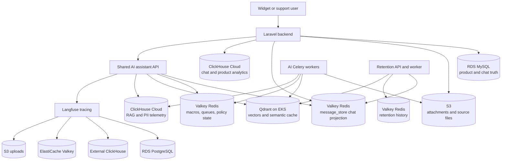
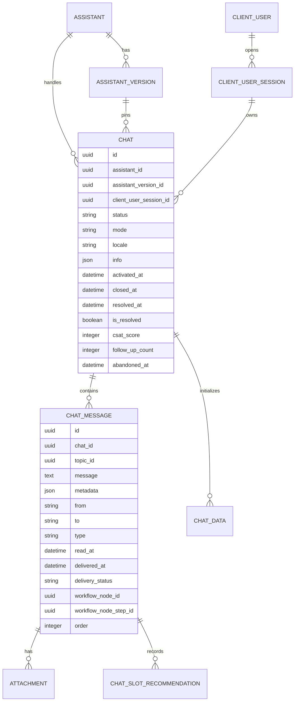
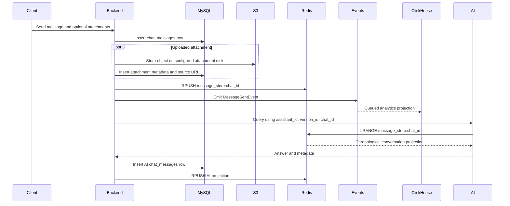

# Database and Storage Architecture

**Status:** Code-grounded description of the checked-in runtime and infrastructure  
**Repositories inspected:** `slotsense-backend`, `slotsense-ai-assistant-new`, `slotsense-rnd-retention-ai`, `slotsense-helm-charts`, and `slotsense-infrastructure`

## The Short Answer

The core Slotsense backend does **not** use PostgreSQL as its transactional database. It uses **MySQL 8.4 on AWS RDS**. PostgreSQL is deployed for supporting products, most importantly Langfuse, but it is not where the backend stores chats.

The chat and AI system is deliberately polyglot:

| Store | Primary role in chat and AI |
|---|---|
| MySQL on RDS | Durable product state: assistants, versions, users, chats, messages, resolution, CSAT, workflow references, attachment metadata |
| Valkey/Redis on ElastiCache | Active transcript projection, RAG parent documents, queues, ingestion status, short-lived escalation and PII state, retention history |
| ClickHouse Cloud | Append-oriented chat analytics, topic analytics, user events, RAG performance and quality metrics, and PII audit counts |
| Qdrant on EKS | Knowledge chunks, semantic cache, game slots, knowledge-center articles, high-quality support conversations, and retention videos |
| Amazon S3 | Source PDFs, uploaded media, chat attachments, and service artifacts |
| PostgreSQL on RDS | Langfuse and other non-core applications; not the main chat database |

The architectural rule visible in the code is:

> Put authoritative business state in MySQL, active and reconstructable state in Redis, similarity-search data in Qdrant, analytical projections in ClickHouse, and large binary/source objects in S3.

## Evidence Labels

This document uses three evidence levels so deployment wiring is not guessed from variable names.

| Label | Meaning |
|---|---|
| **Confirmed** | The checked-in application code and infrastructure definition agree on the behavior |
| **Secret-wired** | The code expects a runtime URL, bucket, or credential from AWS Secrets Manager, but the secret value is not in Git |
| **Present, not active** | A schema or implementation exists, but no current in-repository producer call was found |

For example, two Qdrant installations are defined in Helm. The retention application's actual `QDRANT_URL` is secret-wired, so the repository does not prove which installation that URL targets. The document states both facts instead of choosing an endpoint by assumption.

## Storage Topology



The diagram is logical. `SharedChat`, `AIMemory`, and `RetentionState` may resolve to one or more physical Valkey endpoints through secrets. The checked-in code proves the key contracts; it does not expose the production secret values needed to prove every endpoint mapping.

## Source-of-Truth Matrix

| Data | Authoritative store | Derived or hot copies | Lifecycle |
|---|---|---|---|
| Chat identity, state, mode, resolution, CSAT | MySQL `chats` | ClickHouse `chat_analytics` | Durable product record |
| Visible chat messages | MySQL `chat_messages` | Redis `message_store:{chat_id}`; selected high-quality chats may enter Qdrant | Redis projection is deleted when the chat closes |
| Chat topics and topic resolution analytics | ClickHouse `chat_topic_analytics` | `chat_messages.topic_id` keeps a loose identifier | ReplacingMergeTree versions by `updated_at` |
| Message delivery/read events | MySQL timestamps on the message | ClickHouse `user_events` | Append-only event projection |
| Assistant source PDFs | S3 `assistants/{assistant_id}/...` on the configured assistant disk | MySQL assistant-file/version records | Versioned by backend records and prefixes |
| RAG child chunks | Qdrant `docs_chunks` | Source remains in S3 | Partitioned by assistant and version metadata |
| RAG parent macros | Redis namespace `slotssense_macros` | Rebuildable from source ingestion | No TTL is configured in the store factory |
| Retrieval cache | Qdrant `rag_cache` | None | Versioned payload schema; explicitly invalidated |
| Escalation counters and latches | Redis | None | Explicit 15-minute to 3-hour TTLs |
| PII restoration mapping | Redis `pii_mapping:{request_id}` | ClickHouse stores audit counts, not raw mappings | Redis TTL defaults to 2 hours; audit TTL is 365 days |
| AI request metrics | ClickHouse `rag_realtime_metrics` | Langfuse trace is separate | 365-day ClickHouse TTL |
| Retention interaction memory | Redis `retention_history:{customer_id}:{objective}` | None | Bounded by list length, not key TTL |
| Retention greeting timestamp | Redis `last_retention_message_at:{customer_id}` | None | 30-day TTL |

## 1. MySQL: Durable Backend and Chat State

### What proves it is MySQL

Laravel defaults `DB_CONNECTION` to `mysql`. The production Terraform service named `backend` creates an RDS instance with:

```text
engine: mysql
engine_version: 8.4.5
instance_class: db.m7g.xlarge
storage: 50 GiB gp3
multi_az: false
backup_retention: 7 days
deletion_protection: true
performance_insights: true
```

Stage uses MySQL 8.4.10 on `db.t3.small`, 35 GiB gp3, no retained backups, and no deletion protection.

The RDS module places instances in private subnets, disables public access, encrypts storage, and asks AWS to manage the master password in Secrets Manager. The shared RDS security group permits MySQL and PostgreSQL from the VPC. It also contains a checked-in temporary all-traffic rule for a peered `172.31.0.0/16` VPC, marked with a TODO to remove after migration.

### What goes into the backend database

The backend database covers much more than AI. Briefly, it contains projects, users, assistants, assistant versions and file records, widgets and variants, workflows, integrations, catalogs, attachments, and chat operations.

For the chat path, the important tables are:



### `chats`: conversation control state

The `Chat` model is the durable control record. It stores:

- the assistant and exact assistant version used by the conversation;
- the client-user session;
- lifecycle timestamps such as activation, resolution, abandonment, and closure;
- `status` and `mode` as separate concepts, allowing an active chat to move between AI and human-operator modes;
- locale and free-form `info` JSON;
- ticketing-system connection and synchronization state;
- follow-up counters and timestamps;
- `is_resolved` and `csat_score`.

Version pinning is a storage decision, not only a routing choice. Because `assistant_version_id` is stored on the chat, a conversation continues against the KB version with which it started even after a newer assistant version publishes.

### `chat_messages`: durable transcript and delivery record

Each visible turn is stored as a `chat_messages` row with message text, sender, recipient, message type, and JSON metadata. Delivery fields (`read_at`, `delivered_at`, and `delivery_status`) support channel delivery semantics. Workflow node and step IDs connect a turn to deterministic workflow execution. `account_id` and ticketing IDs connect messages to external channels.

The model installs a global order by `created_at` and then `order`, avoiding ambiguous order when several messages share a timestamp.

`topic_id` is intentionally no longer a relational foreign key. A migration says why: topics moved to ClickHouse, so MySQL can retain the identifier but cannot enforce a foreign key into another database engine.

### `chat_data`: an initialized but largely dormant history field

Starting a chat creates a `chat_data` row with `chat_id`, `last_read`, and a nullable long-text `history`. A `SaveChatHistoryTask` can update that history field, but no current application call site for that task was found. The active AI conversation contract is the Redis `message_store` list, not `chat_data.history`.

That distinction prevents an easy documentation error: a table existing in a migration does not make it the active conversation-memory implementation.

## 2. One Chat Turn Across the Stores



`HandleChatMessageTask` establishes the write order:

1. `CreateMessageTask` inserts the durable MySQL row.
2. Attachments are uploaded and their metadata is related to the message.
3. `AddRedisChatHistoryTask` appends a JSON projection with `RPUSH`.
4. `MessageSentEvent` is emitted for realtime delivery and queued analytics.

This is not a distributed transaction. A MySQL write can succeed before Redis or analytics fails. The advantage is that analytics and AI-memory infrastructure do not have to participate in the main relational commit. The cost is eventual consistency and the need to understand which store can be rebuilt.

## 3. Redis/Valkey: Shared Transcript and Operational Memory

### Physical hosting

Terraform uses AWS ElastiCache **Valkey 8.1**, not a Redis pod in Kubernetes. Each named service gets a private replication group with encryption at rest and transit encryption enabled in `preferred` mode.

The current production topology is cost-optimized rather than highly available:

| Service | Production node | Replicas / failover | Snapshots |
|---|---:|---|---|
| Backend | `cache.m7g.2xlarge` | One node; automatic failover off; Multi-AZ off | 0 days |
| AI assistant | `cache.t3.medium` | One node; automatic failover off; Multi-AZ off | 0 days |
| Langfuse | `cache.t3.small` | One node; automatic failover off; Multi-AZ off | 0 days |
| AL Quiz | `cache.t3.medium` | One node; automatic failover off; Multi-AZ off | 0 days |
| Centrifugo | `cache.t3.micro` | One node; automatic failover off; Multi-AZ off | 0 days |

The backend Valkey group enables engine and slow logs with 30-day CloudWatch retention. Stage uses smaller node classes and the same single-node, no-snapshot posture.

### Backend logical databases

Laravel configures several logical Redis connections:

| Connection | Default DB | Purpose visible in code |
|---|---:|---|
| `default` | 0 | General backend state |
| `cache` | 0 | Laravel cache |
| `queue` | 1 | Backend queues |
| `ai` | 2 | Shared transcript; prefix explicitly disabled |
| `triggers` | 3 | Trigger and user-event processing |

These are defaults. Hosts, ports, schemes, and DB numbers can be overridden through environment secrets.

### Shared transcript contract

The backend appends to:

```text
message_store:{chat_id}
```

using `RPUSH`, so `LRANGE 0 -1` returns chronological order. The stored JSON contains message content, sender, recipient, message type, the selected agent from metadata, and attachment source URLs.

Both the assistant and retention services read this backend-owned list. Their readers normalize older role shapes and turn metadata into prompt-visible annotations for slot cards, quizzes, videos, quick replies, handoff actions, and randomizers.

There is no TTL in `AddRedisChatHistoryTask`. Instead, `CloseChatByIdTask` explicitly deletes `message_store:{chat_id}` before marking the chat closed. MySQL retains the durable transcript after that deletion.

No automatic MySQL-to-Redis transcript rehydration path was found. The data is recoverable in principle from `chat_messages`, but the checked-in runtime does not show a reconciliation job that rebuilds a missing active list.

### AI operational keys

The assistant uses Redis for deterministic state that must survive API-pod changes:

| Key | Meaning | TTL |
|---|---|---:|
| `frustration_counter:{session}` | Repeated-frustration evidence | 3 hours |
| `abuse_counter:{session}` | Repeated-abuse evidence | 3 hours |
| `optional_handoff_offered:{session}` | One-time optional live-support offer claim | 15 minutes |
| `human_request:{session}` | Distinguishes first from repeated human request | 1 hour |
| `pii_mapping:{request_id}` | Token-to-original mapping for response restoration | Default 2 hours |
| `ingestion_status:{assistant_id}:{version_id}` | Worker status polled during publication | No TTL configured |

The optional-handoff key uses Redis `SET` with `NX` and expiry, making the first claim atomic across API replicas. These keys are intentionally ephemeral; losing them changes short-term policy memory, not the durable chat record.

### RAG parent documents in Redis

The ingestion worker stores larger parent macros in a LangChain `RedisStore` namespace named `slotssense_macros`, keyed by deterministic `macro_id`. Qdrant stores smaller child chunks that reference those macro IDs.

At query time:

1. Qdrant finds semantically similar child chunks.
2. The retriever extracts each child's `macro_id`.
3. Redis returns the larger parent macro given to the model.

This is the small-to-big retrieval design. It keeps vector search granular while giving the LLM more complete source context.

The Redis store factory does not configure a TTL. Because the production Valkey definition has no snapshots and one node, parent-macro loss is an operational risk. The retriever now logs `PARENT_DOC_GAP` when children exist in Qdrant but none of their parent macros exist in Redis. Source PDFs and ingestion code can reconstruct the macros, but no transparent per-request rebuild is shown.

### Retention-specific Redis state

Retention has no checked-in SQL database integration. It uses Redis for:

- the shared `message_store:{chat_id}` transcript;
- `retention_history:{customer_id}:{objective}`, a newest-first list of trigger, action, next triggers, and timestamp;
- `last_retention_message_at:{customer_id}`, which gates the once-per-login greeting.

Retention history is bounded with `LTRIM` to twice the configured read limit, but the key itself has no expiry. The greeting timestamp expires after 30 days. Stateless evaluation paths explicitly skip these Redis writes to keep test runs reproducible.

## 4. S3: Source and Binary Objects

### Assistant knowledge files

The backend defines a separate `s3_assistants` disk. Assistant PDFs are stored under `assistants/{assistant_id}/...`. Assistant version and file rows in MySQL identify which objects belong to a pending or published version. Celery ingestion workers download the objects, extract and chunk them, then persist derived data to Qdrant and Redis.

The disk's bucket and credentials come from `ASSISTANT_AWS_*` environment variables. The checked-in production Terraform bucket list does not contain a bucket literally named `assistants`, so the exact production bucket behind `ASSISTANT_AWS_BUCKET` is **secret-wired**, not provable from Git.

### Chat attachments

For a chat upload, the backend stores the bytes on the configured attachment disk, inserts attachment metadata with polymorphic `chatMessage` ownership, generates a source URL, and places only that URL in the Redis transcript projection.

The attachment config defaults `FILESYSTEM_DISK` to `s3`, but the actual production `AWS_BUCKET` value is secret-wired. Terraform defines private encrypted `backend-media` and `chats` buckets and grants the backend IRSA role access to both. The secret is required to prove which one the default disk selects.

### Provisioned buckets

Production Terraform creates `chats`, `backend-media`, `al-projects-catalogs`, `langfuse-uploads`, and `loki`. Stage also creates `mlflow-artifacts`. All buckets block public access and use S3-managed AES-256 server-side encryption. No bucket versioning or lifecycle rule appears in the inspected S3 module.

## 5. Qdrant: Knowledge and Similarity Data

### Hosting

Qdrant is self-hosted on EKS through Argo CD and Helm, not purchased as Qdrant Cloud in the inspected configuration.

Production defines two installations:

| Installation | Namespace / hostname | Replicas | Persistent volume |
|---|---|---:|---|
| Main Qdrant | `slotsense-qdrant` / `qdrant.slotsense.ai` | 2 | 10 GiB gp3 per replica, auto-resizable to 50 GiB |
| Retention Qdrant | `slotsense-qdrant-retention` / `qdrant-retention.slotsense.ai` | 2 | 10 GiB gp3 per replica, auto-resizable to 50 GiB |

Both use an API key loaded from AWS Secrets Manager, a PodDisruptionBudget with `maxUnavailable: 1`, and a startup probe with roughly five minutes of recovery budget for cold EBS collection recovery.

The retention service uses one `QDRANT_URL` for both game-slot reads and its video index, and receives that URL through a secret. Therefore the code proves that both installations exist, but not whether the retention runtime points to the main installation or the retention installation.

### Assistant collections

The assistant settings list these collections:

| Collection | What current code stores |
|---|---|
| `docs_chunks` | Active PDF micro-chunks with assistant, version, language, document, page, and `macro_id` metadata |
| `docs_summaries` | Still listed for cleanup compatibility; the current persister says it is no longer produced because the summarization stage was removed |
| `rag_cache` | Retrieval context and article context, scoped by assistant, version, language, project, exact history hash, cache kind, and schema version |
| `game_slots` | Embedded game-slot catalog used by game recommendations and read directly by retention |
| `golden_support_chats` | Selected high-quality human-support conversations, including conversation text and assistant/version/chat metadata |
| `knowledge_center_articles` | Project- and locale-scoped article text, summaries, categories, ordering, and source metadata |

The active document collection is shared across tenants. Isolation is enforced by payload filters on `metadata.assistant_id` and `metadata.version_id`. The ingestion code creates keyword indexes for assistant, version, language, and document-name fields to make those filtered searches reliable in a large shared collection.

### Child vector payload and parent lookup

Each `docs_chunks` point contains the chunk text plus metadata propagated through extraction, structural splitting, and chunking. Important fields include:

```text
assistant_id
version_id
language
doc_name
doc_id
page
heading_id
macro_id
```

Only `docs_chunks` is declared versioned in `QDRANT_VERSIONED_COLLECTIONS`. Re-ingestion deletes the exact assistant/version partition before rebuilding it. Version updates can copy the old partition to a new version and then apply file changes.

### Retrieval cache contents and privacy boundary

`rag_cache` does not store a generated final answer. It stores reusable retrieval output:

- retrieved document context;
- knowledge-center article context and article IDs;
- assistant, version, language, and project identity;
- an exact hash of prior conversation state;
- cache kind and schema version;
- cache timestamp.

The raw question is represented by its embedding and is not copied into the payload. Raw conversation history is represented by a truncated SHA-256 hash, not stored as payload text. Exact partition filters and a high similarity threshold guard against cross-chat and cross-tenant reuse. The configured mode currently defaults to `SHADOW`, meaning lookup quality can be measured before serving cached context.

### Golden support chats are a derived knowledge store

The knowledge-mining job fetches backend chats that were transferred to a human and contain at least two support messages. It keeps human and support turns, scores conversation quality, deduplicates semantically within an assistant/version partition, and stores successful examples in `golden_support_chats`.

Unlike the retrieval cache, this payload includes conversation text, truncated to 50,000 characters. It is therefore a derived knowledge asset with a different privacy profile from ordinary vectors and should not be described as merely anonymous performance telemetry.

### Retention collections

Retention uses Qdrant for two concrete features:

- It reads the assistant-owned `game_slots` collection directly, filtered by the project/assets-group identity. This removed a service call cycle in which assistant called retention and retention called assistant again.
- It manages `avatar_videos`, one point per backend video. The vector is an embedding of the transcription; payload includes video ID, project ID, URL, transcription, language, situation tags, and tag-schema version.

The video index creates keyword indexes for `project_id` and `language`. A code comment records the reason: the missing language index forced full scans and contributed to Qdrant 500s, after which the feature silently fell back to text.

## 6. ClickHouse: Analytics, Not the Chat Transaction Store

### Hosting

The infrastructure does not deploy a ClickHouse StatefulSet or EC2 instance. Monitoring config names ClickHouse Cloud services and scrapes `api.clickhouse.cloud`. Production monitors:

```text
backend-analytics-prod
ai-analytics-shared
```

Stage monitors `backend-analytics-stage`. Credentials are read from an AWS Secrets Manager entry named for `clickhouse-cloud`. This is strong checked-in evidence that these analytics databases are hosted in **ClickHouse Cloud**.

### Backend chat analytics

The backend writes analytical projections rather than raw authoritative messages into two main tables.

#### `chat_analytics`

One logical record per chat contains:

- assistant, assistant version, project, client user, and locale dimensions;
- start, first AI response, team transfer, and close timestamps;
- AI and human message counts;
- transfer and fallback-email flags;
- conversation duration;
- CSAT score, comment, and submission timestamp.

The table uses `ReplacingMergeTree(updated_at)`, partitioned by the start month and ordered by chat/start identity. Updates insert a newer row; queries deduplicate with newest `updated_at` semantics.

#### `chat_topic_analytics`

One logical record per chat topic contains:

- topic key and AI-generated title;
- open, pending-confirmation, or resolved status;
- start and resolution timestamps and source;
- AI and human message counts;
- escalation flag, escalation type, specific-topic type, and manual redirect;
- free-form metadata.

This table also uses `ReplacingMergeTree(updated_at)`. Moving topic state here explains why MySQL dropped the `chat_messages.topic_id` foreign key.

#### How writes are triggered

Chat-start and message-sent listeners run on `analytics-queue`. A chat start creates the initial analytics row. Each human or AI message reads the current latest record and inserts an updated count; the first AI turn sets `first_ai_response_at`.

The ClickHouse repository suppresses recognized network/connection failures but rethrows query and data errors. That makes availability failures non-fatal to chat processing while still exposing schema/programming errors.

### Backend user and product events

`user_events` is a general append-only MergeTree for event type, user/client user, widget, fingerprint, chat, message, workflow node/step/option, slot, video, project, metadata, and creation time. A `ChatMessageObserver` writes delivered/read events when MySQL message timestamps change.

Other backend ClickHouse tables cover FAQ events, workflows, and quiz analytics. These are relevant to the product analytics platform but secondary to the chat and AI storage story.

`faq_events`, for example, records project, widget, article, category, client user, fingerprint, reaction, locale, event type, and timestamp. It replaced separate FAQ view and feedback tables.

### AI real-time metrics

When ClickHouse host and database settings are present, the active assistant query path writes `rag_realtime_metrics`. It records:

| Category | Examples |
|---|---|
| Identity | event, chat, assistant, version, user, session, trace |
| Privacy-friendly query summary | language, detected language, question length, answer length |
| Cache | hit, similarity, threshold, miss reason |
| Retrieval | documents retrieved, retrieval time, empty context, documents after rerank |
| Latency | end-to-end, cache, transform, guards, retrieval, reranker, LLM, cache store |
| Errors/load | error flag, stage, type, truncated message, concurrent requests |
| RAGAS | faithfulness, response relevancy, context relevance, groundedness |
| Assistant outcome | topic, operator/human request, resolved, escalation reason, situation class, dissatisfaction, selected agent |

The table is a `MergeTree` ordered by creation time, assistant, and version with a 365-day TTL.

Normal non-handoff turns are sent to a Celery analytics task, which calculates RAGAS scores and then inserts the metrics. Error and human-handoff paths write metrics directly so they are not skipped simply because RAGAS is not run.

The `RagRtMetrics` in-memory object also carries vision and procedure fields. The ClickHouse create/insert column list does not currently persist those extra fields. The code explicitly notes that procedure metrics remain in memory and Langfuse until a matching ClickHouse migration exists.

### `rag_analytics`: schema present, active producer not found

`AnalyticsService` can create and insert a second table named `rag_analytics` containing raw question, answer, model, token, cost, escalation, and response data with a one-year TTL. However, no current call site constructing `RAGAnalyticsEvent` or invoking `track_event` was found outside its own module.

Therefore:

> `rag_analytics` is **present, not active** in the checked-in request path; `rag_realtime_metrics` is the confirmed active AI ClickHouse write.

### PII audit storage

Sanitization deliberately splits restoration data from audit data:

- Redis temporarily stores the original PII mappings needed to restore a response.
- ClickHouse `pii_audit_log` stores event ID, request/chat/assistant/version identity, status, counts, severity counts, categories, latency, and error.
- `mappings_json` remains in the schema for compatibility, but current code writes the literal string `"null"` and does not persist raw token-to-original mappings.

`pii_audit_log` has a 365-day TTL. This is a concrete privacy decision: durable analytics record what classes of PII were detected, while raw restoration material stays in short-lived Redis.

## 7. PostgreSQL: Where It Is Actually Used

Terraform provisions PostgreSQL RDS instances for supporting services:

| Environment | Service | Engine | Purpose visible from deployment |
|---|---|---:|---|
| Production | Langfuse | PostgreSQL 17.6 | Langfuse application database |
| Production | AL Quiz | PostgreSQL 17.6 | Separate quiz application |
| Production | Nonsense Casino | PostgreSQL 17.6 | Separate application |
| Stage | Langfuse | PostgreSQL 17.6 | Langfuse application database |
| Stage | MLflow | PostgreSQL 17.6 | MLflow metadata backend |
| Stage | AL Quiz | PostgreSQL 17.6 | Separate quiz application |

The Langfuse Helm chart disables bundled PostgreSQL, Redis, ClickHouse, and S3. It receives external service settings through a Kubernetes ExternalSecret backed by AWS Secrets Manager. In other words, Langfuse is deployed on EKS, but its persistence is supplied by the separately managed RDS, ElastiCache, ClickHouse, and S3 services.

The AI assistant itself has no checked-in PostgreSQL persistence layer. SQLAlchemy appears as a transitive dependency, but no active application import or database session was found. Its durable and operational stores are Redis, Qdrant, ClickHouse, S3, and Langfuse.

Laravel includes a generic `pgsql` connection definition because the framework supports it. That config entry is not evidence that the core backend runs on PostgreSQL; the default connection and Terraform backend engine both say MySQL.

Laravel also defines `event_service_mysql`, a second MySQL connection controlled by `DB_EVENT_*`. Its exact production host is secret-wired and is outside the main chat transaction path.

## 8. Consistency and Failure Semantics

### What is synchronous

- The MySQL message insert happens before the request emits its message event.
- Redis transcript append happens synchronously after the MySQL insert unless a caller explicitly disables it.
- Attachment object and metadata creation happen before the realtime event.
- Active AI retrieval reads Qdrant children and Redis parents during the request.

### What is asynchronous or best-effort

- Backend chat analytics listeners run through `analytics-queue`.
- RAGAS scoring and normal AI metrics writes run in a Celery analytics task.
- AI analytics and PII audit writes are designed not to fail the user request when ClickHouse is unavailable.
- Ingestion runs in Celery and exposes status through Redis for backend publication polling.

### Recovery properties

| Failure | Durable data left | Runtime consequence | Recovery shown in code |
|---|---|---|---|
| Backend Valkey loses `message_store` | MySQL messages remain | AI loses current prompt history | No automatic transcript rebuild found |
| AI Valkey loses parent macros | S3 sources and Qdrant children remain | Retrieval finds children but cannot resolve full parents | Diagnostic exists; re-ingestion can reconstruct |
| Qdrant loses vectors | S3 and MySQL version/file records remain | KB, cache, slot, and mined-chat retrieval unavailable | Ingestion can rebuild document vectors; feature-specific rebuilds vary |
| ClickHouse unavailable | MySQL chat remains | Analytics gap or delayed metrics | Connection failures are suppressed/best-effort; no universal replay log found |
| S3 assistant source lost | Derived vectors may remain | Future re-ingestion and provenance compromised | No cross-store source reconstruction shown |
| MySQL unavailable | Redis may still contain active projection | Backend cannot reliably advance chat/product state | RDS backups exist in prod, but instance is single-AZ |

### Current availability posture

The system's most important durability boundary is stronger than its hot-state boundary:

- production MySQL has encryption, seven-day backups, deletion protection, and Performance Insights;
- production MySQL is still single-AZ;
- Valkey groups are single-node, without automatic failover or snapshots;
- Qdrant has two replicas, persistent gp3 volumes, a disruption budget, startup recovery tuning, and volume auto-resize;
- S3 is private and encrypted, but checked-in versioning/lifecycle protection is absent;
- ClickHouse is managed externally as ClickHouse Cloud.

This matches the role split: MySQL is treated as durable business truth; Redis is treated mostly as hot or rebuildable state. The parent-macro and active-transcript uses make Redis more operationally important than the no-snapshot posture might initially suggest.

## 9. Architecture Decisions Deduced From the Code

### Separate product truth from analytical shape

The backend keeps normalized, update-oriented chat state in MySQL and inserts query-oriented projections into ClickHouse. `ReplacingMergeTree` allows analytical records to evolve without turning ClickHouse into the transaction coordinator.

### Share a transcript instead of creating AI-owned chat databases

The backend, assistant, and retention service converge on `message_store:{chat_id}`. That avoids three competing histories and lets policy, RAG, and retention see the same visible turns. MySQL remains the durable transcript after Redis is cleared.

### Treat vector indexes as derived, versioned data

S3 and backend version records define the source and release identity. Qdrant points are built per `(assistant_id, version_id)`, copied for new versions, filtered at retrieval, and deleted/rebuilt for idempotent ingestion.

### Split vector recall from model context

Small child chunks improve search precision in Qdrant; larger parent macros improve answer grounding from Redis. The `PARENT_DOC_GAP` diagnostic shows that the team recognized the cross-store invariant and made its failure observable.

### Keep policy memory short-lived and cross-pod

Escalation counters and one-time offer claims live in Redis rather than process memory. Explicit TTLs prevent stale user behavior from becoming permanent policy state, and atomic claims prevent duplicate offers across replicas.

### Keep raw PII restoration short-lived

Raw mappings live only in Redis long enough to restore the answer. ClickHouse keeps category/count audit data while writing no raw mapping payload. This supports observability without making the analytics store a permanent PII vault.

### Optimize each store for its query pattern

- MySQL serves ownership, state transitions, joins, and exact chat history.
- Redis serves ordered list reads, atomic latches, queues, and direct key lookup.
- Qdrant serves similarity plus exact tenant filters.
- ClickHouse serves time-series aggregation and event analysis.
- S3 serves large immutable-ish objects.

## 10. Important Gaps to Discuss Honestly

1. **Redis durability does not match every Redis responsibility.** Single-node, no-snapshot Valkey is reasonable for counters and cache, but active transcript and RAG parent macros can cause visible degradation when lost.
2. **There is no universal outbox.** MySQL, Redis, ClickHouse, and realtime events are separate writes. The checked-in code does not show one replayable log that reconciles all projections.
3. **`chat_data.history` can be mistaken for active AI memory.** It is initialized, but its writer has no current call site; Redis is the real shared-memory path.
4. **ClickHouse contains different privacy classes.** `rag_realtime_metrics` avoids raw question/answer fields, while the dormant `rag_analytics` schema supports them and `golden_support_chats` stores conversation text in Qdrant.
5. **Secret-wired topology limits static proof.** Repository code cannot prove exact bucket selection or whether retention's Qdrant URL points to the main or retention installation.
6. **Single-AZ MySQL remains a production availability tradeoff.** Backups and deletion protection improve durability but do not provide automatic AZ failover.
7. **Cross-store cleanup is not one transaction.** Assistant deletion, version cleanup, Redis macro cleanup, S3 cleanup, caches, and analytical data have separate code paths and retention semantics.

## Interview Answer

> The core backend is MySQL 8.4 on private AWS RDS, not PostgreSQL. MySQL owns durable product and chat state: the assistant/version pinned to a chat, every message, delivery state, resolution, follow-ups, CSAT, and attachment metadata. When a message is created, the backend first inserts MySQL, then appends an AI-facing projection to `message_store:{chat_id}` in Valkey. The assistant and retention service read that same chronological list, so there is one active conversation memory rather than service-specific histories. Closing a chat deletes the Redis projection while preserving the MySQL transcript.
>
> The AI data plane is split by access pattern. S3 holds source PDFs, Qdrant holds tenant-filtered child vectors, and Redis holds the larger parent macros resolved after vector search. Qdrant also contains the retrieval cache, game slots, knowledge-center articles, mined high-quality support chats, and retention video embeddings. ClickHouse Cloud is analytical: backend chat/topic projections and events go to one service, while the assistant writes RAG latency, cache, quality, outcome, and PII audit metrics to another. PostgreSQL is used by Langfuse and other separate products, not by the chat backend or assistant runtime.
>
> The tradeoff is consistency and recovery complexity. The system avoids making Redis or ClickHouse part of the relational transaction, so chat availability is less coupled to analytics. But there is no global outbox, and the current Valkey groups are single-node without snapshots. That is harmless for short-lived counters, less harmless for active transcripts and RAG parent documents. The code has diagnostics and source data can be re-ingested, but automatic transcript or parent-store reconstruction is an area I would harden.

## Claims This Repository Does Not Support

- The core chat backend stores chats in PostgreSQL.
- ClickHouse is the authoritative raw chat database.
- The AI assistant has its own relational chat database.
- Every Qdrant collection is definitely on the main or retention hostname; URLs are injected by secrets.
- The checked-in Terraform proves the physical bucket used by `s3_assistants` or the default attachment disk.
- `chat_data.history` is the active shared-memory implementation.
- `rag_analytics` currently receives all questions and answers; no active producer call was found.
- Redis loss is automatically repaired from MySQL or S3 during a request.
- Chat, Redis, Qdrant, ClickHouse, and S3 writes are one atomic transaction.

## Code Evidence

Backend database and chat persistence:

- `slotsense-backend/config/database.php`
- `slotsense-backend/config/filesystems.php`
- `slotsense-backend/app/Containers/ClientSection/ChatClient/Models/Chat.php`
- `slotsense-backend/app/Containers/ClientSection/ChatClient/Models/ChatMessage.php`
- `slotsense-backend/app/Containers/ClientSection/ChatClient/Models/ChatData.php`
- `slotsense-backend/app/Containers/ClientSection/ChatClient/Tasks/HandleChatMessageTask.php`
- `slotsense-backend/app/Containers/ClientSection/ChatClient/Tasks/CreateMessageTask.php`
- `slotsense-backend/app/Containers/ClientSection/ChatClient/Tasks/AddRedisChatHistoryTask.php`
- `slotsense-backend/app/Containers/ClientSection/ChatClient/Tasks/CloseChatByIdTask.php`
- `slotsense-backend/app/Containers/ClientSection/ChatClient/Tasks/ClearRedisChatHistoryTask.php`
- `slotsense-backend/app/Containers/ClientSection/ChatClient/Tasks/UploadChatAttachmentTask.php`
- `slotsense-backend/app/Containers/ClientSection/Attachment/Tasks/UploadAttachmentToDiskTask.php`
- `slotsense-backend/app/Containers/ClientSection/ChatClient/Data/Migrations/2025_11_25_185506_drop_topic_id_foreign_key_from_chat_messages.php`

Backend ClickHouse analytics:

- `slotsense-backend/database/clickhouse-migrations/2025_10_06_080837_clickhouse_create_user_events_table.php`
- `slotsense-backend/database/clickhouse-migrations/2025_11_20_132228_create_chat_analytics_table.php`
- `slotsense-backend/database/clickhouse-migrations/2025_11_20_132229_create_chat_topic_analytics_table.php`
- `slotsense-backend/database/clickhouse-migrations/2025_11_26_125239_change_chat_analytics_tables_structure.php`
- `slotsense-backend/database/clickhouse-migrations/2026_06_03_120000_replace_faq_tables_with_faq_events.php`
- `slotsense-backend/app/Containers/AnalyticsSection/ChatAnalytics/Data/Repositories/ChatAnalyticsClickHouseRepository.php`
- `slotsense-backend/app/Containers/AnalyticsSection/ChatAnalytics/Data/Repositories/ChatTopicClickHouseRepository.php`
- `slotsense-backend/app/Containers/AnalyticsSection/ChatAnalytics/Listeners/ChatStartedAnalyticsListener.php`
- `slotsense-backend/app/Containers/AnalyticsSection/ChatAnalytics/Listeners/MessageSentAnalyticsListener.php`
- `slotsense-backend/app/Containers/ClientSection/ChatClient/Observers/ChatMessageObserver.php`

Assistant storage and telemetry:

- `slotsense-ai-assistant-new/src/infrastructure/settings.py`
- `slotsense-ai-assistant-new/src/infrastructure/analytics.py`
- `slotsense-ai-assistant-new/src/infrastructure/metrics.py`
- `slotsense-ai-assistant-new/src/core/memory/redis_chat_history.py`
- `slotsense-ai-assistant-new/src/core/memory/service.py`
- `slotsense-ai-assistant-new/src/core/rag/factories.py`
- `slotsense-ai-assistant-new/src/core/rag/caching.py`
- `slotsense-ai-assistant-new/src/core/retrieval/factory.py`
- `slotsense-ai-assistant-new/src/core/sanitization/mapping_store.py`
- `slotsense-ai-assistant-new/src/processing/ingestion/persister.py`
- `slotsense-ai-assistant-new/src/workers/tasks/ingestion/persist.py`
- `slotsense-ai-assistant-new/src/workers/tasks/analytics/rag.py`
- `slotsense-ai-assistant-new/src/core/knowledge_mining/service.py`
- `slotsense-ai-assistant-new/src/core/knowledge_center/processor.py`

Retention storage:

- `slotsense-rnd-retention-ai/src/chat_history.py`
- `slotsense-rnd-retention-ai/src/retention_history.py`
- `slotsense-rnd-retention-ai/src/redis_client.py`
- `slotsense-rnd-retention-ai/src/video_index.py`
- `slotsense-rnd-retention-ai/src/tools/game_slots_search.py`
- `slotsense-rnd-retention-ai/src/config.py`

Hosting and secret delivery:

- `slotsense-infrastructure/terraform/aws/modules/rds/main.tf`
- `slotsense-infrastructure/terraform/aws/prod/rds.tf`
- `slotsense-infrastructure/terraform/aws/stage/rds.tf`
- `slotsense-infrastructure/terraform/aws/modules/valkey/main.tf`
- `slotsense-infrastructure/terraform/aws/prod/valkey.tf`
- `slotsense-infrastructure/terraform/aws/stage/valkey.tf`
- `slotsense-infrastructure/terraform/aws/modules/s3/main.tf`
- `slotsense-infrastructure/terraform/aws/prod/s3.tf`
- `slotsense-infrastructure/terraform/aws/prod/application-irsa.tf`
- `slotsense-infrastructure/argocd-applications/prod/qdrant.yaml`
- `slotsense-infrastructure/argocd-applications/prod/qdrant-retention.yaml`
- `slotsense-helm-charts/qdrant/values-common.yaml`
- `slotsense-helm-charts/qdrant/values-prod.yaml`
- `slotsense-helm-charts/qdrant-retention/values-common.yaml`
- `slotsense-helm-charts/qdrant-retention/values-prod.yaml`
- `slotsense-helm-charts/kube-prometheus-stack/values-prod.yaml`
- `slotsense-helm-charts/kube-prometheus-stack/values-stage.yaml`
- `slotsense-helm-charts/langfuse/values-common.yaml`
- `slotsense-helm-charts/slotsense-backend/templates/secret.yaml`
- `slotsense-helm-charts/slotsense-ai-assistant/templates/secret.yaml`
- `slotsense-helm-charts/slotsense-ai-retention/templates/secret.yaml`
