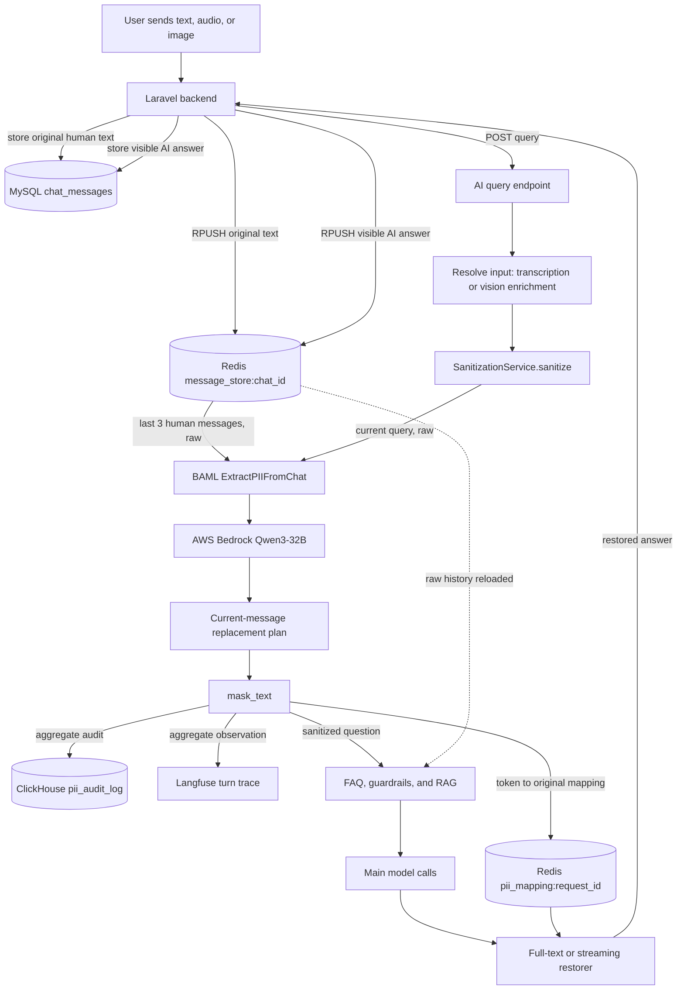
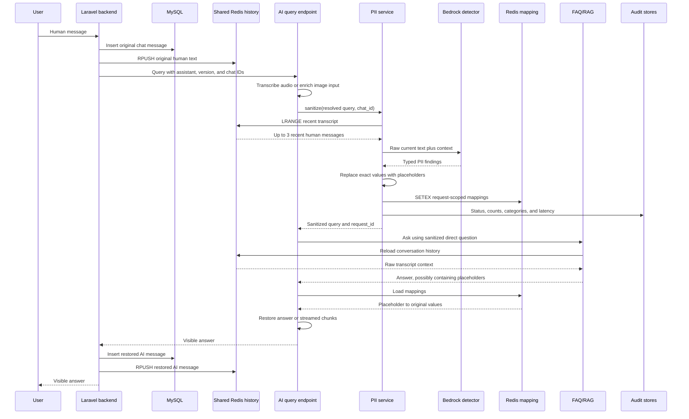
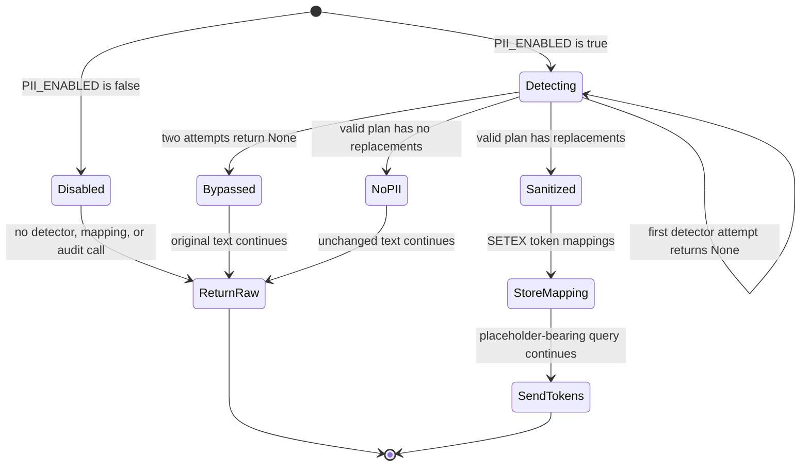
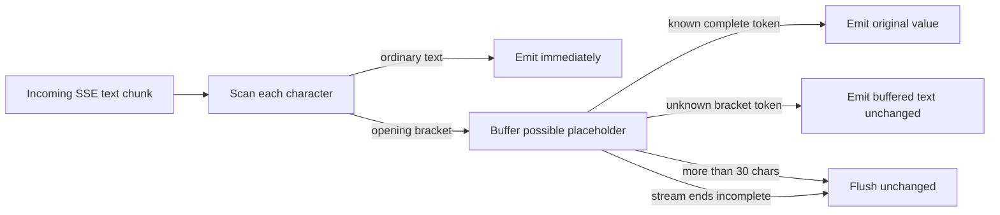
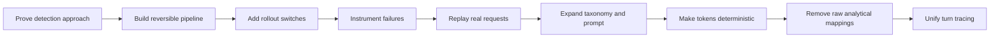
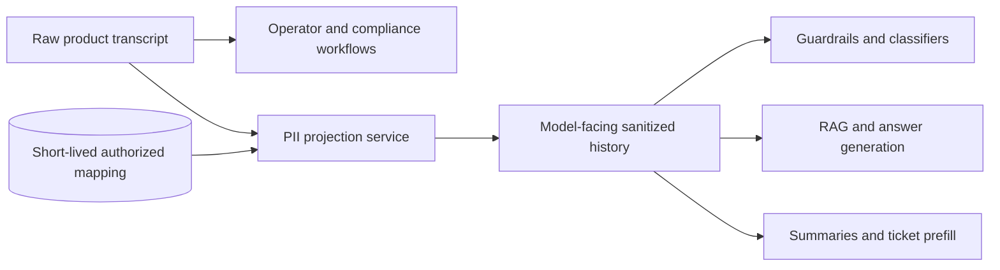

# PII Detection and Reversible Sanitization

**Status:** Code-grounded description of the current implementation, its development history, and its verified boundaries

**Repositories inspected:** `slotsense-ai-assistant-new` and `slotsense-backend`

**Primary implementation:** `slotsense-ai-assistant-new/src/core/sanitization/`

## The Short Answer

SlotSense inserts a contextual PII detector before the main FAQ/RAG call. The detector uses a BAML schema and Qwen3-32B on AWS Bedrock to classify explicit values in the current message. The application replaces detected values with typed placeholders such as `[EMAIL_0]` or `[CPF_0]`, stores the reversible mapping temporarily in Redis, sends the placeholder-bearing question into the FAQ pipeline, and restores placeholders in the answer before it reaches the backend.

This is **reversible pseudonymization at the AI query boundary**. It is not end-to-end redaction of the chat platform.

That distinction matters because the Laravel backend stores the original human message in MySQL and pushes it into the shared Redis transcript before calling the AI service. The assistant also reloads that raw transcript for conversation context. The current code therefore protects the direct `question` argument when detection succeeds, but it does not prove that every model-visible history message is sanitized.

The architecture decision visible in the code is:

> Use a context-aware detector for domain-specific PII, preserve answer quality through reversible typed placeholders, keep raw restoration mappings short-lived, and retain only aggregate audit evidence in analytical stores.

## Evidence Labels

| Label | Meaning |
|---|---|
| **Implemented** | Enforced by the current checked-in runtime code |
| **Historical evidence** | Recorded by an experiment, bug report, or commit, but not itself a current runtime guarantee |
| **Verified gap** | A limitation demonstrated by following the current call and storage paths |
| **Deployment-dependent** | Controlled by runtime environment or secrets not proven by the checked-in source defaults |

## What the System Protects

| Boundary | Current behavior | Evidence level |
|---|---|---|
| Current resolved user query before `FAQService` | Detected values are replaced by typed placeholders | Implemented |
| Main answer before it returns to the backend | Placeholders are restored from a request-scoped Redis mapping | Implemented |
| SSE token stream | Split placeholder tokens are buffered and restored before emission | Implemented |
| Raw mapping retention | Stored under `pii_mapping:{request_id}` with a configurable Redis TTL | Implemented |
| ClickHouse audit | Stores counts, categories, status, latency, and error; `mappings_json` is the literal string `"null"` | Implemented |
| Langfuse PII observation | Stores length and aggregate category/severity metadata, not original values | Implemented |
| Backend transcript | Original human and restored AI text remain in MySQL and shared Redis | Implemented, outside the protection boundary |
| All model-visible conversation history | Not guaranteed; raw shared history is loaded independently by FAQ/RAG paths | Verified gap |

## Actual Runtime Topology



The dotted edge is the critical boundary. It is present in the current code, not a hypothetical concern.

## One Turn, in Execution Order



## Why a Contextual LLM Detector Was Chosen

The checked-in experiment report compares several detector families. Its strongest evidence is not a generic claim that LLMs are better; it is that the actual support domain contains ambiguous numeric identifiers and Brazil-specific concepts that conventional NER models did not classify reliably.

The historical comparison covered 201 chats and 5,330 messages:

| Metric | GPT experiment baseline | GLiNER |
|---|---:|---:|
| Messages with PII detected | 1,365 | 713 |
| Total entities detected | 1,505 | 841 |
| CPF detections | 11 | 4 |
| PIX key detections | 12 | 3 |
| Bet ID detections | 12 | 3 |
| Name detections | 897 | 201 |
| Exact matches | 450 | 450 |

The report describes GLiNER as finding about 47% as many entities as the GPT baseline. The largest gaps were in CPF, PIX, bet IDs, and names. Those results motivated a schema-guided contextual detector rather than relying only on an off-the-shelf NER model.

The production-shaped implementation then moved the detector behind BAML to `CustomBedrockQwen`:

```text
provider: aws-bedrock
model: qwen.qwen3-32b-v1:0
region: eu-central-1
retry policy: Exponential
```

This gives two useful architectural properties:

1. The detector contract is a typed `ChatPIIReport`, not free-form text that application code must parse.
2. The model client can be selected by `PII_BAML_CLIENT` without changing the masking, persistence, or restoration code.

The repository proves the Bedrock provider, model ID, and region. It does not by itself prove organization-specific private networking or a complete regulatory data-perimeter claim.

## Detection Contract

### Input payload

`SanitizationService` reads the last 20 Redis transcript entries, keeps human messages, and sends at most the last 3 as context. `detector.py` creates a compact payload:

```json
{
  "chat": {"id": "sanitization_runtime"},
  "messages": [
    {"message_id": "context_0", "human": "previous message"},
    {"message_id": "current_message", "human": "current query"}
  ]
}
```

The BAML prompt may use nearby turns to classify an ambiguous value, but it is instructed not to invent a value that is absent from the text. The application then discards findings for `context_*` messages and builds replacements only from the result whose ID is `current_message`.

This is a deliberate compromise:

- context improves classification of bare values;
- old turns are not re-masked or added to the current request mapping;
- the detector still receives the raw context, so this is not a boundary that hides PII from the detector model.

### Current taxonomy

The BAML schema contains 22 categories:

| Group | Categories |
|---|---|
| Identity | `NAME`, `DATE_OF_BIRTH`, `CPF`, `SSN`, `UUID` |
| Contact and location | `EMAIL`, `PHONE`, `ADDRESS` |
| Accounts and payments | `ACCOUNT_NUMBER`, `CREDIT_CARD_NUMBER`, `BANK_NAME`, `MONETARY_AMOUNT` |
| Domain identifiers | `BET_ID`, `TRANSACTION_REFERENCE`, `ACCOUNT_CREATION_DATE` |
| Brazil payment data | `PIX_KEY`, `PIX_QR` |
| Online identity | `URL`, `INSTAGRAM_HANDLE`, `TELEGRAM_LINK` |
| Affiliation and fallback | `ORGANIZATION`, `OTHER` |

The prompt contains explicit disambiguation rules for:

- `BET_ID` versus `CREDIT_CARD_NUMBER`;
- `TRANSACTION_REFERENCE` versus `ACCOUNT_NUMBER`;
- generic dates versus date of birth or account-creation dates;
- generic domains versus personal or session-specific URLs;
- a mention of a PII type versus an explicit value;
- a PIX mention versus an actual PIX key or QR payload.

Severity is `LOW` or `HIGH`. The current schema describes CPF, SSN, account numbers, and card numbers as high-sensitivity examples. Severity currently changes telemetry only. It does not trigger blocking, escalation, or a different retention period.

There is also a small schema inconsistency worth noticing: the `HIGH` description mentions passport numbers, but no `PASSPORT` enum member exists. Such values can only fall into `OTHER` unless the taxonomy is extended.

## Placeholder Design

The detector returns category, original value, and severity. The application owns placeholder generation and assigns a counter per category:

```text
[NAME_0]
[EMAIL_0]
[EMAIL_1]
[CPF_0]
```

Moving counter generation into the application was a deliberate reliability decision. Commit `6343868` removed index generation from the model contract and made tokens deterministic per category. The model decides *what the value is*; ordinary code decides *how to name the reversible token*.

For a synthetic input:

```text
Input:     My email is user@example.com and my CPF is 000.000.000-00
Sanitized: My email is [EMAIL_0] and my CPF is [CPF_0]
```

`mask_text` does not run its own regex or validation. It replaces exact substrings emitted by the detector. Replacements are sorted from the last occurrence toward the first and each call replaces one matching occurrence. The stored `MappingEntry` contains:

```text
token, original, category, severity
```

This is pseudonymization, not anonymization. The mapping intentionally makes the transformation reversible during the request lifecycle.

## Sanitization Outcome State Machine



The four `SanitizationStatus` values are:

| Status | Meaning | Direct question sent to FAQ |
|---|---|---|
| `disabled` | Feature flag is off | Original text |
| `bypassed` | Detector produced no valid plan after retries or an outer failure path chose fail-open | Original text |
| `no_pii_found` | Detector succeeded with an empty replacement list | Original text |
| `sanitized` | At least one exact value was replaced | Placeholder-bearing text |

Only `sanitized` makes `SanitizationResult.has_pii` true and therefore enables restoration in the query endpoint.

## Non-Streaming Restoration

The non-streaming endpoint executes this order:

1. Resolve text, audio transcription, and any vision-enriched query text.
2. Await `pii.sanitize(...)`.
3. Call `faq.aget_answer(question=sanitized_query, ...)`.
4. If mappings exist, load them by `request_id` and replace every matching placeholder in `faq_response.answer`.
5. Run text-to-speech on the restored answer when audio output is requested.

Restoration happens before TTS, so the audible response receives the same visible values as the text response.

## Streaming Restoration

The streaming path cannot apply a simple final string replacement because a model may emit one placeholder across several chunks:

```text
"[" + "EMAIL" + "_0" + "]"
```

`StreamingRestorer` therefore buffers character-by-character after `[`:



The endpoint also restores `faq_response.answer` after streaming finishes. That is not redundant: streamed token events and the final response object are separate representations. The final object is later used for metadata, fallback token emission, and TTS.

If the Redis mapping cannot be loaded, there is no restorer and placeholder text can reach the client unchanged. Raw PII is not reconstructed without the mapping.

## Storage and Audit Design

### Redis: short-lived reversible mapping

| Property | Current implementation |
|---|---|
| Key | `pii_mapping:{request_id}` |
| Value | JSON list of token, original, category, and severity |
| Write | `SETEX` |
| Source-code default TTL | 7,200 seconds, or 2 hours |
| Purpose | Restore model output during request and streaming lifecycles |

The two-hour default was introduced with commit `035ac1c`, replacing the earlier five-minute value. The likely intent is visible in the combination of changes: allow enough time for long request lifecycles while keeping raw mappings out of durable analytics.

### ClickHouse: aggregate audit, no raw mapping

`pii_audit_log` uses `MergeTree`, orders by `(timestamp, assistant_id, request_id)`, and applies a 365-day TTL. It stores:

```text
event_id
request_id
chat_session_id
assistant_id
version_id
timestamp
status
pii_count
high_severity_count
categories_found
detection_latency_ms
error
mappings_json
```

The schema retains `mappings_json` for compatibility, but the current writer always inserts the string `"null"`. Commit `035ac1c` specifically removed the token-to-original payload from ClickHouse. This is a concrete data-minimization decision: analytics can answer how often and where PII was found without becoming a long-lived copy of the PII itself.

The `PIIAuditEvent` model and some docstrings still describe permanent mappings. They are stale. The active `_save_to_clickhouse` writer is the authoritative evidence.

### Langfuse: aggregate observability

The PII observation records:

- original text length, not original text;
- request ID;
- status;
- count and high-severity count;
- category and severity pairs;
- detector latency;
- assistant, version, chat, and error metadata.

When a turn trace exists, `pii_sanitization` is nested beneath it. Otherwise, the code creates a standalone trace grouped by chat session. The `pii_bypassed`, `pii_high_severity`, and `pii_error` tags are only attached in that standalone fallback branch; the nested span receives the aggregate fields but not those trace tags.

### Backend transcript: deliberately outside this mapping store

The backend's `HandleChatMessageTask` first creates a durable `chat_messages` row and then calls `AddRedisChatHistoryTask`, which writes the visible message text to `message_store:{chat_id}`. `StartChatAction` does this before `SendMessageToAITask` calls the assistant.

After the AI endpoint restores an answer, `ProcessAIResponseTask` stores that visible answer through the same path. Therefore:

- Redis mapping expiry does not erase PII from the product transcript;
- ClickHouse mapping removal does not mean the platform stores no PII;
- support operators can still see the intended conversation;
- platform-level PII deletion and retention must be handled by backend data governance, not by this sanitizer alone.

## Failure Semantics: Intended Versus Actual

The source contains `PII_FAIL_OPEN`, but several lower-level helpers catch their own exceptions. The practical behavior is more nuanced than the flag name suggests.

| Failure | Actual current behavior | Effect on user/model path |
|---|---|---|
| PII disabled | Service returns `disabled` immediately | Raw query continues; no mapping or audit call |
| Bedrock/BAML call fails | `detect_pii` catches the exception and returns `None`; service retries twice | After two failed attempts, status is `bypassed` and raw query continues |
| Detector raises past its helper | Service re-raises only when fail-open is false | Strict behavior is possible only for exceptions not already swallowed |
| Transcript context Redis read fails | `_get_recent_human_messages` catches it and returns `None` | Detection continues without context; it does not enter the outer bypass branch |
| Mapping Redis write fails | Store logs and returns successfully | Sanitized query continues, but later restoration may have no mapping |
| Mapping Redis read fails | Store logs and returns an empty list | Answer remains placeholder-bearing; strict mode does not see the exception |
| Mapping TTL expires | Empty mapping list | Answer remains placeholder-bearing |
| ClickHouse write fails | Warning is logged and request continues | Audit row is lost; answer path continues |
| Langfuse write fails | Failure is caught and request continues | Trace is lost; answer path continues |

This means `PII_FAIL_OPEN=false` is not a complete fail-closed guarantee today. Detector, context-store, and mapping-store errors are often converted into `None` or empty results before `SanitizationService` can apply the flag.

The code also describes audit work as non-blocking on failure, but it is still awaited in the request path. Failures do not fail the request, yet ClickHouse setup and insertion can still contribute latency until their own client timeouts complete.

## Configuration and Rollout Thinking

| Setting | Current source default | Role |
|---|---:|---|
| `PII_ENABLED` | `False` | Master runtime switch |
| `PII_FAIL_OPEN` | `True` | Prefer request availability when outer failures propagate |
| `PII_BAML_CLIENT` | `CustomBedrockQwen` | Select BAML detector client |
| `PII_MAPPING_TTL_SECONDS` | `7200` | Lifetime of reversible mappings |
| `PII_DEBUG_LOGGING` | `False` | Log raw and sanitized text plus mappings for debugging |

The source defaults were deliberately changed over time. The feature first gained explicit enable/fail-open toggles for staged rollout, was enabled on some stage history, and was later set to disabled by default for local iteration. Runtime environment variables can override all five settings.

The checked-in current source therefore proves capability and default behavior, not whether every live deployment currently has PII enabled. A production claim requires inspecting the deployed environment or secret values.

## Input-Type Boundaries

PII scanning occurs after input resolution:

- audio is transcribed first, then the transcription is scanned;
- image attachments are processed by the vision service first, then the enriched `user_query` is scanned;
- text is scanned directly.

Consequences:

1. PII present in an audio transcription can be masked before the FAQ pipeline.
2. PII represented in the vision-generated description can be masked if the detector finds it.
3. The vision and speech providers necessarily process the source input before this sanitizer runs.
4. Attachment URLs and binary payloads are not independently scanned by the PII service.

The sanitizer is therefore a boundary before FAQ/RAG, not before every upstream AI or media processor.

## Verified History Gap

This is the most important current limitation.

1. The backend persists the raw human turn before calling the AI service.
2. `SanitizationService` masks the query passed directly into `FAQService`.
3. `FAQService._prepare_conversation_node` independently reloads Redis history.
4. `MemoryManager.sanitize_history` only coerces message content to strings. Despite its name, it does not remove PII.
5. `prepare_conversation` removes a trailing current human message only when it exactly equals the `question` argument.
6. The Redis copy is raw while the direct `question` may contain placeholders, so that equality check can fail.
7. Raw current or previous turns can consequently remain inside the conversation string and `history_msgs` sent into downstream model calls.

The RAG agent has a similar exact-match `drop_echoed_question` check. It compares raw history with the sanitized question, so it has the same mismatch risk.

The defensible interview statement is:

> I built a reversible sanitizer around the direct AI query path, then a cross-repository review exposed that the shared transcript was a second model-input path. The next architectural step is a model-facing sanitized history projection while preserving the raw operator transcript as the product record.

That is stronger and more honest than claiming that no PII reaches an LLM.

## Evaluation and Bug History

### Initial model-selection evidence

The 201-chat comparison established that local/general NER was missing domain-important categories. This drove the move toward a contextual typed detector.

### Live replay evidence

A later historical evaluation replayed 1,893 requests and initially flagged 35 false negatives. Individual reruns found:

| Result | Count |
|---|---:|
| Evaluation correlation false alarms | 4 |
| Confirmed detector gaps | 31 |

The confirmed gaps were concentrated in:

- email addresses;
- formatted and bare CPF values;
- phone numbers;
- PIX keys and QR payloads;
- short account or protocol IDs;
- long 13 to 16 digit identifiers.

This is useful evidence of engineering thinking in two ways:

1. It found detector failures on real traffic shapes rather than relying only on prompt examples.
2. It also found an evaluation-harness bug: weak request-ID correlation made four successful detections look like false negatives.

The historical documents disagree on final status. `pii_filtering_feature_report.md` says all 31 gaps were fixed before release, while `bug_pii_false_negatives.md` still marks them open. The current BAML prompt clearly contains later rules for email, CPF, PIX, phone-like values, account numbers, transaction references, and long domain IDs. However, no checked-in post-fix aggregate run was found that proves all 31 cases closed.

The correct conclusion is:

> The incident drove concrete taxonomy and prompt changes, but repository evidence does not justify claiming a measured zero-false-negative result afterward.

## Decision Timeline From Commits

| Commit | Decision or issue addressed |
|---|---|
| `3b7ac22` | Added the end-to-end detector, masker, mapping store, full and streaming restorers, endpoint wiring, and tests |
| `92c8d35` | Added enable and fail-open flags so rollout could be reversed without reverting code |
| `406a75f` | Added stage-by-stage debug logging to diagnose detector, masking, and restoration behavior |
| `a26e61e` | Added email targeting in the BAML prompt while also fixing ClickHouse TLS/health behavior |
| `6343868` | Moved placeholder index generation from the model to deterministic application code with per-category counters |
| `4ac64e4` | Classified account numbers as high severity |
| `035ac1c` | Stopped writing raw mappings to ClickHouse and increased Redis mapping TTL from 5 minutes to 2 hours |
| `9b352e7` | Nested PII observations under the single trace for a chat turn |
| `58e0c00` | Disabled PII and debug logging as source defaults for local iteration; runtime environment can still enable them |

The progression shows a recognizable productionization sequence:



## Test Coverage Present in the Repository

`tests/core/pii/test_sanitization.py` covers:

- one, multiple, absent, and non-matching replacements;
- one and multiple full-text restorations;
- `sanitized`, `no_pii_found`, `bypassed`, and `disabled` service outcomes;
- Redis mapping save and load;
- complete, split, unknown, multiple, incomplete, and empty streaming tokens;
- no context, supplied context, and a three-turn context limit;
- translating the BAML report into current-message replacements.

Important gaps in the checked-in tests include:

- no full query-endpoint integration test proving sanitize to FAQ to restore for both HTTP modes;
- no cross-repository test proving what the backend writes before the AI call;
- no test that prevents raw Redis history from entering model prompts;
- no test that `PII_FAIL_OPEN=false` fails closed on Redis mapping failures;
- no assertion that ClickHouse can never receive an original mapping value;
- no checked-in post-fix replay summary resolving the historical 31 cases.

## Security and Privacy Risks Visible in Code

### 1. Debug logging can reproduce raw PII

When `PII_DEBUG_LOGGING=true`, the service logs original text, sanitized text, restored output, and the full mappings including original values. This is useful for local diagnosis and dangerous in a shared production log system.

The source default is now false, but the control is deployment-dependent. Production should enforce false rather than relying only on convention.

### 2. FAQ history is logged at info level

`FAQService._prepare_conversation_node` logs the loaded history with:

```text
logger.info("HISTORY (PREPARE CONVERSATION): %s", history)
```

That history comes from the raw shared transcript. This can place PII in application logs independently of the PII debug flag.

### 3. Mapping-store errors are swallowed

If a query is masked but its mapping is not saved, the main model gets placeholders and the user may also receive placeholders because restoration has no key. This preserves privacy better than reconstructing a guessed value, but it degrades the answer and makes strict mode ineffective.

### 4. Generative detection remains probabilistic

The detector has explicit rules and typed output, but values are masked only when Qwen emits them and the exact substring exists. There is no deterministic fallback for high-confidence formats such as email, CPF, phone, card, UUID, or PIX QR.

### 5. High severity is observational only

`high_severity_count` is audited, but high severity does not alter routing, block requests, change Redis TTL, or trigger an alert in the sanitization code.

### 6. Detection delays time to first streamed token

The endpoint awaits `pii.sanitize` before constructing `StreamingResponse`. Historical notes estimate a Bedrock call at roughly 1 to 3 seconds, but the current control flow means that time is paid before SSE token generation begins. Streaming makes restoration possible; it does not hide detector latency from time to first token.

## Hardening Priorities Deduced From the Architecture

These are recommendations, not claims about current code.

| Priority | Change | Why |
|---|---|---|
| P0 | Create one model-facing sanitized history projection and use it in FAQ, RAG, summarization, similar-issue, and ticket-prefill paths | Close the raw shared-history path without corrupting the operator transcript |
| P0 | Remove the unconditional raw history info log and prohibit raw PII debug logging in production config | Prevent application logs becoming another PII store |
| P0 | Make detector and mapping-store failures typed and observable; let strict mode receive them | Make `PII_FAIL_OPEN=false` an enforceable contract |
| P0 | Require a successfully stored mapping before sending a sanitized query that may need restoration | Avoid placeholder leakage caused by failed mapping writes |
| P1 | Add deterministic recognizers for high-confidence formats, then use the LLM for contextual and ambiguous categories | Reduce known false negatives while preserving domain-aware classification |
| P1 | Add cross-path integration tests and a post-fix real-traffic replay with stable correlation IDs | Convert historical claims into measured regression protection |
| P1 | Move best-effort analytical writes off the latency-sensitive request path or enforce tight timeouts | Protect time to first token when ClickHouse is unhealthy |
| P2 | Define policy for high-severity detections, alerts, and backend transcript deletion | Connect telemetry to operational privacy governance |

The key design requirement for history hardening is dual representation:



The raw ledger and model projection should have different access and retention rules. Replacing the canonical transcript itself with placeholders would damage human-support continuity and make deletion semantics harder to reason about.

## Interview Framing

A concise way to explain the work:

> The problem was not just finding names and emails. Support chats contained CPF, PIX, bet IDs, transaction references, and ambiguous numeric strings whose meaning depended on nearby turns. I compared local NER approaches against a contextual model on real chat data, then put the detector behind a typed BAML contract. The application, not the model, creates deterministic typed placeholders. Redis holds the reversible mapping only long enough to restore the answer, while ClickHouse and Langfuse retain aggregate evidence without raw values. Feature flags and fail-open behavior made rollout reversible. Real-traffic replay then exposed both detector gaps and a correlation bug in the evaluation harness, which led to taxonomy and prompt changes. A later cross-repository review also exposed the next boundary: raw shared history can still enter model context, so I would separate the canonical operator transcript from a sanitized model-facing projection.

The judgment demonstrated is broader than PII prompt writing:

- use experiments to choose a detector for the actual domain;
- place deterministic responsibilities in application code;
- make a probabilistic subsystem observable and reversible;
- minimize sensitive data in analytical stores;
- distinguish request availability from privacy guarantees;
- trace data across repository boundaries before claiming end-to-end protection;
- document known limits as architecture work, not as hidden implementation detail.

## Code Anchors

### AI assistant

| Concern | File |
|---|---|
| Endpoint ordering for text, audio, images, streaming, and restoration | `src/api/v1/endpoints/query.py` |
| Cached service construction and Redis dependency | `src/api/dependencies.py` |
| Feature flags and source defaults | `src/infrastructure/settings.py` |
| BAML detector client | `baml_src/clients.baml` |
| PII categories, severity, prompt rules, and typed report | `baml_src/pii_filter.baml` |
| Context payload, current-message filtering, and token counters | `src/core/sanitization/detector.py` |
| Status and mapping contracts | `src/core/sanitization/models.py` |
| Orchestration, retries, context, audit, and restore | `src/core/sanitization/service.py` |
| Exact-substring masking | `src/core/sanitization/masker.py` |
| Full and streaming restoration | `src/core/sanitization/restorer.py` |
| Redis mappings and ClickHouse audit schema | `src/core/sanitization/mapping_store.py` |
| Langfuse aggregate observation | `src/core/sanitization/audit.py` |
| Raw history loading into FAQ conversation state | `src/core/faq_service.py` |
| RAG history loading and echoed-question comparison | `src/core/agents/rag.py` |
| What `sanitize_history` actually does | `src/core/memory/service.py` |
| Unit tests | `tests/core/pii/test_sanitization.py` |
| Model-selection and implementation report | `docs/pii_filtering_feature_report.md` |
| Historical false-negative investigation | `docs/bug_pii_false_negatives.md` |

### Backend

| Concern | File |
|---|---|
| Persist user turn before invoking AI | `app/Containers/ClientSection/ChatClient/Actions/StartChatAction.php` |
| Create durable message and append Redis projection | `app/Containers/ClientSection/ChatClient/Tasks/HandleChatMessageTask.php` |
| Raw shared-transcript payload | `app/Containers/ClientSection/ChatClient/Tasks/AddRedisChatHistoryTask.php` |
| Persist restored AI response | `app/Containers/ClientSection/ChatClient/Tasks/ProcessAIResponseTask.php` |

## Evidence Boundary

The current repositories do **not** support claims that:

- all PII is removed before every LLM or media model call;
- the backend transcript is anonymized;
- `PII_FAIL_OPEN=false` currently catches every dependency failure;
- high-severity PII automatically blocks or escalates a request;
- production currently has PII enabled merely because the feature exists;
- the 31 historical false negatives have a checked-in post-fix zero-failure report;
- ClickHouse stores no PII anywhere in the wider platform, only that `pii_audit_log` no longer stores raw mappings;
- Bedrock configuration alone proves a complete legal or network data-perimeter guarantee.

Those are exactly the boundaries an interviewer should hear: what was built, why it was built, what evidence changed the design, and what the next architecture decision needs to solve.
