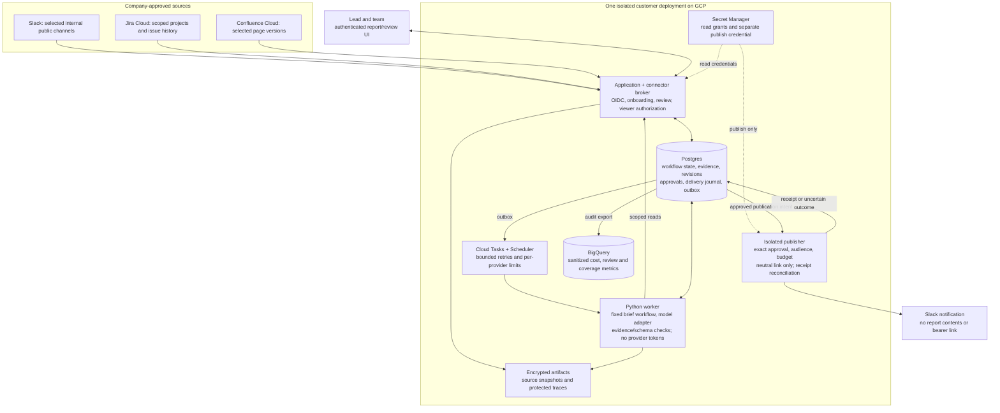

# Team Brief — production MVP implementation and rollout plan

> **Scope notice — 6 October 2026:** This plan describes the earlier reporting-only MVP. The [PRD v0.2](PRD.md) now specifies a shared async coordination platform. This plan and its 8–12 week estimate are not the implementation baseline for that scope; they require revision.

Proposed 6 October 2026. Product contract: [PRD](PRD.md). This plan creates a new application; it does not assume an agent platform already exists in the field-guide repository. No integrations have been installed and no production code has been deployed.

## 1. Delivery approach

Build one useful workflow end to end before generalizing agent infrastructure. First demonstrate that a lead can produce a more useful weekly report with less total work than today's process. Build shared reliability and permission controls around that workflow; avoid thirty agents, dynamic tool discovery or autonomous orchestration.

Reference estimate: 8–12 engineering weeks for one experienced engineer, with customer IT/security/product/reviewer support and existing managed infrastructure. OAuth approval, identity/access discovery and customer procurement can extend elapsed time. This is a planning estimate, not a delivery promise. Re-estimate after the connector/access spike.

Use a separate application repository when implementation is authorized. Keep this field guide for product/design evidence. Do not modify existing job-search automation or its permissions.

## 2. Proposed architecture

There is one application codebase and three deployment identities: application/broker, worker and publisher. The diagram does not imply a microservice for every box. Shared customer deployment does not mean shared cross-company credentials or databases.

### Deliberate choices

- Python/FastAPI application and workers; a small browser review UI. Cloud Run, Postgres, Cloud Tasks, Scheduler, Secret Manager, object storage, BigQuery and Terraform.
- A fixed typed workflow initially. LangGraph may express step/checkpoint transitions, but the product owns permission, approvals and publication state. Pin the runtime and demonstrate crash behavior before choosing it.
- No vector database initially. Bounded project/page/time-window retrieval and relational evidence metadata are enough for the first report. Add semantic retrieval only if relevance tests show the need.
- No generic MCP server is required for the product to work. Typed connector adapters are the stable seam. Optional read-only MCP exposure comes after authorization/contracts are established; tool discovery must never expand grants.
- A transactional outbox and durable operation IDs are mandatory before any external publish. Queue deduplication is supplemental.
- Production analytics does not read raw private prompts by default. Operational state is never recovered from BigQuery.

## 3. Dependency-ordered delivery slices

### Slice 0 — prove the workflow and access model (approximately 1–2 weeks)

Deliver: two design-partner team workflows, manual-report baselines, agreed brief examples, source-size measurements, sandbox Slack/Atlassian connections and tested reader permission behavior.

Demonstrate:

1. A real integration principal can read an allowed issue/page, but cannot read a denied one.
2. A different report reader cannot use the lead's broad grant to see inaccessible evidence.
3. Current Jira issue permissions and Confluence page/inherited permissions can be checked through the selected OAuth/API path.
4. Slack app classification, relevant history/replies rate limits and distribution/install requirements are known.
5. Customer approves provider/data/region/retention choices and source scope.

Exit: a documented connector/access decision and an achievable pilot size. If access preservation is unproven, stop real-data work; continue only with synthetic fixtures while resolving it. Do not bury this blocker in a late security sprint.

### Slice 1 — usable review workflow on synthetic evidence (approximately 1 week)

Deliver: OIDC organization boundary, workflow settings, reporting period, deterministic draft template, evidence links, editable immutable revisions, approval/rejection/withdrawal and report audience checks. Generate fixtures, not realistic-looking unsupported company facts.

Exit: a lead creates/reviews a brief in the UI. Edits invalidate old approval; an unrelated identity cannot view or approve it. User feedback settles the report format before model complexity grows.

### Slice 2 — read-only Jira and Confluence evidence (approximately 1–2 weeks)

Deliver: delegated OAuth lifecycle, encrypted grants, allowlisted site/project/page configuration, pagination, field/history/version normalization, incremental synchronization, tombstones and source health.

Fetch current source data through the broker under the configured grant. Implement recipient access verification early, including restricted issue/page, inherited restrictions, withdrawn consent and identity mapping failure. Initial reads can be scheduled polling; webhooks are a freshness optimization.

Exit: a real sandbox draft identifies observed issue transitions and document revisions with valid citations. A source failure shows missing coverage. No Jira/Confluence write token or route exists.

### Slice 3 — Slack context and practical rate-limit behavior (approximately 1 week)

Deliver: Slack OAuth installation, signed events with replay protection, selected public channel/thread ingestion, duplicate events, edits/deletions, bounded backfill and scheduled reconciliation. Target callback acknowledgement within Slack’s three-second deadline after a fast durable handoff; model processing is asynchronous. If persistence cannot complete, fail the callback and rely on provider retry plus deduplication rather than acknowledging lost work.

Exit: discussions enrich the draft without becoming asserted decisions. Private channels, DMs, shared channels and unapproved workspace IDs are rejected. Backfill is visibly partial when provider limits prevent completion.

### Slice 4 — bounded model generation and quality gate (approximately 1–2 weeks)

Deliver: structured report claims, source IDs, fact/inference/editorial labels, evidence selection, model timeout/cost bounds, output validation, prompt-injection tests and offline evaluation gate.

Do not let the model invent tool names, source scope or publication operations. Maintain model/prompt/code/evaluation version digests in each run. Unsafe or ungrounded outputs remain unavailable for ordinary approval until corrected.

Exit: evaluated drafts improve on the deterministic baseline. Human-label at least 200 material claims across representative scenarios for initial release assessment; publish the actual denominator and confidence/uncertainty. Deterministic safety failures block release regardless of average quality score.

### Slice 5 — durable, consented Slack publication (approximately 1 week)

Deliver: run/step leases, checkpoints, transactional outbox, immutable approval contract, isolated publisher, neutral Slack link, delivery journal, per-reviewer notification budget, connection/policy rechecks and withdrawal behavior.

Default proposed contact policy: at most one ready-for-review notification per reviewer/day and one scheduled published notification per workflow/week. Bundle pending items; no @channel/@here/mentions or automatic nudges. Delivery is a distinct authorized operation, not a tool available to the model.

Exit: crash injection at every boundary produces one logical publication or a visible uncertain state; no unapproved sends. A timed-out send is reconciled or held for operator resolution rather than blindly retried. Revoked approval prevents unsent publication, with in-flight limitations made explicit.

### Slice 6 — production readiness and limited live pilot (approximately 1–2 weeks plus four weekly cycles)

Deliver: infrastructure IaC, environment separation, CI/CD release/rollback, model kill switch, dashboards, restricted audit export, backup/PITR/restore drill, token rotation/revocation, deletion/export processing and operator runbooks.

Run shadow mode first: lead sees draft, nothing goes to recipients. Then explicit publication to a small approved audience. Expand to the second team only after reliability/privacy/quality acceptance.

Exit: four live weekly cycles per pilot team, manual baseline comparison and a decision to continue, revise or stop. The four-cycle observation window can overlap engineering hardening; do not equate it to four engineer-weeks.

## 4. Domain and persistence contracts

| Entity | Responsibility / critical invariant |
|---|---|
| Organization / Principal | Company boundary and verified identity; revoked principal cannot view/approve |
| IntegrationGrant | Provider site/workspace, delegating principal, scopes, source allowlists, health/revocation; encrypted credential reference |
| WorkflowVersion | Immutable report template, source scope, schedule, owner, audience and budget policy |
| SourceRecord / SourceVersion | Stable source ID, observed revision, provenance and tombstone; never overwrite historical evidence silently |
| EvidenceSnapshot | Protected content/reference and acquisition/access metadata; a snapshot is not proof of current permission |
| Run / StepAttempt | Idempotency key, pinned versions, lease/fencing generation, checkpoint, costs and coverage |
| ReportRevision / Claim | Immutable content hash, evidence dependencies, fact/inference/editorial distinction |
| Approval | Reviewer, exact revision/destination/audience policy hash, expiry and revocation |
| PublicationIntent / DeliveryAttempt | Logical delivery ID, claim/lease, external receipt, OUTCOME_UNKNOWN and reconciliation |
| ContactReservation | Recipient/workflow window, atomic reserved budget, bundled intent and delivery outcome |
| AuditEvent / OutboxEvent | Durable append-only decisions and dispatch/export intent; no privileged raw payload in general logs |
| Feedback / BaselineObservation | Corrections, review effort and comparable manual cost; avoid employee rankings |

Uniqueness: organization + workflow version + reporting interval/manual request ID identifies a logical run. Report revisions are append-only. Multiple delivery attempts share one logical publication identity. Transactional uniqueness/compare-and-set is preferred to process-local locks.

### Run lifecycle

QUEUED → COLLECTING → GENERATING → VALIDATING → NEEDS_REVIEW → APPROVED → PUBLISHING → PUBLISHED.

Explicit alternatives: BLOCKED_SOURCE, BLOCKED_POLICY, FAILED_RETRYABLE, FAILED_FINAL, REJECTED, EXPIRED, WITHDRAWN and DELIVERY_UNKNOWN. APPROVED binds a revision; it is not a generic boolean on a mutable report. Human waiting and downstream ambiguity are not retryable model steps.

### External API surface, proposed

- Connect/disconnect/list integration health.
- Configure/version/pause a workflow and preview source scope.
- Request a draft with an idempotency key; inspect run/coverage/status.
- Read draft/evidence under authorization; create revised draft.
- Approve a specific revision or revoke/withdraw it.
- Read published report under current source permissions; record feedback.
- Request export/deletion and retrieve measurement reports.

No public or internal endpoint accepts an arbitrary external URL, raw OAuth token, arbitrary SQL, Jira mutation or unrestricted tool invocation from the model. All commands derive company context from authenticated identity, not a caller-supplied tenant header alone.

## 5. Testing strategy and seams

Primary seam: workflow API from authorized event/request to reviewable report and controlled delivery. Assert user-visible behavior and persistent outcome, not LangGraph node wiring. Provider adapter contracts are the additional unavoidable seams; use fakes for deterministic failures and customer-owned sandboxes for actual permission/rate-limit behavior. No existing application tests claimed.

| Test family | Required cases |
|---|---|
| Product acceptance | Correct reporting interval/timezone, edit/review/publish, partial coverage, correction/withdrawal |
| Authorization | Cross-org IDs, lead vs reader, revoked users, denied Jira issue/page, inherited Confluence restrictions, changed audience, source outside allowlist |
| Injection | Source asks for secret, forbidden write, wider retrieval or audience change; unsafe instruction is ignored and action remains unreachable |
| Grounding | False progress, attribution error, contradictory sources, stale status, discussion mistaken for decision, missing citation, accusatory interpretation |
| Recovery | Duplicate webhook, outbox replay, stale lease, crash before/after external send, ambiguous receipt, exhausted retries |
| Connector contract | Pagination, 401/403/404/429/5xx, token refresh/revocation, cursor expiration, edits/deletions, large pages |
| Privacy | Raw artifacts missing from broad logs/warehouse; unauthenticated link preview generic; grant revoked after report generation |
| Contact | Concurrent agents/runs cannot overspend budget; no forbidden mention or automatic reminders |
| Operations | Backup restoration, rollback of release, model kill switch, connection offboarding, retention purge |
| Load/cost | Pilot workload and concurrent jobs, provider limits, bounded generation, non-starvation of manual requests |

Hard policy assertions cannot be graded by an LLM. A judge helps assess textual quality/entailment after calibration; it cannot override a permission failure. Add reviewed production incidents to the release suite.

## 6. Operational readiness

Dashboards: queue age, draft completion/failure by source, permission-denial rate, retry/quarantine count, stale-review age, delivery uncertainty, correction rate, token/model spend and synchronization lag. Alerts go to an assigned operator; they do not trigger broad team interruptions.

Runbooks: provider outage/rate limit, revoked integration, leaked artifact, failed model release, unknown Slack send, DB restore, customer deletion and rollback. Practice the two most consequential failures—permission change and ambiguous publication—in a sandbox.

Deployment: migrate compatibly, test in staging, pin a release manifest, canary one pilot workflow, monitor, then expand. Reverting runtime code does not undo an external notification. Secret rotation and schema migration procedures are part of the release plan.

## 7. Main risks and mitigation

| Risk | Mitigation / decision gate |
|---|---|
| Reporting is already easy with native dashboards | Validate cross-tool pain and manual baseline before a broad platform build |
| Reader permissions cannot be preserved | Resolve before real-data pilot; no service-account shortcut |
| OAuth installation/distribution is slow | Customer admin partner in slice 0; distinguish internal/custom app from commercial distribution |
| Slack backfill is severely rate-limited | Event-first ingestion, bounded pilot history and honest coverage; classify app early |
| Review takes longer than manual reporting | Use concise output/evidence UI; stop or change workflow if baseline shows no gain |
| Agent overclaims progress | Typed facts, source histories, uncertainty and human edit; no inferred commitments |
| Scope expands into enterprise search | Preserve one workflow and bounded source selection until pilots prove value |
| One engineer cannot support several customers reliably | Isolated template deployments, narrow supported environments, designated support coverage before expansion |

## 8. Expansion only after evidence

Next candidates: authenticated evidence-grounded Q&A; Confluence publication with separate grants and exact version checks; GitHub change evidence; another recurring team workflow. Each needs its own product proof, permissions and evaluations.

Later platform features: typed agent inventory/compiler, per-agent capability registration, reusable evaluation packages and read-only observer agents. Team process metrics may be considered with explicit governance; individual productivity scoring remains outside the product.
