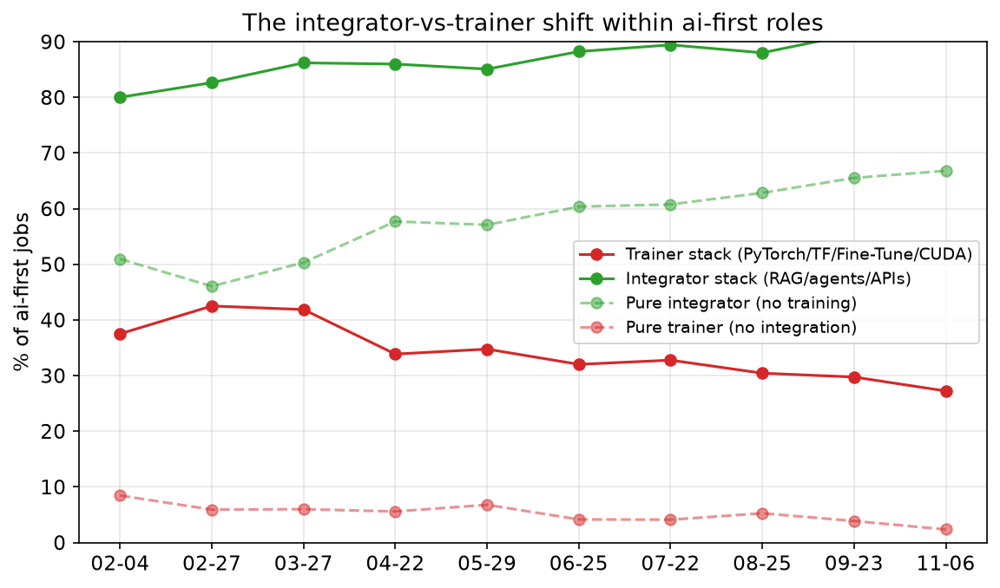
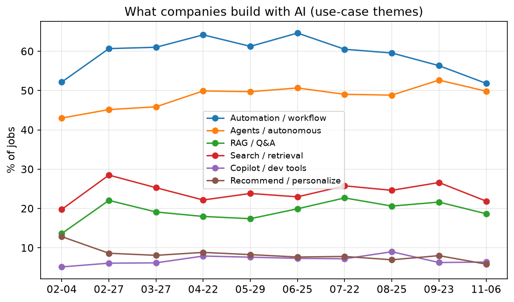
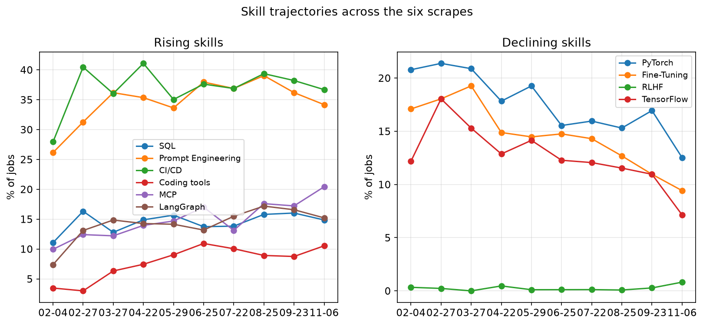
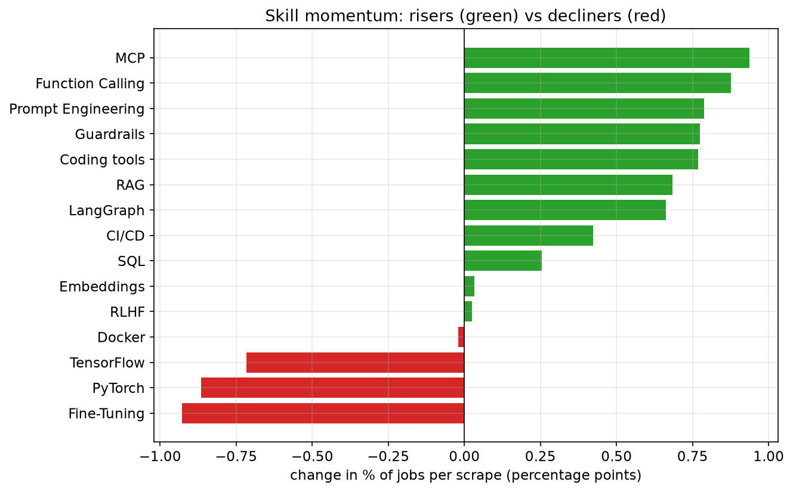

# AI Engineering Job Market Trends

What 9,760 AI engineering job postings tell us about where the role is going, based on 10 monthly scrapes of builtin.com (Feb 4, 2026 through Nov 6, 2026).

This is the readable summary. Full tables, cluster signatures, methodology, and reproduction steps are in [the appendix](08-trends-appendix.md). All charts are generated by [_internal/analysis/charts.py](../job-market/_internal/analysis/charts.py).

A note on the data: there is zero overlap in job IDs between any two scrapes, so each month is an independent cross-section of the market, not a panel of the same postings over time. I can track what the market asks for month to month, but not how long a given role stays open.

## Since February: what actually moved

Putting the first scrape (Feb 4) next to the latest (Nov 6) directly:

- ai-first share: 71.5% -> 62.6%, after holding in a tight 68-72% band for the first nine scrapes, while ai-support jumped from 22.2% to 32.9% in November.
- Within ai-first jobs, the integrator stack (RAG/agents/APIs) rose from 80.0% to 91.7% and the trainer stack (PyTorch/TensorFlow/Fine-Tuning/CUDA) fell from 37.5% to 27.2%. This shift is real and it's the strongest directional signal in the whole dataset.
- RAG-and-agents-together jobs went from 33.1% to 51.0% of ai-first postings - now a majority, up from a third.
- `MCP` (9.9% -> 20.4%) and `Function Calling` (9.6% -> 18.5%) are the fastest-moving named skills by slope, ahead of `Prompt Engineering` (26.1% -> 34.2%) and `Guardrails` (10.2% -> 17.5%).
- Inference/serving work within ai-first roles fell (19.8% -> 13.5%), and `Model Deployment` specifically fell from 18.3% to 8.3%. The dedicated AI-infra role remains far from emerging.
- Staff+ seniority declined as a share of postings (18.5% -> 11.4%), while junior/entry-level stayed pinned around 1% (1.5% -> 0.8%) throughout. The bottom rung of this market has been closed since February; the top has thinned too.
- Average skill breadth per posting stayed in an 18-23 skill range all year (18.4 -> 19.2) rather than climbing steadily - "the posting is getting fatter" isn't borne out.

## The integrator-vs-trainer shift holds up

Within ai-first jobs, the move from model-training toward integration and orchestration is the strongest directional signal in the dataset:

- The integrator stack rose from 80.0% to 91.7%
- The trainer stack fell from 37.5% to 27.2%
- Pure-integrator roles rose from 50.9% to 66.8% - now two-thirds of ai-first postings
- Pure-trainer roles shrank to a tiny minority, 8.4% down to 2.3%

The responsibility verbs point the same direction: `train`/`research`/`optimize` fell from 64.5% to 51.3% (after bottoming at 45.9% in August), while `build`/`develop` stayed near-universal (97.3% to 98.5%).

## Five role archetypes

Running the same spherical k-means clustering (k=6, deterministic, seed=7) on the current corpus, k-means initially split agent-building into two clusters that differed almost entirely on whether `Prompt Engineering` was tagged as a skill (95% vs 0% - `Agents` and `MCP` shares were high in both). That's a skill-tagging artifact, not a distinct role, so I merged them:

1. Agent builder - 29.9%. `Agents` + `Prompt Engineering` + `MCP` + provider APIs (~87% ai-first). Still the largest archetype.
2. RAG app builder - 26.6%. `RAG` + vector databases + `LangChain` + `LangGraph` (96% ai-first).
3. DevOps / full-stack engineer - 16.9%. `CI/CD` + `Kubernetes` + `Docker` + `React`/frontend. Only 34% ai-first - the least AI-native cluster.
4. Cloud / ML platform engineer - 14.1%. Multi-cloud (`GCP`/`AWS`/`Azure`), `Terraform`, `PyTorch`/`TensorFlow` (48% ai-first).
5. ML trainer / researcher - 6.3%. `PyTorch`/`TensorFlow` + inference/serving + `MLOps`. Still the smallest archetype.

Agent-building remains the largest archetype, ahead of RAG app building, pointing at agent-style work becoming the default shape of the role rather than a specialization within it.

Note: [images/role-archetypes.png](../job-market/images/role-archetypes.png) still shows the unmerged six-cluster chart - regenerating it needs a change to `_internal/analysis/charts.py`'s cluster-naming logic, not just this doc.

## What companies build

- Automation / workflow remains the largest use case: 52.2% in Feb to 51.8% in Nov (peaking at 64.6% in June)
- Agents / autonomous systems: 43.0% to 49.9%
- Search / retrieval: 19.8% to 21.9%
- `RAG` / Q&A: 13.6% to 18.7%
- Classic recommendation / personalization keeps fading: 12.8% to 5.9%

## Skill trajectories: MCP, function calling, and prompt engineering lead

By slope of monthly share, the risers:

- `MCP`: 9.9% to 20.4% (+0.94 pp per scrape) - now the fastest-rising named skill
- `Function Calling`: 9.6% to 18.5% (+0.88)
- `Prompt Engineering`: 26.1% to 34.2% (+0.79)
- `Guardrails`: 10.2% to 17.5% (+0.77)
- AI coding tools (`Claude Code`/`Copilot`/`Cursor`): 3.5% to 10.5% (+0.77)
- `LLM Evaluation`: 20.3% to 26.6% (+0.76)
- `RAG`: 32.8% to 38.2% (+0.68)
- `LangGraph`: 7.4% to 15.2% (+0.66)

The decliners are still the training stack: `Fine-Tuning` (17.1% to 9.4%, -0.93 pp/scrape), `PyTorch` (20.8% to 12.5%, -0.86 pp/scrape), `TensorFlow` (12.2% to 7.1%, -0.72 pp/scrape).

`SQL` moved from 11.1% to 14.9% over the same period - a real but modest gain, nowhere near the top of the list.

## Two distinct stacks

Skill co-occurrence (lift over baseline) still shows two cleanly separated stacks:

The application stack, around `RAG`:

- `RAG` jobs pull in embeddings 36% of the time (x2.2 lift), vector databases 49% (x2.0), `Function Calling` (x1.9), `LangGraph` (x1.9)
- `LangChain` jobs pull in `LangGraph` 50% of the time - still the strongest pair in the dataset (x3.5 lift)

The training/infra stack, around `PyTorch`:

- `PyTorch` jobs pull in `MLOps` (x2.3), vector databases (x1.5), `AWS` (x1.4), `Kubernetes` (x1.3)

`MCP` and `Fine-Tuning` both now sit closer to the application stack than the training one - a shift from earlier in the year, when fine-tuning pulled more heavily toward MLOps and infra.

Among jobs using any agent framework, `LangChain` dipped from 86.3% to 76.8% share while `LangGraph` climbed from 37.7% to 71.0% - nearly matching `LangChain` among framework adopters - and `Semantic Kernel` rose from 6.9% to 22.1%. `CrewAI` (16.6% to 26.2%) and `AutoGen` (10.9% to 25.1%) also grew substantially. Everyone is layering orchestration frameworks on top of (or alongside) `LangChain`.

## Title predicts the stack

- `ai engineer` (n=3,006): 88% ai-first, 56% `RAG`, 70% agents - the canonical RAG-and-agents builder
- `applied` (n=549, excludes FDE titles): 91% ai-first, only 29% customer-facing - despite the name, mostly not customer-facing
- Forward Deployed / FDE (n=287): 95% ai-first, 85% customer-facing - the only title group where customer-facing is common, and by a wide margin. I originally grouped this with `applied`, which blended a 29% and an 85% customer-facing rate into a meaningless 48% - they're different roles and should be read separately.
- `ml engineer` / `scientist` (n=750): 48% `PyTorch`/`TensorFlow` - the title still most rooted in traditional ML, though now also 46% `RAG`
- `platform` / `infra` / `devops` (n=1,010): only 48% ai-first, 43% `Kubernetes`
- `data engineer` (n=237): 46% ai-first, 88% Python - data work with AI increasingly layered on top

## Startups lead on fine-tuning now, growth-stage on coding tools

- Early-stage (Seed-Series A) companies over-index on ai-first (x1.16) and `Fine-Tuning` (x1.28) - and sharply under-index on `PyTorch`/`TensorFlow`, `AWS`, and `Docker`/`Kubernetes` (all around x0.55-0.58)
- Growth-stage (Series B-F) companies over-index hardest on coding tools (x1.29) and `AWS` (x1.14), while under-indexing on `RAG` (x0.74), `Fine-Tuning` (x0.54), and `PyTorch`/`TensorFlow` (x0.44)
- Public/late-stage companies over-index on `RAG` (x1.22), `Fine-Tuning` (x1.22), and `Docker`/`Kubernetes` (x1.13)

## The "AI infra engineer" still hasn't emerged

Within ai-first jobs, the inference/serving stack (`vLLM`, `Triton`, `TensorRT`, `CUDA`, `Model Deployment`) fell from 19.8% to 13.5%. `Model Deployment` specifically dropped from 18.3% to 8.3%. Meanwhile general `Kubernetes` mentions rose (18.6% to 23.8%). Inference work continues to live inside the platform/infra archetype rather than forming its own mass role.

## Eval tooling is migrating from ML to LLM-native

- Classic MLOps (`MLflow`, `Kubeflow`) declining: 19.9% to 14.5%
- LLM-native eval (`LangSmith`, `Langfuse`, `Guardrails`, `LLM Evaluation`) rising: 26.7% to 34.5%
- `Guardrails` specifically: 10.2% to 17.5%

Most postings still name no dedicated eval tool at all - "LLM Evaluation" as a bare requirement (20.3% to 26.6%) is far more common than any named product. `MCP` continues joining the standard agent stack (9.9% to 20.4%, pulling `Function Calling` and `LangGraph` at 2.4x lift), and AI coding tools as a listed skill went from 7.6% to 13.6% of postings overall (peaking at 16.2% in June).

## Forward Deployed Engineer (FDE) in AI

The FDE remains a small, distinct, customer-facing archetype: 287 postings (2.9% of the market), rising from 2.0% in February to a peak of 4.4% in July and 3.9% in November.

- 95% ai-first, 85% customer-facing - against 15% for other ai-first roles, nearly a 6x difference
- 78% agents, 54% `RAG` - agent-heavy generalists
- Only 10% `PyTorch`/`TensorFlow` (vs 19% for other ai-first roles) - less research, more delivery

Their use cases cluster around enterprise delivery: automation, workflows, agents, and production systems. The FDE is the customer-facing, ship-fast generalist who deploys AI into enterprises.

## The job description didn't actually get fatter

Skill breadth bounced in an 18-23 skill range all 10 scrapes without a clear upward trend (18.4 in Feb to 19.2 in Nov). GenAI-specific skill count ticked up modestly from 4.6 to 5.1 per posting (peaking at 5.9 in June-July), so the broader "the role keeps demanding more" story doesn't hold.

## Seniority: the bottom stays closed, and the top is thinner

- Staff and above declined: 18.5% to 11.4% - the clearest seniority move in the data
- Senior eased slightly from 30.8% to 25.7%
- Mid (unspecified) grew from 43.9% to 55.8%
- Lead roles stayed in a 4.5-8.1% range (4.6% to 5.6%)
- Junior / entry-level stayed pinned near 1% the entire 10 scrapes (1.5% to 0.8%)

Companies hire mid and senior AI engineers overwhelmingly; they almost never hire juniors, and that has not changed since February. What has changed is the top of the ladder - Staff+ postings have thinned as a share of the market.

For the full monthly tables, cluster signatures, stage-by-stage numbers, methodology, and how to reproduce everything, see [the appendix](08-trends-appendix.md).
